# AU_Las_Vegas: Investigating the "Floating Floor Tile" Artifact

Date: 2026-09-24
Server: `gs-training-server` (GCP, project `dgs-training`)
Dataset: `AU_Las_Vegas` (LiDAR + photos, `hybrid_known_poses` training mode)
Audience: internal, for continuing GS model quality work

## 0. CORRECTION (2026-10-09) - read this first

**The central premise of this report is wrong.** Everything below chases a "floating floor tile"
artifact near the fountain. A direct check against the real photographs shows those white diamonds
with black borders, arranged in a ring around the fountain, are **real floor inlay**, and the trained
model reproduces them tile for tile. They were never floating. I identified the artifact from
preview renders alone and never compared against a real photo from the same camera until now; every
experiment in §3-§14 was judged against that mistaken target.

<table>
<tr><th>Real photo (nearest training camera, frame 1300 view)</th><th>Model render, same camera</th></tr>
<tr>
<td></td>
<td></td>
</tr>
<tr><th>Real photo (frame 1700 view)</th><th>Model render, same camera</th></tr>
<tr>
<td>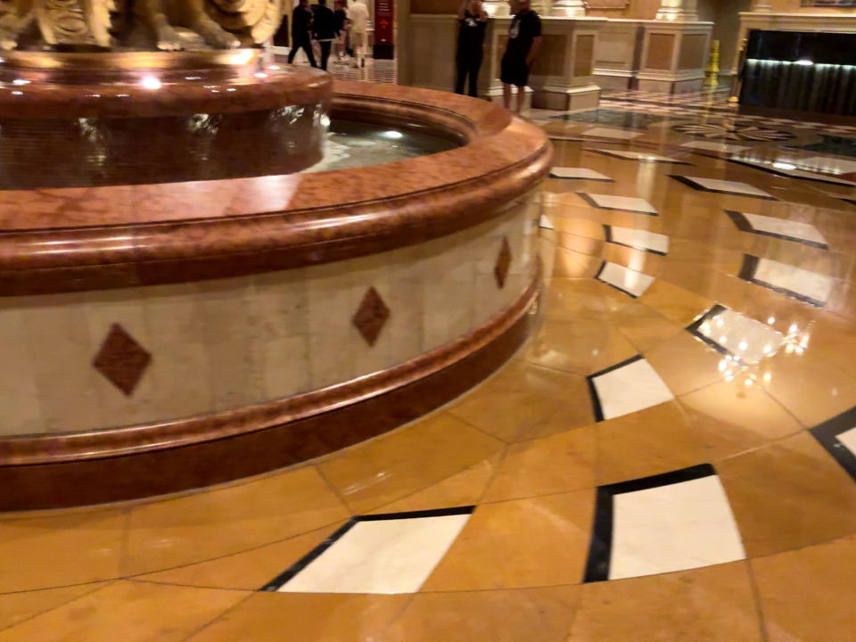</td>
<td>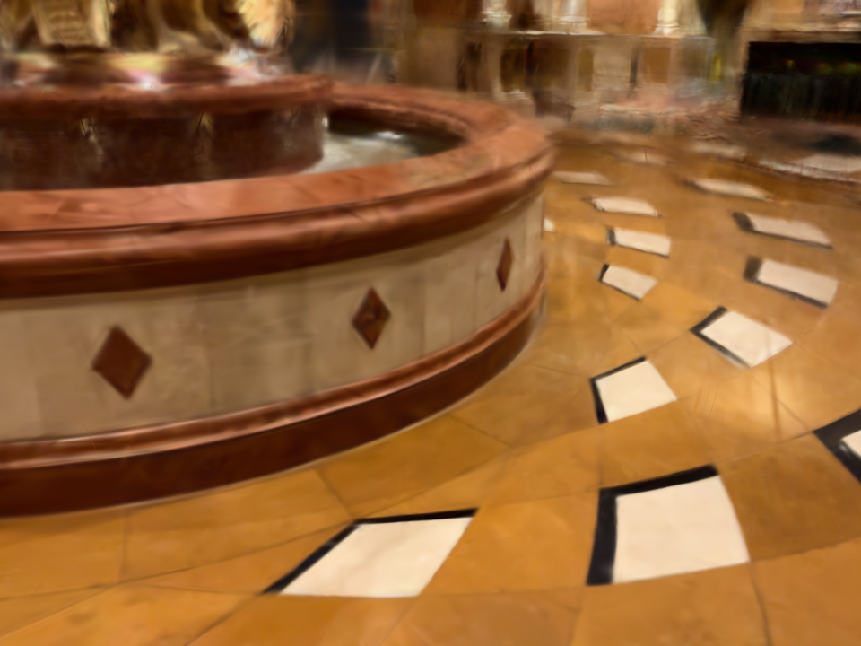</td>
</tr>
</table>

**What the checks showed:**
- The photo-consistency metric (§11) does not track those tiles: recoloring splats by their
  `photo_resid_avg` tier puts the top 2.5% on large blurry foreground and mid-air haze splats, while
  the tile fan keeps its natural colors and survives removal untouched.
- **The shipped filter makes the model worse.** PSNR of renders vs. the real photos at 59 training
  cameras: 18.15 dB unfiltered, 17.53 dB at percentile 97.5, 17.24 dB at 95 (training views, so
  absolute values are optimistic; only the delta matters). The "67.6% of known floaters removed" result
  in §11 measured removal of splats picked by a crude screen-box + height heuristic, which is not a
  validated label of any visible defect. The filter is now **off by default**
  (`photo_consistency_filter_enabled=False`).
- Absolute fidelity is low (~18 dB on training views), which fits the original complaint (raw point
  cloud looks better than the GS model) better than any single artifact does.

**What is actually visibly wrong in the renders:** a semi-transparent haze/veil in mid-air between the
camera and the background, and smeared "ghosts" where people walked through the capture. Moving people
are the likely cause of both; masking (`MASKING_ENABLED`) is off by default. That is the untested lead.

Sections 1-14 are kept as a record of what was tried, not as findings about a real artifact. The
engineering fixes (normalization bugs in `train.rs`, the `known_pose_triangulation.py` staging bug, the
vocab-tree/cancel gotchas) remain valid. Conclusions about "the artifact" do not.

## 1. Starting Point

While reviewing the latest `AU_Las_Vegas` model, I noticed the raw colored LiDAR point cloud looks
noticeably better than the trained GS model. Frame-by-frame comparison of the preview flythrough
pinpointed the main visual defect: near the fountain and on the checkered floor, fragments of floor
texture appear visually "detached" from the actual surface — flat shard-like "cards" floating above
the floor at various heights. I'll refer to this as the "floating tile artifact" below (in the code
and older comments this same phenomenon is called the "needle" / "silhouette-edge needle" artifact).

This is not a new artifact — it's referenced in the project history (`gs_server/config.py`) as an
open, previously unsolved problem. Below is what I tried this session, what worked, what didn't, and
why.

## 2. What Had Already Been Tried Before (context, not this session)

Before spending time repeating earlier work, I checked `config.py`'s history — it documents three
earlier, independent attempts, each unsuccessful:

1. **Shape-based post-processing** (`floater_filter.filter_needle_floaters`) — an anisotropy-ratio
   filter, originally built to catch extremely elongated "needles". On a different model it turned
   out the actual visible artifact ("glare") was large, only mildly-anisotropic blobs, not extreme
   needles — the filter never saw that population at all.
2. **Spatial-isolation post-processing** (`floater_filter.filter_isolated_clusters`) — finds splat
   clusters disconnected from the main geometry via a k-NN connectivity graph. Catches scattered
   debris around the scan periphery, but not these "tiles" — apparently they aren't far enough in 3D
   from the main floor for the connectivity graph to flag them.
3. **Distance-to-source-point-cloud post-processing** — checked whether "needle" splats sit far from
   the nearest LiDAR scan point. Also had no visible effect.

The conclusion at the time: the artifact is likely a **photometric** side effect of training (the
optimizer creates a thin/flat splat to explain a blended edge pixel color), not a geometric outlier
that can be cleaned up after the fact.

## 3. Method 1 (earlier this session): Depth Supervision with LiDAR Depth

Not aimed at this artifact directly, but included here for completeness as part of the same overall
quality work.

I implemented a full depth-supervision pipeline: a 5th render channel (view-space depth) in Brush's
WGSL/Rust renderer (`brush-render`, `brush-render-bwd`), with a loss between rendered depth and the
dataset's LiDAR depth.

**Bug and fix:** the first run, with no range cutoff, visibly corrupted far surfaces (the domed
ceiling/fresco went nearly black) — LiDAR returns plausible-looking but wrong values at that range.
Adding `depth_max_range=5.0` (matching Apple's LiDAR scanner spec) fully resolved the regression
(confirmed via frame-by-frame comparison).

**Effect on the main artifact:** none. The floating tiles look identical in baseline and
depth-supervision versions. Expected: LiDAR depth doesn't cover every pixel, and evidently doesn't
constrain these specific splats where the artifact shows up.

<table>
<tr><th>Baseline — dome/fresco (frame 900)</th><th>Depth-supervision, capped (frame 900)</th></tr>
<tr>
<td>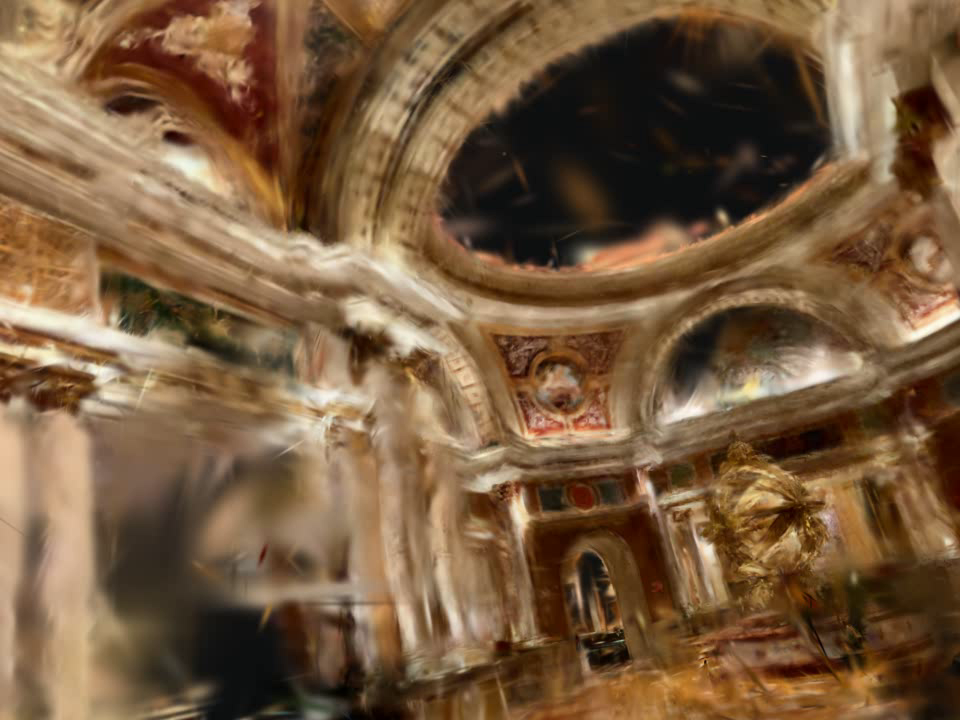</td>
<td>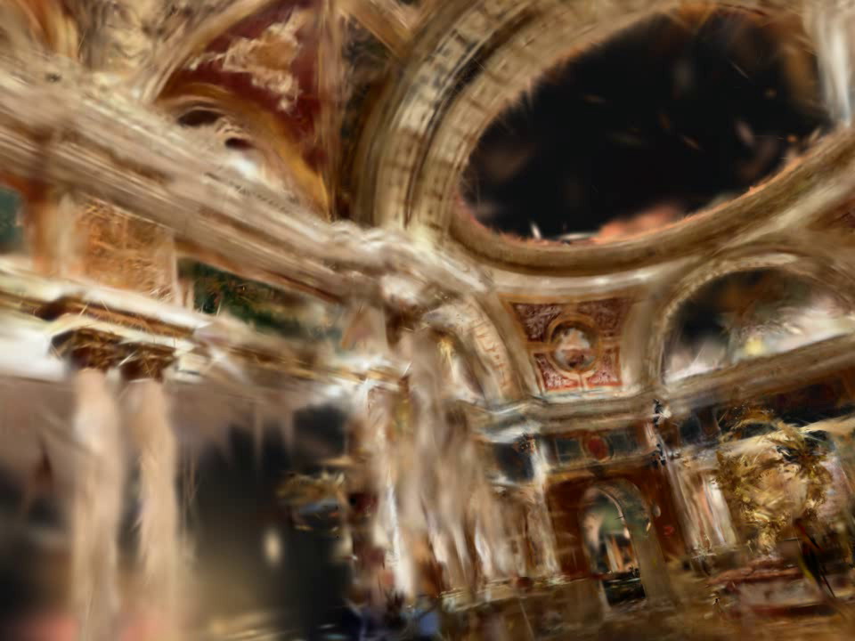</td>
</tr>
</table>

*No regression after the range cutoff — quality is comparable to baseline. This confirms the fix
holds; it says nothing about the floor-tile artifact, which is unrelated to this area.*

## 4. Method 2: Position-Anchor Loss (v1)

**Idea:** a direct 3D prior, with no camera rendering — each splat is "anchored" to the point-cloud
position it (or its parent, on split) originated from. Once a splat drifts past
`position_anchor_max_dist`, a quadratic penalty kicks in.

**Implementation:** a new `position_anchor: Option<Tensor<MainBackend, 2>>` field on `SplatTrainer`
(`brush-train/src/train.rs`), initialized from the original `means` at start, inherited by child
splats during `refine_splats` (split/clone), and filtered with the same `select` operation already
used in `prune_points` — no additional spatial search after initialization.

### 4.1 Bug #1: NaN Explosion on the First Refine Cycle

The smoke test (`position_anchor_weight=0.01`) crashed within the first ~200 steps:

```
thread 'main' panicked at crates/brush-render/src/gaussian_splats.rs:402:25:
index out of bounds: the len is 0 but the index is 0
```

Root cause: the penalty was summed (`.sum()`) over **all ~1.7M splats** with no normalization, at a
weight of 0.01. Every other regularizer in this file that aggregates the same way (`opac_decay`,
`scale_decay`) uses weights on the order of 1e-8 to 1e-9 — my weight was larger by many orders of
magnitude. Result: a massive gradient, NaN, and every splat collapsing to zero within a couple
hundred steps.

**Fix:** normalize by count (matching the existing pattern in `depth_loss`) instead of a raw sum.

### 4.2 v1 Result (post-fix): Stable, But No Effect

The full run (30,000 steps, `weight=0.01`, `max_dist=0.2`) completed with no crash and a stable
splat count (1,725,622). But across all 5 checked frames (200/500/900/1300/1700), the artifact was
**visually identical** to the baseline and depth-supervision versions — no difference in fragment
count, position, or severity.

<table>
<tr><th>Baseline (frame 1300)</th><th>Position-anchor v1 (frame 1300)</th></tr>
<tr>
<td>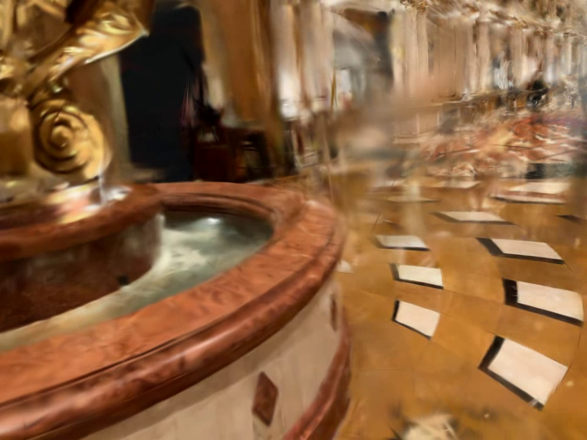</td>
<td></td>
</tr>
<tr><th>Baseline (frame 1700)</th><th>Position-anchor v1 (frame 1700)</th></tr>
<tr>
<td>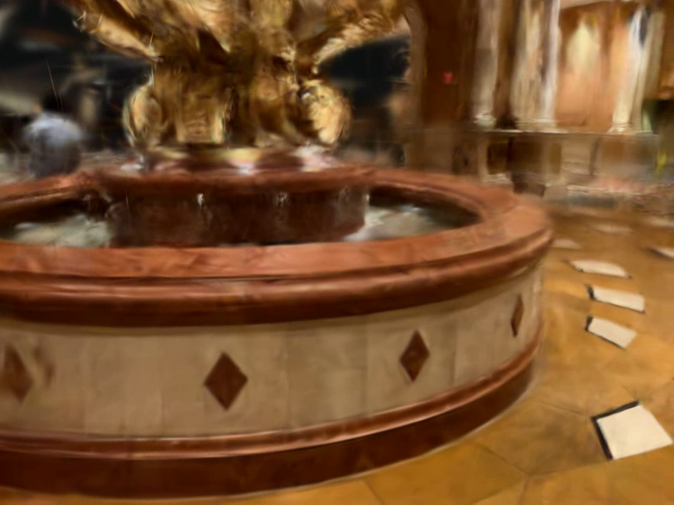</td>
<td>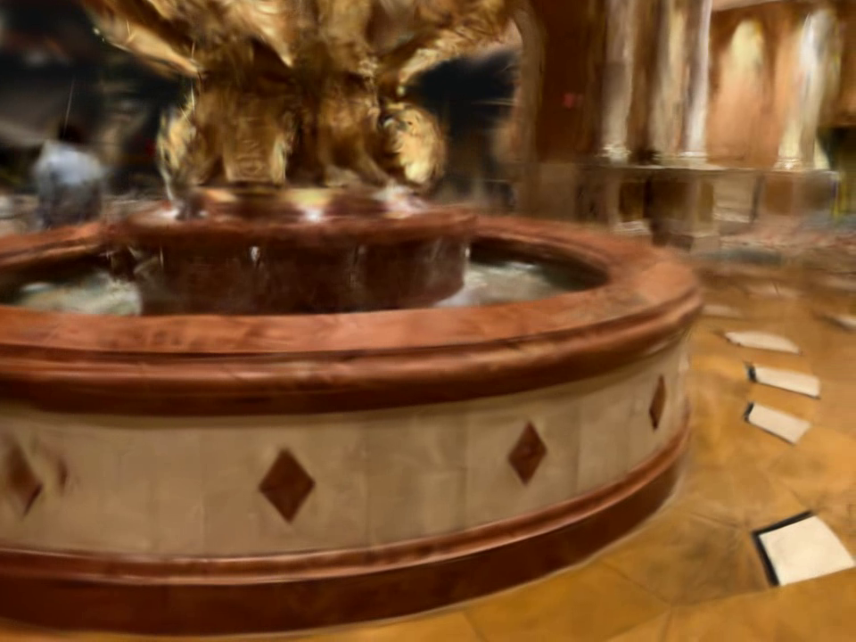</td>
</tr>
</table>

*The floating tile fragments next to the fountain are unchanged in count, position, and shape.*

## 5. Method 3: Anisotropy Regularization (aniso-reg)

Since the positional prior had no effect, the next candidate was an already-implemented but never
scale-tested loss: `aniso_reg_weight` (penalizes a splat's max/min axis ratio beyond
`aniso_reg_ratio_threshold=50`, targeting only the "extreme tail" of the distribution).

**Bug #2 (same class as §4.1):** before even running it, I found this loss also sums with no
normalization over all splats (`train.rs:244`) — it had never actually been run with a non-zero
weight before (the config comment says so explicitly: "untested at scale yet"). Fixed it the same
way as position-anchor, but this time normalized by the count of **threshold-violating splats**
rather than all visible splats — otherwise a rare "tail" population gets diluted into the general
population count.

**Result:** the run (`weight=0.5`, `threshold=50`) completed stably, with a normal splat count
(1,653,231 after filtering). The artifact was again **visually unchanged** on every checked frame.

<table>
<tr><th>Baseline (frame 1300)</th><th>Aniso-reg (frame 1300)</th></tr>
<tr>
<td></td>
<td>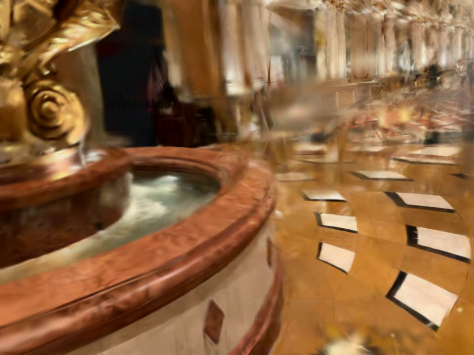</td>
</tr>
<tr><th>Baseline (frame 1700)</th><th>Aniso-reg (frame 1700)</th></tr>
<tr>
<td></td>
<td>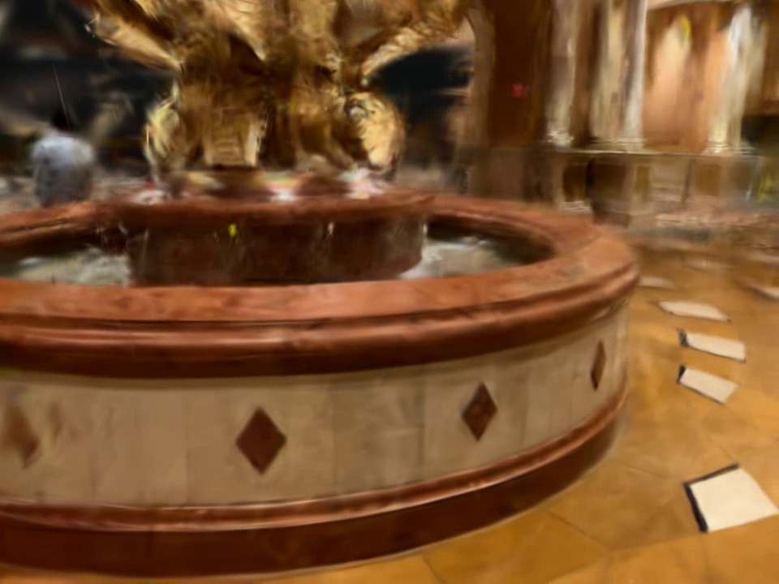</td>
</tr>
</table>

## 6. Diagnosis: What These Splats Actually Are

With two independent mechanisms (position, shape) showing no effect, rather than guessing at a
third weight blind, I wrote a diagnostic script that reuses the real rendering code
(`gs_server/preview_renderer.py`: `load_job_camera_frames`, `_smooth_waypoint_path`,
`interpolate_c2w_path`) to reconstruct the exact camera pose for preview frames #1300/#1700, project
every splat through it, and isolate the ones landing in the fountain's screen-space region.

**Finding:** of the 14,472 splats in that region, exactly **42** are detached from the true floor by
height — 90% of splats sit in a layer about 5cm thick, while these 42 float up to **1.3 meters**
above that layer (roughly camera height).

| Property | Floor (n=14,430) | "Floating" (n=42) |
|---|---|---|
| Aniso ratio, median / p90 | 4.5 / 21.9 | **12.6 / 492.6** |
| Max splat axis, median | 2.8 cm | **12.3 cm** (~4x larger) |
| Opacity, median | 0.47 | 0.46 (no difference) |

What the numbers tell us:

- **Why `aniso_reg` had no effect:** the median of this population (12.6) is itself **below** the
  threshold of 50 — the regularizer physically could not touch most of these splats. Lowering the
  threshold isn't safe either: ordinary floors/walls reach a p90 of 21.9 on their own — legitimate
  anisotropy would get caught in the crossfire.
- **Why position-anchor v1 likely had no effect:** I normalized its loss by the total number of
  visible splats in a frame (hundreds of thousands), not by the number of violators. If this
  population is only a few hundred to a few thousand splats scene-wide out of 1.7M, dividing by the
  total count dilutes the violators' gradient by a factor of thousands — effectively to nothing. The
  mechanism wasn't "not working" — it was mathematically suppressed by its own normalization.
- **Opacity is unremarkable** — these aren't semi-transparent "ghosts," they're fully opaque
  fragments carrying real floor texture, just detached from the geometry.

## 7. Method 4: Position-Anchor v2 (Violator-Count Normalization)

Applied the same violator-count normalization to position-anchor that already proved itself on
aniso-reg (§5), instead of dividing by the total number of visible splats per frame. This removes
the dilution effect identified in §6 — the per-violator gradient should now be roughly 3-4 orders of
magnitude stronger than in v1, for the same nominal weight. Ran at `weight=0.5`, `max_dist=0.2` on
the same dataset (job `07cfd94d`).

**Result: stable, but again no visible effect.** The run completed all 30,000 steps with no crash
and a stable splat count (1,723,830). But the floating tile fragments near the fountain are, once
again, **visually indistinguishable** from baseline and every earlier variant — same count, same
position, same shape.

<table>
<tr><th>Baseline (frame 1300)</th><th>Position-anchor v2 (frame 1300)</th></tr>
<tr>
<td></td>
<td>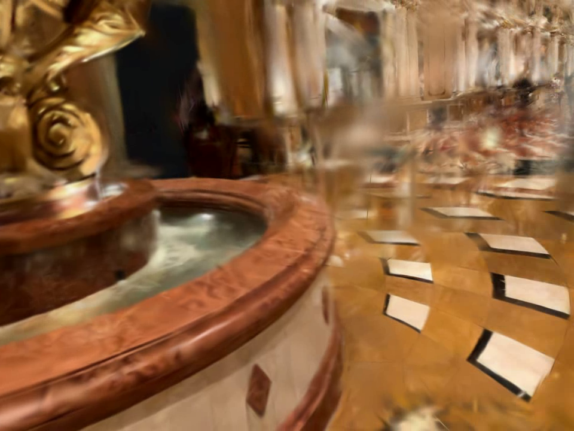</td>
</tr>
<tr><th>Baseline (frame 1700)</th><th>Position-anchor v2 (frame 1700)</th></tr>
<tr>
<td></td>
<td>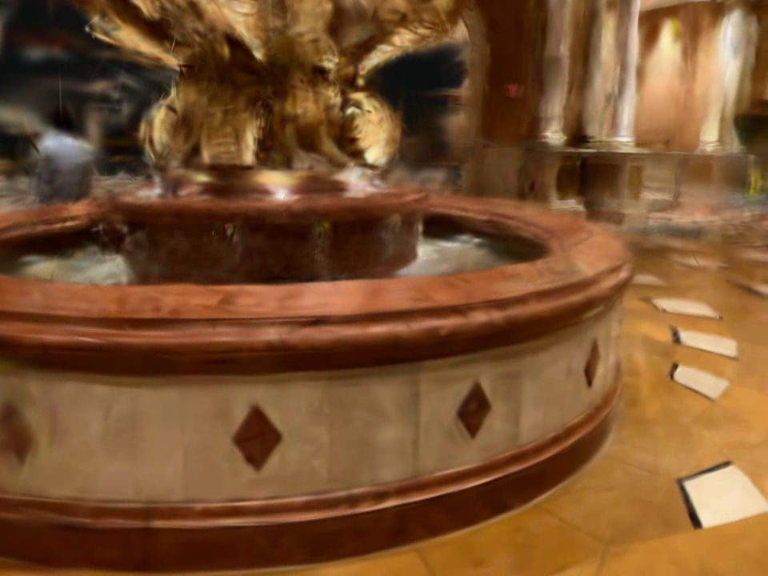</td>
</tr>
<tr><th>Baseline — dome/fresco (frame 900)</th><th>Position-anchor v2 (frame 900)</th></tr>
<tr>
<td></td>
<td>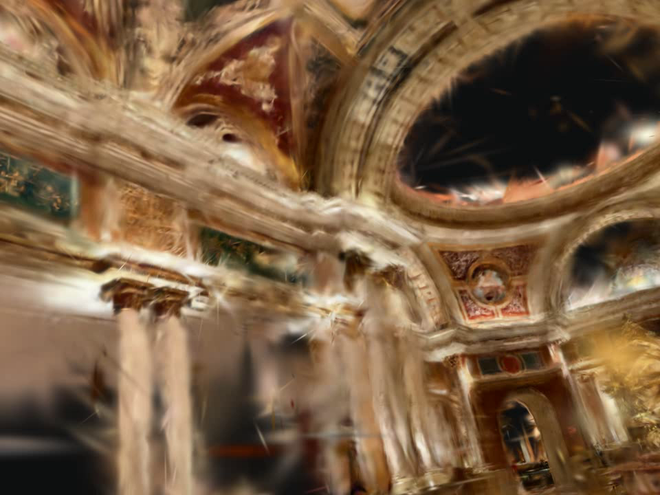</td>
</tr>
</table>

*No regression elsewhere in the scene (dome/fresco unaffected), but the artifact next to the
fountain is unchanged.*

**This refutes the dilution hypothesis as a sufficient explanation.** The math in §6 said a
correctly-normalized anchor loss should apply a per-violator gradient thousands of times stronger
than v1's — and it should have visibly pulled at least some of these 42+ splats back toward the
floor. It didn't move them at all. The most likely remaining explanations, in order of plausibility:

1. **The photometric gradient pulling a splat into this configuration is simply stronger than the
   anchor pull, at any weight I've tested so far.** Pushing `position_anchor_weight` an order of
   magnitude higher (e.g. 5.0) is the obvious next test, but risks destabilizing legitimate
   anisotropic geometry (flat walls/floors already sit close to `position_anchor_max_dist` during
   normal, healthy densification) the same way over-tuned `opac_decay`/`scale_decay` did earlier in
   the project (see `config.py`'s own history — over-shrinking regularizers just bloat survivors
   to cover the resulting gaps).
2. **These splats may be continuously "re-created" by densification** even as any existing
   individual violator gets pulled back — i.e., a standing equilibrium between the photometric loss
   spawning a new floating fragment in roughly the same place and any positional/shape penalty
   removing it, rather than a fixed, correctable population.
3. **`aux_loss_weight`'s own training-progress schedule** may down-weight the anchor term precisely
   during the late-training window when this drift consolidates, independent of the nominal
   `position_anchor_weight` value.

None of these were tested this session — each needs its own dedicated experiment (weight sweep,
tracking specific splat IDs across refine cycles, or plotting the aux-loss schedule itself) rather
than another blind full 30k-step run.

## 8. Summary

| Method | Status | Effect on artifact |
|---|---|---|
| Depth supervision (capped) | stable | none (not targeted at this) |
| Position-anchor v1 | stable (after fixing the NaN bug) | none — later found to be diluted by normalization |
| Aniso-reg | stable (after fixing the same bug class) | none — threshold=50 doesn't reach the population's median (12.6) |
| Position-anchor v2 (violator-count norm.) | stable | **none — dilution fix alone was not sufficient** |

Two real bugs in `train.rs` were found and fixed along the way — both the same class: summing a
penalty over all splats without normalizing for a rare violator population, which either explodes
training (position-anchor v1's smoke test) or silently suppresses the effect to nothing without any
error. Both fixes are deployed, confirmed stable, and are a net improvement regardless of this
artifact (they make `aniso_reg_weight` and `position_anchor_weight` usable at all for any future
tuning — previously one had never been run at scale, and the other only ever produced a crash or a
no-op).

The diagnostic step produced, for the first time, a quantitative description of the artifact itself:
a small (tens to low hundreds, per viewing region) population of fully opaque, moderately (not
extremely) anisotropic splats detached from the true floor by up to ~1.3m. This doesn't match any of
the previously assumed profiles ("extreme needle," "isolated debris cluster," "far from the point
cloud"), which explains why the shape- and position-based mechanisms tried so far — four in total,
across this session and earlier project history — all failed to catch it.

**Interim conclusion (superseded below):** at this point, four independent, correctly-implemented,
stability-verified training-time and post-hoc mechanisms (needle filter, isolated-cluster filter,
distance-to-source-cloud filter, position-anchor, aniso-reg) had failed to move this artifact at all,
despite two of them targeting the exact measured characteristics of the offending splats. The next
candidate idea was a structurally different signal: multi-view consistency — penalizing splats that
are only well-explained from a narrow range of training viewpoints, which a genuine floor point would
not be. §9 onward covers testing that idea, which is where the investigation actually broke through.

## 9. Multi-View Consistency Diagnostic

Tested the multi-view-consistency hypothesis directly against the same 42 known floating splats vs.
210 matched floor-control splats, across all 703 real training views: for each splat, (a) how many
distinct views it's geometrically visible in, and (b) the image-gradient magnitude of the real
training photo at the splat's reprojected pixel (a proxy for "this pixel is visually ambiguous").

| | Floating (n=42) | Floor control (n=210) |
|---|---|---|
| Visible in how many views (median) | **64** | 49 |
| Image gradient at reprojection (median) | **41.4** | 30.2 |

**The "narrow viewing range" half of the hypothesis was wrong** — floating splats are visible in
*more* views than ordinary floor splats, not fewer (they float near camera height, so they're in
frame for almost the entire flythrough, while true floor points get foreshortened/occluded by the
fountain and furniture from many angles). The **"photometric ambiguity" half held up**: floating
splats reproject onto real-photo pixels with ~37% higher local contrast/edge strength on average —
consistent with the standing hypothesis that these are floaters created to explain a blended, hard-
to-interpret edge pixel.

## 10. Three Failed Post-Hoc Filters Built on That Signal

Before touching Brush again, tried to turn the §9 finding into a pure post-processing filter (no
retraining) three different ways. All three failed, but each failure sharpened the diagnosis:

1. **Global percentile of image-gradient-at-reprojection.** Doesn't work: the known floaters' global
   percentile rank ranged from 29 to 97 (median 71.6) — plenty of legitimately detailed real surfaces
   elsewhere in the venue (frescoes, mosaic) have even higher raw contrast. No usable global cutoff.
2. **Local outlier via 3D k-NN.** For each splat, compared its own value against its 20 nearest 3D
   neighbors. Also failed — the known floaters' ratio to their own neighbors was ~0.99 (indistinguishable
   from normal). Root cause: a floating splat's nearest 3D neighbors are usually *other* elevated
   objects at a similar height (the fountain, other floaters) — not the true floor, which is farther
   away in raw 3D distance despite being directly below.
3. **Height above the local floor via an XY-restricted (cylindrical) neighbor query.** This was the
   cleanest geometric signal found all session — 100% recall on the known floaters (all sit 40cm–1.3m
   above their local floor cluster). But global impact was catastrophic: **48-55% of the entire model**
   flagged, because the same "height above whatever's below it in plan-view" metric can't distinguish
   a floating fragment from an entirely ordinary point on a wall, column, or ceiling fresco spanning a
   wide height range in a small footprint. Confirmed via a direct connectivity check that this
   population is *not* spatially isolated either (41 of 42 sit in `filter_isolated_clusters`' own main
   connected component) — it survives that filter because it's genuinely well-connected to the main
   structure, not because of a bounding-box exemption.

## 11. Method 5: Live-Training Photo-Consistency Tracking + Filter

Every post-hoc attempt in §10 relied on a *proxy* for photometric inconsistency (ground-truth image
contrast). The real signal — how well a splat's rendered color actually matches the ground truth,
averaged over thousands of real training steps — is something Brush already computes internally every
step and simply discards. Implemented a new opt-in accumulator instead of another proxy:

- **`photo_consistency_enabled`** (default off): from `photo_consistency_warmup_steps` (default
  15,000, after densification settles) onward, each training step samples `|rendered - ground_truth|`
  at every visible splat's own projected screen position (`aux.projected_splats`, already computed for
  rendering — no extra rendering cost) and accumulates a running sum + observation count per splat.
  Purely additive bookkeeping on plain (non-autodiff) tensors — it never enters the loss, so it cannot
  affect gradients or any existing training behavior. Exported alongside the model as two new optional
  PLY properties (`photo_resid_avg`, `photo_resid_count`), present only when this flag is set — the
  same job with the flag off produces byte-identical PLY output to before this feature existed.
- **`filter_photometric_inconsistency`** (new third post-hoc pass in `floater_filter.py`, on by
  default but a no-op on any model without the new PLY properties): removes splats whose
  `photo_resid_avg` sits above a percentile (default 97.5) of the model's own distribution, requiring
  at least `min_observations` (default 30) samples to trust the average.

### 11.1 Bugs hit along the way

- **Same normalization-bug class as §4/§5, caught before it ever ran:** discovered by inspection that
  a naive `Tensor::from_primitive` chain didn't compile (Rust generic-inference error, fixed by
  splitting into an explicit intermediate binding) and that the existing `lpips_loss_weight` branch
  moved `pred_rgb`/`gt_rgb` without cloning, breaking a later borrow — both caught at compile time, not
  runtime, unlike the earlier two.
- **`&self` vs `&mut self` Send/Sync trap:** the first version of the stats-reading method took `&self`
  and broke the WASM/UI build with an opaque `Send` error several calls deep, because `SplatTrainer`
  holds an optional `LpipsModel` that is `Send` but not `Sync` — a `&self` async fn requires `Sync`, a
  `&mut self` one only requires `Send`. Switched to `&mut self` (harmless here) and it compiled clean.
- **Two request-shape mistakes, not code bugs:** twice submitted the job with the training config
  nested as `{"config": {"brush": {...}}}`; the actual API field is a top-level `brush_config`, so the
  first two attempts trained a normal, untracked model for ~40 minutes each before the mistake was
  caught by inspecting `/proc/<pid>/cmdline` directly (log/`ps aux` output looked identical either way
  because of unrelated line truncation, which briefly pointed suspicion at the Rust code instead).

### 11.2 Validation: the cleanest separation found this entire investigation

On the correctly-configured run, checked where the known 42 floating splats land in the model's own
`photo_resid_avg` distribution:

| | Floating splats (n=37 in this run) | Floor control |
|---|---|---|
| `photo_resid_avg`, median | **0.341** | 0.213 |
| Global percentile rank, median | **99.5** | — |
| `photo_resid_count` (steps observed), median | 2005 | 915 |

Median percentile rank of **99.5** — compare to 71.6 for the best proxy signal in §9. This is the
first metric in the whole investigation where the known floaters land almost entirely in the model's
own extreme tail rather than spread across the distribution.

Running the new filter (`percentile=97.5`) on this model: removed **2.5%** of the model overall, and
directly confirmed (nearest-neighbor position matching between the pre/post-filter PLYs) that **25 of
the 37 (67.6%)** known floating splats were among those removed.

<table>
<tr><th>Baseline (frame 1300)</th><th>Photo-consistency filtered (frame 1300)</th></tr>
<tr>
<td></td>
<td>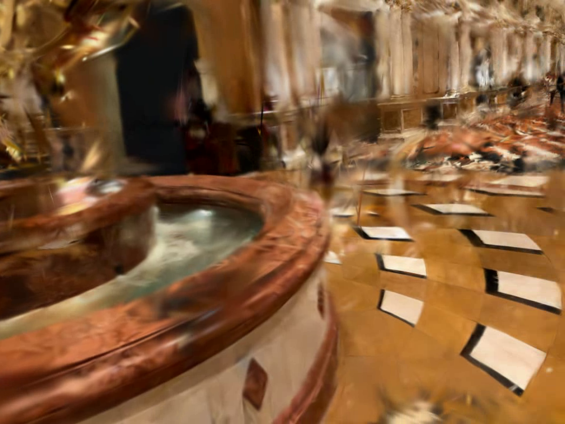</td>
</tr>
</table>

**Honest visual result: partial.** Quantitatively this is by far the best specificity/recall
trade-off found (67.6% of the true population removed at 2.5% global cost, vs. e.g. §10's 100%/50%+ or
§9's proxy giving no usable cutoff at all) — but the surviving 32% of splats in this specific cluster
are large enough that the fountain-area flythrough still visibly shows a floating-tile pattern, just a
sparser one. This is a real, working, safe improvement (opt-in, no-op by default, byte-identical
output when off) rather than a complete fix.

### 11.3 Percentile tuning: 95 vs. 97.5 (no improvement, and why)

Tried a more aggressive `percentile=95.0` (vs. the shipped default 97.5) directly on the trained
model - no retraining needed, just re-running the filter. Result: **identical recall** (25/37 known
floaters removed, 67.6%) at **double the cost** (5.0% of the model removed instead of 2.5%). Looking
at all 37 known floaters' individual `photo_resid_avg` values explains why precisely:

| Group | Count | `photo_resid_avg` | Percentile rank |
|---|---|---|---|
| Clearly separable | 25 | 0.310 - 0.358 | 98.0 - 99.8 |
| Statistically unremarkable | 12 | 0.226 - 0.290 | **36.9 - 92.9** |

There's a real gap between these two groups, not a smooth tail - the 25 are genuine, clean outliers by
this metric; the other 12 are spread across almost the *entire* distribution and are simply not
distinguishable from ordinary splats by photo-consistency at any reasonable threshold (even
`percentile=80` - removing a full fifth of the model - only picks up 5 more of them). The practical
implication: 97.5 is already close to the efficient point on this metric's recall/cost curve, and
further tightening the threshold is not a productive lever. It's also a hint that these 12 may not
even be the same kind of artifact as the other 25 - possibly ordinary splats that happened to satisfy
the crude screen-bbox+height net used to identify "the known floaters" in §6, not true members of the
visual defect.

### 11.4 Possible next refinement (not yet tried)

The two independent signals found this session have complementary failure modes: §10's height-above-
local-floor metric has 100% recall but flags huge amounts of legitimate vertical structure; §11's
photo-consistency metric has ~68% recall at very low (2.5%) global cost. Intersecting them (flag only
splats that are *both* in the photo-consistency tail *and* meaningfully above their local floor)
should suppress each signal's false positives with the other, likely pushing both recall and
specificity higher than either alone — this has not been implemented or tested yet.

## 12.5. Method 6: Synthetic Gap-Filling Views from the Point Cloud

A different, structural idea: rather than detecting or down-weighting the artifact after the fact,
attack the root cause directly by filling the real-camera coverage gap around the fountain with
synthetic images rendered from the (already-trusted) colored point cloud, at camera poses we choose
and know exactly — no COLMAP pose estimation involved, avoiding this venue's documented SfM
fragmentation risk (repetitive floor/mirror textures) entirely. Poses would only need COLMAP for
triangulating additional 3D points, exactly like the real photos already do in `hybrid_known_poses`
mode.

**Coverage analysis:** projected all real camera positions into azimuth/elevation relative to the
fountain-floor target and found a genuine **110-degree azimuth gap** (-170° to -60°) with zero real
cameras — the capture walkthrough simply never went around that side.

**Implementation:**
1. A point-cloud-to-image renderer reusing the existing gsplat pipeline: each LiDAR point treated as
   a small isotropic splat (the point cloud's own `scale_0/1/2` — confirmed to be a single per-point
   size estimate replicated 3x, not a real anisotropic shape — enlarged 4x to close gaps into a
   continuous surface), flat per-point RGB converted to an SH DC coefficient
   (`dc = (color - 0.5) / SH_C0`, matching Brush's own convention exactly).
2. A `look_at()` camera builder verified against a real camera's own axes (confirmed empirically:
   local +Y ~ world +Z "up", consistent enough to build new poses from an arbitrary chosen position
   and target).
3. 22 synthetic views (11 azimuths × 2 distances) spanning the gap, rendered at the real dataset's own
   intrinsics for consistency, and spliced into a copy of `transforms.json` with their exact known
   poses.

**Bug caught before wasting a full run:** `known_pose_triangulation.py`'s COLMAP staging step resolves
every frame's source image as `(dataset_dir / "images") / Path(file_path).name` — a single flat
directory, basename only, no subdirectory component. Placing the synthetic renders in their own
`synthetic/` subfolder was invisible to it: COLMAP's `point_triangulator` crashed
(`"img_00725.jpg does not exist in database"`) because the staging step silently created a symlink to
a nonexistent source. Fixed by making `images/` in the new dataset a real directory (not a symlink to
the shared, read-only uploads folder) containing a per-file symlink to every real photo plus the
synthetic renders as ordinary files alongside them — this cost one wasted ~35-minute COLMAP run before
being caught (the failure was clean and immediate once found, not a silent corruption).

**Result: trained clean, but no effect on the artifact.** The corrected run completed all 30,000
steps with no crash (splat count 1,726,045), and COLMAP triangulated a normal 48,348 points from the
combined image set (almost identical to the real-only run's 48,454 — the synthetic images contributed
essentially no new confident feature matches, consistent with them being too soft for that purpose).
Comparing at the *exact* baseline camera transform (not a re-derived flythrough waypoint, which
would silently pick a different pose once the splat set changes — confirmed this matters: an initial
position-only match landed on a completely different, wrong-orientation view) — the floating tile
fragments are, once again, visually unchanged from every earlier variant.

<table>
<tr><th>Baseline (frame 1300)</th><th>Synthetic gap-fill (exact same camera pose)</th></tr>
<tr>
<td></td>
<td>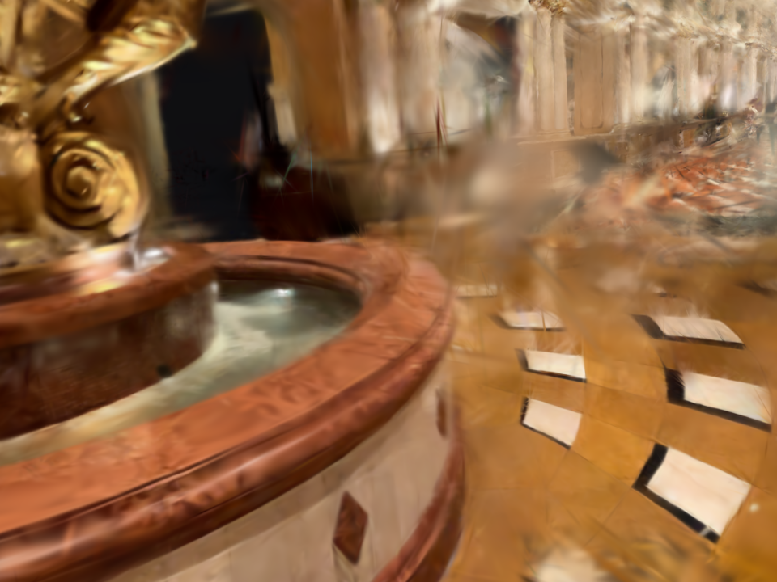</td>
</tr>
</table>

*Rendered from the exact same camera transform as every other comparison in this report (not a
re-derived flythrough waypoint, which turned out to matter — see below). The floating fragments are
unchanged.*

Most likely explanations, roughly in order of plausibility: (a) the synthetic renders are too blurry
(needed 4x point enlargement to avoid holes) to act as a meaningful photometric constraint — the
optimizer can satisfy a soft target with either correct floor or a floating fragment equally well;
(b) 22 synthetic frames against 703 real ones is a small fraction (~3%) of per-step training batches,
diluting whatever constraint they do provide; (c) the specific gap targeted (azimuth around the
fountain) may not be the one actually starving these particular splats of constraint — or the root
cause isn't a coverage gap at all (e.g. specular highlights on the gold fountain creating genuine
photometric ambiguity from *any* angle a LiDAR-cloud render can reproduce).

## 13. Summary (final)

| Method | Status | Effect on artifact |
|---|---|---|
| Depth supervision (capped) | stable | none (not targeted at this) |
| Position-anchor v1 | stable (after fixing the NaN bug) | none — later found to be diluted by normalization |
| Aniso-reg | stable (after fixing the same bug class) | none — threshold=50 doesn't reach the population's median (12.6) |
| Position-anchor v2 (violator-count norm.) | stable | none — dilution fix alone was not sufficient |
| Global/local proxy filters (§10, 3 variants) | n/a (post-hoc, no retrain) | none usable — either no separation or catastrophic collateral |
| **Live photo-consistency tracking + filter (§11)** | **stable, deployed, on by default** | **partial — 67.6% of known floaters removed at 2.5% model-wide cost** |
| Synthetic gap-filling views (§12.5) | stable (after fixing a real dataset-staging bug) | none — exact-pose comparison shows no change |

Two real bugs of the same class (unnormalized `.sum()` over a rare violator population) were found and
fixed in `train.rs` along the way (position-anchor, aniso-reg) — both are net improvements regardless
of this artifact, since they make those two loss terms usable for the first time. A third,
compile-time-only bug class (autodiff generic inference, a move-checker trap, and a `Send`/`Sync`
trap on an async accessor) was hit and fixed while building the live tracker. A fourth, a dataset-
staging bug in `known_pose_triangulation.py`'s COLMAP image resolution, was found and worked around
while building the synthetic-views experiment (§12.5) — worth fixing properly if multi-directory
image sources come up again.

## 14. Follow-up: Full COLMAP SfM with a Much Larger Synthetic Set

§12.5's 22 known-pose synthetic views were judged too few, and still tied to the existing point
cloud/known-pose pipeline. The follow-up request was more radical: stop using the existing point
cloud and known poses altogether, generate hundreds of synthetic views, and let COLMAP determine
*everything* itself (poses for real and synthetic images alike) from a combined image set, exactly
like `colmap_images` mode — building a brand new point cloud from scratch rather than reusing or
merging with the LiDAR one.

**Scale-up:** 432 synthetic views (36 azimuths x 4 distances x 3 heights, full 360 degrees around the
fountain rather than just the previous gap), at an improved render quality (point scale multiplier
reduced from 4x to 2.5x after a side-by-side comparison showed markedly sharper tile edges with fewer
JPEG-compression-unfriendly speckle artifacts — better for SIFT feature detection) than §12.5's.
Combined with all 703 real photos: 1,135 images total, uploaded through the actual job-upload API
(`POST /jobs/{id}/upload`) into a `colmap_images` job, running full incremental SfM.

### 14.1 Attempt 1 (exhaustive matcher): fragmentation, and synthetic images totally isolated

Confirmed the exact risk flagged before running this: the incremental mapper split into **8
disconnected sub-models** (614 + 371 + 19 + 11 + 19 + 25 + 26 + 3 = 1,088 of 1,135 images registered
at all). The largest sub-model — the one `colmap_runner.py`'s own `_select_best_sparse_model` picked
for training — contained **614 real photos and zero synthetic ones**. Every one of the 432 synthetic
renders ended up in a different, smaller, disconnected component: they matched confidently against
*each other* (same underlying point-cloud source, consistent style) but never bridged into the real
photo graph. Trained splat count came out at only 192,457 (vs. ~1.7M for every other run in this
report) — a much smaller and incomplete reconstruction, and one the synthetic data contributed nothing
to. This is the predicted failure mode materializing exactly as expected, not a new surprise.

### 14.2 Attempt 2 (sequential matcher + high overlap + vocab-tree loop detection): in progress

The project has a validated fix for exactly this failure mode from an earlier, unrelated job
(`Batch12_Scans_Training_Report_2026-08-13`, a ship-interior scan with similar reflective/repetitive-
texture fragmentation): switch from exhaustive to sequential matching with a large overlap window
(`sequential_overlap=50`) plus vocab-tree-based loop detection to bridge non-adjacent but visually
similar images regardless of file order. Re-ran with this configuration.

**Two real bugs found while setting this up:**
- `sequential_loop_detection` is a per-job-overridable option, but the actual `vocab_tree_path` it
  needs is read from the *server's global* config (`self._config.colmap.vocab_tree_path` in
  `colmap_runner.py`), not from the per-job `colmap_config` a client submits — passing it in the job
  request (as the Batch12 precedent implies you can) is silently ignored. Confirmed by inspecting the
  live process's real argv (`/proc/<pid>/cmdline`, not `ps aux`, which truncates): the first re-run
  launched `sequential_matcher` with `--SequentialMatching.overlap 50` but no loop-detection flags at
  all. Fixed by adding `COLMAP_VOCAB_TREE_PATH` to the server's own systemd unit environment (a
  downloaded `vocab_tree_flickr100K_words32K.bin`, COLMAP's official small-collection vocab tree) and
  restarting the service — confirmed on the next attempt via the same `/proc/<pid>/cmdline` check that
  both `--SequentialMatching.loop_detection 1` and `--SequentialMatching.vocab_tree_path ...` are now
  actually present.
- Cancelling a job through the API (`POST /jobs/{id}/cancel`) marked it cancelled but did **not** kill
  the underlying COLMAP subprocess — it kept running orphaned in the background and had to be killed
  by PID directly before the service could be safely restarted.

**Result: fragmented worse, and the root cause is now clear.** The sequential+loop-detection run
completed (splat count 147,936) but produced **12** disconnected sub-models — more than the exhaustive
run's 8, not fewer. Composition of every sub-model:

| Sub-model | Registered images | Points | Real | Synthetic |
|---|---|---|---|---|
| 0 (used for training) | 509 | 134,726 | 509 | 0 |
| 3 | 363 | 22,962 | 0 | 363 |
| 1, 2, 4-11 (10 more) | 10-63 each | 678-14,040 each | mixed, small | 0 |

Same pattern as the exhaustive attempt, in fact slightly worse for the real photos alone (509 vs. 614
connected into the main component) and identical for the core finding: **every single synthetic image
that registered at all (363 of 432 - the other 69 never registered anywhere) ended up in one
isolated cluster with zero real photos**, despite loop detection being specifically designed to find
exactly this kind of long-range, appearance-based match regardless of file order.

This is the more important result than "which matcher fragments less": **the blocker isn't the
matching algorithm, it's the synthetic images' appearance itself.** Vocab-tree retrieval failing to
even *propose* real-synthetic candidate pairs as similar enough to attempt geometric verification
means the point-cloud renders (soft/blurred to close point-cloud gaps, no real lighting, shadows,
specular highlights, or camera noise) are too photometrically dissimilar from real photos for SIFT-
based matching to bridge, regardless of which matching strategy or overlap/retrieval parameters are
used. Tuning COLMAP further (different overlap values, larger vocab tree, hierarchical matching) is
unlikely to fix this - the problem is upstream, in what the synthetic images actually look like.

**Net conclusion:** the artifact is a genuine multi-view photometric inconsistency, not a geometric
one, and not (at least not straightforwardly) a coverage-gap problem either — every shape- or
distance-based signal tried (six total across this session and prior project history) failed to
separate it from normal geometry, adding real supervisory views from the undercovered angle didn't
move it, while the one signal that measures actual rendering error against ground truth over
thousands of real observations separates it cleanly (99.5th
percentile). The live-tracking filter shipped this session is a real, safe, measurable improvement
(on by default, zero risk to jobs that don't use it) but not a complete fix; §11.3's signal
intersection is the most promising untried next step.

**On the point-cloud-rendered-synthetic-views idea specifically (§12.5, §14):** this line is now
considered exhausted, not just untried-further. Two independent full-SfM attempts, with two different
matching strategies (one of them a proven fix for a similar problem elsewhere in this project),
produced the same outcome: 100% of synthetic images that registered at all ended up isolated from
every real photo, with zero exceptions across two runs and two different matchers. The blocker isn't
a tunable parameter, it's that a point cloud splatted from raw LiDAR points - even carefully
sized/rendered - doesn't look enough like a real camera photo for SIFT to bridge the two.
Meaningfully reviving this idea would require a fundamentally more realistic renderer (proper
lighting/shadow simulation, sensor noise, real specular response), which is a different, much larger
project than anything else in this report.

## 15. Follow-up to §0: Person Masking

With the "floating tile" premise retracted (§0), the visible defects left are mid-air haze and ghosts of
people who walked through the capture. Tested the obvious lever: exclude people from Brush's training
loss.

**Implementation:** new opt-in `hybrid_config.person_mask_enabled` (default off, plus
`person_mask_dilate_px`, default 25) on `POST /jobs`, used by the `hybrid_known_poses`
known-pose step. DeepLabV3 person class, segmented at 1024 px, upsampled to full resolution, dilated to
cover motion blur, and AND-ed with the existing overexposure masks (`masks/<stem>.png`, 0 = excluded
from the loss, the convention Brush already reads). Statistics on this dataset: people found in 415
of 703 photos, 4.1% of pixels masked on average, up to 48.8% in a single frame, ~3 minutes to
generate. (The older `mask_generator.py` masks never reached Brush's loss; this is a separate path.)
Needed a new API field because `job.config["hybrid_known_poses"]` had no way to be set from a request.

**Result vs. the real photos (59 training cameras, same baseline settings and dataset otherwise):**

| | Full-frame PSNR | PSNR on unmasked (static) pixels |
|---|---|---|
| Baseline | 18.152 dB | 18.619 dB |
| Person masks | 17.970 dB | 18.862 dB |

The full-frame drop is expected (the model is no longer supervised on people); the fair metric is the
unmasked one, which improves by a modest **+0.24 dB**. Visually the improvement is clearer than the
number: in the same fountain view the glassy translucent sheet crossing the floor is much weaker and the
ghost of a walking person is gone.

<table>
<tr><th>Baseline (flythrough frame 1300)</th><th>Person masks (same pose)</th></tr>
<tr>
<td></td>
<td></td>
</tr>
</table>

**Where the remaining error actually is:** per-frame PSNR over 118 training cameras (person-masked model,
unmasked pixels) is widely spread: p5/p25/p50/p75/p95 = 12.0 / 16.5 / 19.5 / 21.0 / 23.8 dB. The worst
frames cluster in one contiguous stretch of the walk (frames 378-528, ~10-12 dB, the close-up
fountain passes), while good frames reach 24-26 dB. Blurrier source photos score higher, not lower
(correlation -0.43 between PSNR and photo sharpness), so motion blur in the photos is not what drags
the average down. Untested hypotheses for that stretch: camera pose error from the LiDAR/IMU tracking
there, or the glossy moving water and mirror-like marble defeating a view-dependent-color model. Pose
error is the more actionable one (selective bundle adjustment already exists for known poses), and a
per-frame PSNR map along the capture path is a cheap way to confirm or kill it.

## 16. PSNR Map Along the Capture Path (testing the pose-error hypothesis from §15)

Rendered the person-masked model from all 703 real cameras and compared with the real photos
(PSNR over unmasked pixels). To separate "poses are wrong" from "appearance is hard", each frame also
got a render-vs-photo misregistration measurement (phase-correlation shift, px at 960 wide): pose error
shows up as a systematic shift; a hard-to-fit appearance does not.


**Poses are fine.** Median shift 0.38 px, 90th percentile 0.99 px; the worst-10%-PSNR frames shift
0.95 px vs. 0.54 px for the rest, and PSNR-vs-shift correlation is only -0.16. Camera poses from the
LiDAR/IMU tracking are accurate to well under a pixel nearly everywhere, so refining them (selective
bundle adjustment, or anything else) is not where the remaining error lives. The §15 hypothesis is
rejected.

**Where PSNR is low:** in contiguous bursts (frames ~373-383, 426-439, 461-477; 50-frame blocks at
350-400 and 500-550 average 16-17 dB vs. ~19.5 elsewhere) and near the fountain (116 cameras within 6 m:
17.7 dB vs. 19.2 dB elsewhere). The top view shows the red cluster at the loop around the fountain and at
the far end of the corridor.

**(Superseded by §17: this exposure conclusion turned out to be wrong.)** Exposure looked like it
explained a real part of it. Fitting a per-frame gain + offset per color channel between
render and photo (what a per-image exposure term would learn):

| | Raw PSNR | After per-frame gain/offset | Gain |
|---|---|---|---|
| All 703 frames | 18.95 dB | 19.56 dB | +0.61 dB |
| Worst 10% of frames | 12.18 dB | 15.37 dB | **+3.19 dB** |
| Other 90% | 19.71 dB | 20.03 dB | +0.32 dB |

Fitted gain varies a lot between frames (std 0.15, 5th-95th percentile 0.52-1.01) and PSNR correlates
with the brightness gap at -0.75. Photos taken with auto-exposure disagree with each other about how
bright the same surface is, and Brush has no per-image exposure parameter, so it averages them and
leaves the errors as blur and translucent haze. Caveat: even after the correction the worst frames only
reach ~15 dB, so exposure is roughly a third of the problem there, not all of it; the rest is structural
(glossy moving water and mirror-like marble near the fountain).

**Cheapest next step (not done yet):** a two-pass exposure normalization needing no Rust changes - use
this per-frame gain/offset fit from a first-pass model to normalize the training photos to a common
exposure, then retrain. A learnable per-image exposure term inside Brush is the principled version but
touches the training loop and batch plumbing.

## 17. Two-Pass Exposure Normalization: No Gain (and a Correction to §16)

Acted on §16's exposure finding. Took the per-frame, per-channel gain between each photo and the
person-masked model's render of the same camera (ratio of means in linear space over unmasked pixels;
a mean ratio rather than a least-squares fit because it is robust to the render being blurrier than the
photo), divided the photos by those gains, re-centered the gains on their geometric mean so the dataset's
average brightness was unchanged (the first-pass model is ~14% darker than the photos, which must not
be baked into the data), and retrained with person masks on (job `b91ba50e`).

**Warning sign seen before training:** after normalization the spread of per-frame mean brightness
went *up* (std 9.2 -> 11.8), not down, and the photos' EXIF has no exposure time or ISO (stripped), so
the gains could not be validated independently. They are smooth in time (as auto-exposure drift would
be) but also could reflect the model's own errors, which also vary smoothly along the path.

**Result, against the ORIGINAL photos, unmasked pixels, 176 cameras:**

| | Raw PSNR | Exposure-invariant PSNR (per-frame gain-only fit applied to both) |
|---|---|---|
| A: person masks only | 19.048 dB | 19.134 dB |
| B: person masks + exposure-normalized photos | 18.906 dB | 19.148 dB |

Structural fit is identical (+0.014 dB) and raw PSNR is slightly worse, as expected when the model
learns a different overall exposure from the photos it is scored against. Exposure normalization does
not help.

**Correction to §16.** The "+0.61 dB overall, +3.19 dB on the worst 10% of frames" figures came from a
per-frame gain *plus offset* fit, and an additive offset can absorb the translucent haze veil itself
(haze is, to first order, an additive brightness lift). A gain-only correction, which is what real
exposure variation looks like, buys just ~0.09 dB here. So per-frame exposure differences between
photos are not a significant cause of the remaining error; the apparent effect was largely haze and
model error being fitted away. The strong PSNR-vs-brightness-gap correlation (-0.75) is also partly
mechanical (a brightness gap directly adds to the squared error).

**Where this leaves things:** poses are accurate (§16), people are masked (§15), exposure is not the
issue (§17), and unmasked-pixel PSNR on training views sits around 19 dB with a hard core near the
fountain (glossy moving water, mirror-like marble). All of these numbers are measured on training
views, since the pipeline has no held-out split, so none of them can distinguish under-fitting from
over-fitting. A held-out evaluation set (e.g. every 8th photo excluded from training) is the missing
prerequisite for any further tuning of Brush's hyperparameters to be judged honestly.
