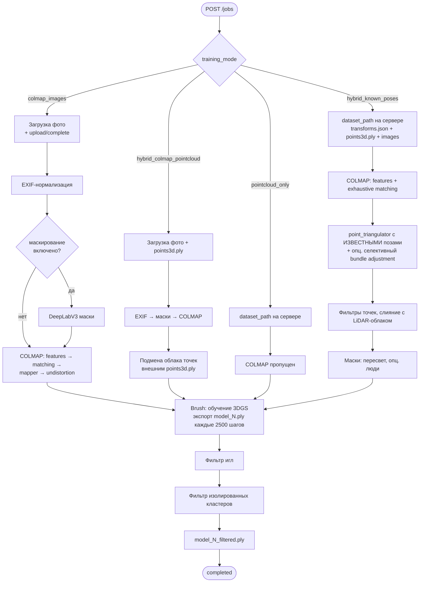
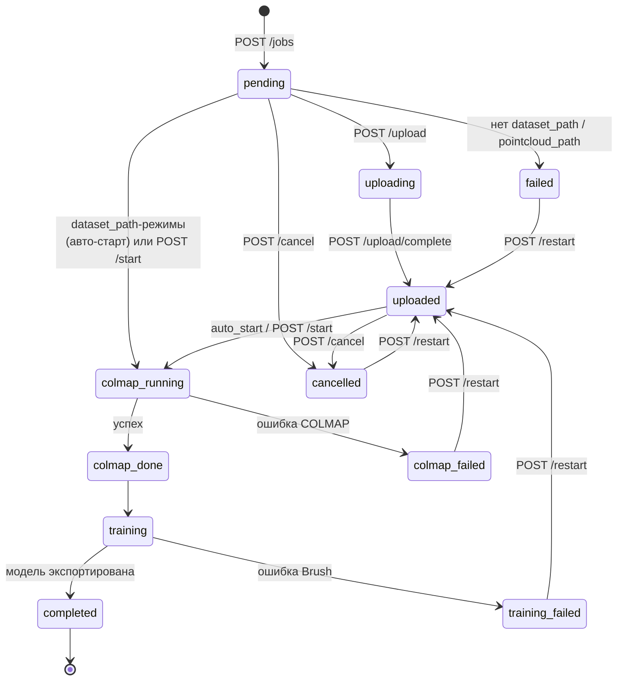
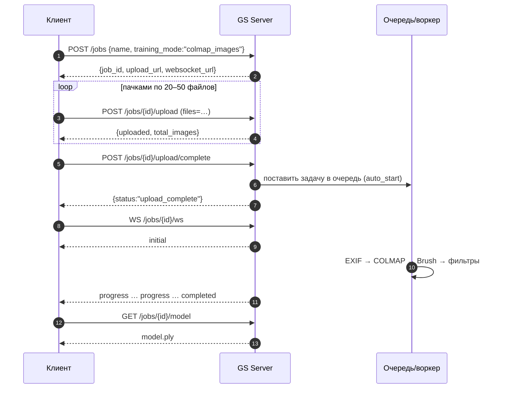
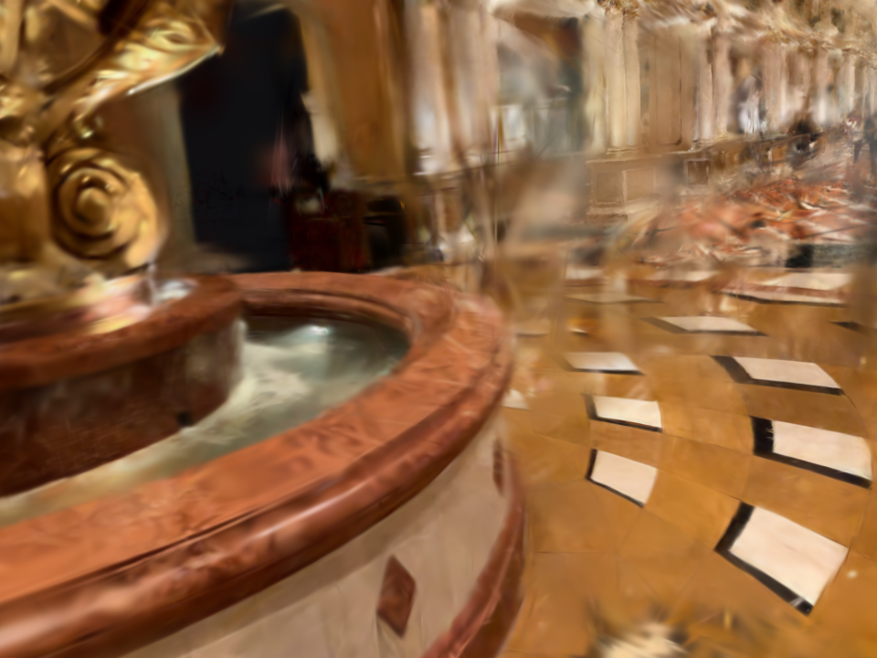
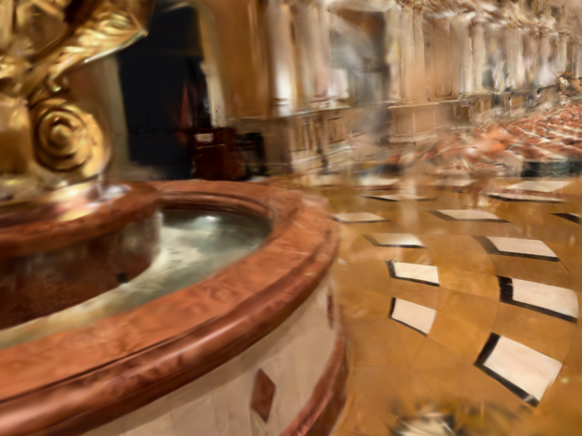
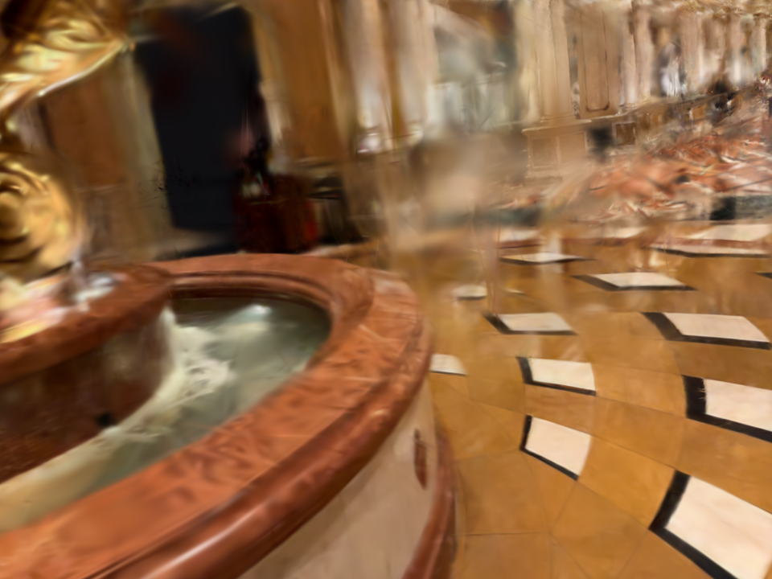
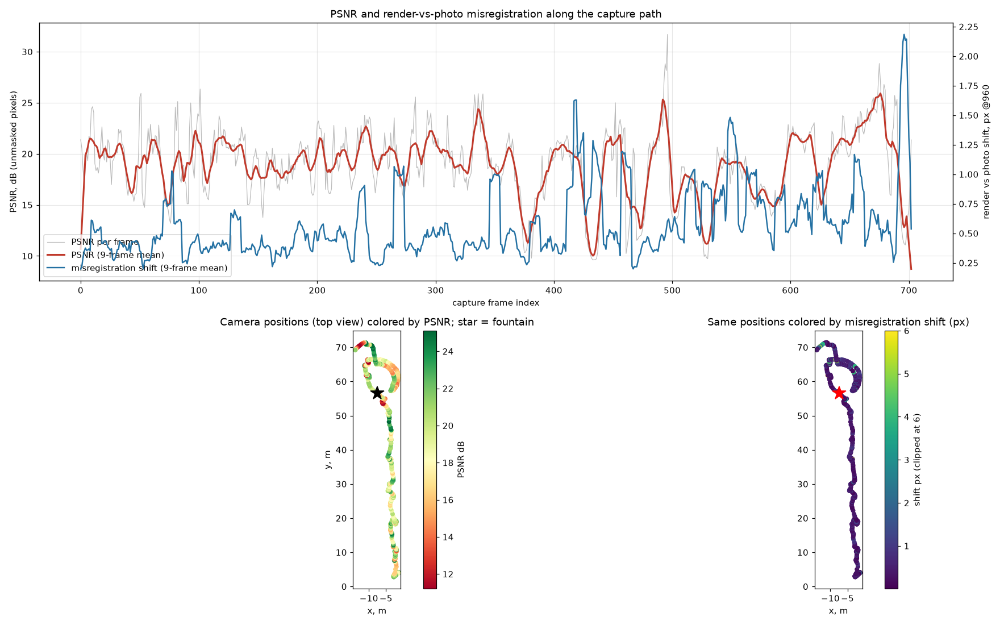

# GS Training Server — описание функциональности и руководство пользователя

> Версия сервера: `1.0.0` · Документ описывает фактическое поведение кода в `gs_server/`
> (а не только то, что написано в старых README). Там, где код ведёт себя неочевидно или
> расходится с другими документами, это явно отмечено значком ⚠️.

---

## Содержание

1. [Что это такое](#1-что-это-такое)
2. [Архитектура](#2-архитектура)
3. [Быстрый старт за 5 минут](#3-быстрый-старт-за-5-минут)
4. [Режимы обучения — какой выбрать](#4-режимы-обучения--какой-выбрать)
5. [Формат датасета (Nerfstudio) и его подготовка](#5-формат-датасета-nerfstudio-и-его-подготовка)
6. [Жизненный цикл задачи](#6-жизненный-цикл-задачи)
7. [Справочник API](#7-справочник-api)
8. [Сквозные сценарии с кодом](#8-сквозные-сценарии-с-кодом)
9. [Параметры обучения и обработки](#9-параметры-обучения-и-обработки)
10. [Постобработка: фильтры плавающих артефактов](#10-постобработка-фильтры-плавающих-артефактов)
11. [Маски: пересвет, люди, динамические объекты](#11-маски-пересвет-люди-динамические-объекты)
12. [Видео-превью и позиции камер](#12-видео-превью-и-позиции-камер)
13. [Как оценивать качество модели](#13-как-оценивать-качество-модели)
14. [Эксплуатация production-сервера](#14-эксплуатация-production-сервера)
15. [Устранение неполадок](#15-устранение-неполадок)
16. [Известные ограничения и особенности](#16-известные-ограничения-и-особенности)
17. [Рецепты: что включать в каких ситуациях](#17-рецепты-что-включать-в-каких-ситуациях)
18. [Приложение: структура каталога задачи](#18-приложение-структура-каталога-задачи)

---

## 1. Что это такое

**GS Training Server** — HTTP-сервис, который превращает набор фотографий (и, при наличии,
данные лидара/IMU) в обученную **3D Gaussian Splatting** модель — файл `.ply`, который
открывается в любом 3DGS-вьювере.

Сервер умеет:

| Возможность | Кратко |
|---|---|
| Приём данных | Фото пачкой или кусками (chunked), облако точек `.ply`, либо готовый датасет, уже лежащий на диске сервера |
| 4 режима обучения | COLMAP по фото · готовый датасет · гибрид «COLMAP + внешнее облако» · гибрид «известные позы + дотриангуляция» |
| Реконструкция | COLMAP (GPU SIFT, exhaustive/sequential/… matching, mapper, undistortion) |
| Обучение | Brush (Rust/wgpu) с собственными доработками: depth-loss, position-anchor, anisotropy-reg, photo-consistency |
| Маски | Пересвет (по умолчанию в `hybrid_known_poses`), люди (DeepLabV3), динамические объекты при COLMAP |
| Постобработка | Фильтр «игл» (needle), фильтр изолированных кластеров, опциональный фотометрический фильтр |
| Очередь | Одна задача обрабатывается за раз, остальные ждут в очереди (FIFO) |
| Прогресс | REST-опрос, WebSocket, метрики PSNR/SSIM/число сплатов/ETA |
| Выдача | Скачивание итоговой модели и промежуточных экспортов |
| Превью | Видео-пролёт по траектории съёмки (по запросу) и набор «хороших» стартовых камер |
| Устойчивость | Состояние каждой задачи на диске (`state.json`); после рестарта сервиса прерванные задачи ставятся в очередь заново |
| Документация | Swagger UI `/docs`, ReDoc `/redoc` |

---

## 2. Архитектура

```
                    ┌────────────────────────────────────────────────────────┐
                    │                GCP VM  gs-training-server              │
                    │             (NVIDIA L4 24 GB, Ubuntu, 8 vCPU)          │
                    │                                                        │
   Клиент           │   ┌──────────────┐    ┌───────────────────────────┐    │
 (curl / Python /   │   │  FastAPI     │    │       JobManager          │    │
  браузер /  ───────┼──▶│  gs_server   │───▶│  • словарь задач + диск   │    │
  своё приложение)  │   │  :8080       │    │  • очередь (1 воркер)     │    │
        ▲           │   │  REST + WS   │◀───│  • подписчики WebSocket   │    │
        │           │   └──────┬───────┘    └────────────┬──────────────┘    │
        │           │          │                         │ по одной задаче   │
        │           │          │ скачивание              ▼                   │
        │           │          │ .ply / .mp4   ┌───────────────────────┐     │
        └───────────┼──────────┘               │      Конвейер         │     │
                    │                          │ EXIF → маски → COLMAP │     │
                    │   Файлы на диске         │  → Brush → фильтры    │     │
                    │   jobs/<job_id>/…        └───────────────────────┘     │
                    └────────────────────────────────────────────────────────┘
```

Ключевые факты:

- Процесс один (`workers=1`), состояние задач хранится в памяти и дублируется в `jobs/<id>/state.json`.
- **Обрабатывается ровно одна задача одновременно** (общий `asyncio.Lock`). Новые задачи ждут в очереди.
- Рендер превью использует GPU параллельно с обучением, но два превью одновременно не рендерятся (глобальный lock).
- CORS открыт для любых источников (`*`) — API можно дёргать прямо из браузера.
- Авторизации нет. Доступ ограничивается только firewall'ом GCP (см. [§14](#14-эксплуатация-production-сервера)).

### Конвейер по режимам



---

## 3. Быстрый старт за 5 минут

Предположим, сервер доступен по адресу `http://<SERVER>:8080` (у production-VM внешний IP
показывает `gcloud compute instances describe gs-training-server …`, см. [§14](#14-эксплуатация-production-сервера)).

**Шаг 0 — проверить, что сервер жив:**

```bash
curl http://<SERVER>:8080/status
```
```json
{"status":"running","version":"1.0.0","active_jobs":0,"queued_jobs":0,"completed_jobs":12,
 "gpu_available":true,"colmap_version":null,"brush_version":null}
```

**Шаг 1 — создать задачу** (режим по умолчанию — COLMAP по фотографиям):

```bash
curl -X POST http://<SERVER>:8080/jobs \
  -H "Content-Type: application/json" \
  -d '{"name":"my_scene","brush_config":{"total_steps":30000,"max_resolution":1920}}'
```
```json
{"job_id":"b6675af5-c61c-421f-b6d3-0d68d50b8c60",
 "upload_url":"http://<SERVER>:8080/jobs/b6675af5-c61c-421f-b6d3-0d68d50b8c60/upload",
 "websocket_url":"ws://<SERVER>:8080/jobs/b6675af5-c61c-421f-b6d3-0d68d50b8c60/ws"}
```

**Шаг 2 — загрузить фото** (поле формы называется именно `files`, можно несколько раз):

```bash
curl -X POST http://<SERVER>:8080/jobs/$JOB/upload \
  -F "files=@photos/IMG_0001.jpg" -F "files=@photos/IMG_0002.jpg" -F "files=@photos/IMG_0003.jpg"
```
```json
{"uploaded":3,"total_images":3,"total_size_bytes":8123456}
```

**Шаг 3 — сообщить, что загрузка закончена** (это и запускает обработку, если `auto_start=true`):

```bash
curl -X POST http://<SERVER>:8080/jobs/$JOB/upload/complete
```
```json
{"status":"upload_complete","images_count":3,"total_size_bytes":8123456}
```

**Шаг 4 — следить за прогрессом:**

```bash
curl http://<SERVER>:8080/jobs/$JOB/progress
```

**Шаг 5 — скачать модель, когда `status == "completed"`:**

```bash
curl -o my_scene.ply http://<SERVER>:8080/jobs/$JOB/model
```

> Откройте `http://<SERVER>:8080/docs` — те же шаги можно сделать кнопками в Swagger UI.

---

## 4. Режимы обучения — какой выбрать

### 4.1 Дерево решений

```
У вас есть ТОЧНЫЕ позы камер из другого источника
(лидар / IMU / SLAM — например Leica BLK2GO)?
│
├── ДА ──▶ у вас есть и цветное облако точек (points3d.ply)?
│          │
│          ├── ДА ──▶  hybrid_known_poses  ★ лучший выбор для лидарных сканов
│          │            (позы не пересчитываются, COLMAP только добавляет точки)
│          │
│          └── ДА, и хотите обучить «как есть», без COLMAP ──▶ pointcloud_only
│
└── НЕТ ──▶ у вас есть внешнее облако точек, которым хочется заменить
            разреженное облако COLMAP?
            │
            ├── ДА  ──▶ hybrid_colmap_pointcloud
            └── НЕТ ──▶ colmap_images   (только фотографии)
```

### 4.2 Сводная таблица

| Режим | Откуда позы | Что нужно загрузить / указать | Загрузка по HTTP? | COLMAP | Старт |
|---|---|---|---|---|---|
| `colmap_images` | COLMAP оценивает сам | Только фото | да (`/upload`) | полный (mapper) | после `/upload/complete` |
| `hybrid_colmap_pointcloud` | COLMAP оценивает сам | Фото + `points3d.ply` | да (`/upload` + `/pointcloud`) | полный (mapper) | после `/upload/complete` |
| `pointcloud_only` | `transforms.json` датасета | `dataset_path` на сервере | **нет** — файлы уже на сервере | пропущен | сразу при создании (`auto_start=true`) |
| `hybrid_known_poses` | `transforms.json` датасета (не пересчитываются*) | `dataset_path` на сервере | **нет** — файлы уже на сервере | только features + matching + triangulator | сразу при создании (`auto_start=true`) |

\* кроме опционального селективного bundle adjustment — см. [§9.3](#93-colmap_config).

### 4.3 Подробно по режимам

**`colmap_images`** — классика. Фото → EXIF-нормализация → (опционально DeepLab-маски) →
COLMAP (`feature_extractor` → matcher → `mapper` → `image_undistorter`) → Brush.
Минус: на малотекстурных поверхностях (блестящий металл, повторяющийся узор, стеклянные
фасады) mapper распадается на несвязные фрагменты.

**`hybrid_colmap_pointcloud`** — то же, что `colmap_images`, но после COLMAP его разреженное
облако точек подменяется вашим `points3d.ply` (копируется в `colmap/dense/points3d.ply`).
Нужен, когда у вас есть более плотная инициализация, но нет надёжных поз.
Без `pointcloud_path` задача падает с ошибкой `hybrid_colmap_pointcloud mode requires pointcloud_path`.

**`pointcloud_only`** — Brush запускается прямо на готовом датасете (`transforms.json` +
`points3d.ply` + `images/`). Ничего не пересчитывается. Быстро, но облако точек остаётся
таким, каким вы его подготовили. Без `dataset_path` — ошибка `pointcloud_only mode requires dataset_path`.

**`hybrid_known_poses`** — позы из `transforms.json` считаются **истиной**. COLMAP не
«ищет» позы, а лишь:
1. извлекает SIFT-признаки и матчит все пары (exhaustive — для 703 снимков ~35–40 минут);
2. запускает `point_triangulator` с вашими позами — получает фотограмметрическое облако
   **в той же системе координат**, что и ваши позы;
3. фильтрует его (bbox-фильтр по лидарному облаку + длина трека ≥ 3);
4. чистит лидарное облако (SOR-фильтр выбросов, уступает место COLMAP-точкам) и сливает оба;
5. создаёт в `jobs/<id>/inputs/hybrid_dataset/` новый датасет и обучает Brush на нём.

Это единственный режим, где итог лучше, чем у любого из источников по отдельности, и
где позы никогда «не уплывают».

### 4.4 Обратная совместимость

Если `training_mode` не указан, сервер выбирает его так: `skip_colmap=true` → `pointcloud_only`,
иначе → `colmap_images`.

---

## 5. Формат датасета (Nerfstudio) и его подготовка

Для режимов `pointcloud_only` и `hybrid_known_poses` нужен каталог **на диске сервера**
(путь передаётся в `dataset_path`). Загрузить его через HTTP нельзя — копируйте `scp`/`gcloud compute scp`.

### 5.1 Структура

```
<dataset_path>/
├── transforms.json          ← обязательно: позы и интринсики
├── points3d.ply             ← цветное облако точек (инициализация сплатов)
├── images/                  ← обязательно: кадры
│   ├── frame_000001.jpg
│   └── …
├── depth/                   ← необязательно: карты глубины (для depth_loss_weight)
│   ├── frame_000001.png
│   └── …
└── masks/                   ← необязательно: Brush сам подхватывает masks/<stem>.png
    └── frame_000001.png        (0 = исключить из loss, 255 = использовать)
```

### 5.2 `transforms.json`

```json
{
  "camera_model": "OPENCV",
  "fl_x": 1456.2, "fl_y": 1456.1, "cx": 960.0, "cy": 720.0,
  "w": 1920, "h": 1440,
  "k1": 0.0, "k2": 0.0, "p1": 0.0, "p2": 0.0,
  "frames": [
    {
      "file_path": "images/frame_000001.jpg",
      "fl_x": 1456.2, "fl_y": 1456.1, "cx": 960.0, "cy": 720.0,
      "w": 1920, "h": 1440,
      "transform_matrix": [[ … 4×4 camera-to-world в NeRF-конвенции … ]]
    }
  ]
}
```

Что важно:

- `transform_matrix` — **camera-to-world в NeRF-конвенции** (столбцы Y и Z OpenCV-матрицы
  умножены на −1). Сервер внутри делает обратное преобразование для COLMAP.
- Интринсики берутся **покадрово** (`fl_x`, `fl_y`, `cx`, `cy`, `w`, `h`; опционально `k1,k2,p1,p2`).
- Единицы — **метры**. Если источник отдаёт сантиметры/миллиметры — масштабируйте при конвертации
  (`--pose-scale 0.01`), иначе облако точек и позы окажутся в разных масштабах.
- `file_path` может быть `images/xxx.jpg`; сервер сопоставляет по имени файла.
- Необязательное поле `ply_file_path` указывает на облако точек (по умолчанию `points3d.ply`).

### 5.3 Подготовка из Leica BLK2GO

В репозитории есть конвертер [`leica_to_nerfstudio.py`](leica_to_nerfstudio.py):

```
Вход:  <data-dir>/images/              RGB-кадры (JPEG 1920×1440)
       <data-dir>/depth/               карты глубины
       <data-dir>/*_intrinsics.txt     интринсики покадрово (CSV)
       <data-dir>/*_SensorFrames.txt   матрицы c2w 4×4 (OpenCV-конвенция)
       <e57>                           облако точек для инициализации

Выход: <out>/images/ · transforms.json · points3d.ply
```

```bash
python leica_to_nerfstudio.py \
  --data-dir "D:\scans\2026-06-28 Nico Office" \
  --e57 "D:\scans\2026-06-28 Nico Office\scan.e57" \
  --out D:\scans\NicoOffice_nerfstudio \
  --e57-step 2 --max-pts 50000
  # --pose-scale 0.01   если позы в сантиметрах
  # --no-ply            пропустить извлечение облака из E57
  # --no-copy           не копировать изображения
```

После конвертации — залить на сервер:

```bash
gcloud compute scp --recurse D:\scans\NicoOffice_nerfstudio \
  gs-training-server:/home/anoma/data_prepared/NicoOffice \
  --zone=us-central1-a --project=dgs-training
```

---

## 6. Жизненный цикл задачи

### 6.1 Статусы



| Статус | Значение |
|---|---|
| `pending` | Создана, ждёт данных / очереди |
| `uploading` | Идёт загрузка файлов |
| `uploaded` | Загрузка завершена (`/upload/complete`) |
| `colmap_running` | Идёт COLMAP (или known-pose триангуляция) |
| `colmap_done` | COLMAP закончен, ждёт Brush |
| `colmap_failed` | Ошибка COLMAP / триангуляции |
| `training` | Идёт обучение Brush |
| `training_failed` | Ошибка обучения |
| `completed` | Готово, модель доступна |
| `failed` | Общая ошибка (нет обязательных полей, исключение в воркере) |
| `cancelled` | Отменена пользователем |

⚠️ Значение `training_done` объявлено в enum, но в коде нигде не выставляется — после обучения
задача сразу переходит в `completed`.

### 6.2 Шкала прогресса (`overall_progress`, 0–100)

```
0 ──── 2 ── 5 ───────────────────── 50 ─────────────────────────── 100
│      │    │                        │                               │
│      │    │◀── COLMAP / known-pose ▶│◀── Brush: 50 + 50·step/total ▶│
│      │    └ upload/complete = 5     └ COLMAP_DONE = 50              └ completed
│      └ EXIF-нормализация = 2
└ создана
```

Для `hybrid_known_poses` внутри первой половины: БД и признаки ≈ 5–15, matching 15–35,
запись модели 35, триангуляция 40, BA 45, слияние облаков 46, маски 48, готово 50.

### 6.3 Поведение при рестарте сервиса

- Задачи со статусом `colmap_running` или `training` при старте сервиса получают статус `pending`
  и **ставятся в очередь заново — с самого начала** (чекпойнтов нет).
- Превью, которое рендерилось в момент рестарта, помечается `failed` («Interrupted by server restart»).
- Завершённые, упавшие и отменённые задачи просто загружаются с диска.

⚠️ Поэтому **перед `systemctl restart gs-server` всегда проверяйте, нет ли активной задачи** (см. [§14](#14-эксплуатация-production-сервера)).

---

## 7. Справочник API

Базовый URL: `http://<SERVER>:8080`. Все тела — JSON, кроме загрузок (`multipart/form-data`).
Ошибки приходят как `{"detail": "..."}` с кодом 400/404/409/422/500.

### 7.1 Карта эндпоинтов

```
Info      GET    /                                   имя, версия, ссылка на /docs
          GET    /status                             сводка сервера

Jobs      POST   /jobs                               создать задачу
          GET    /jobs                               список (status, limit, offset)
          GET    /jobs/{id}                          полная информация
          GET    /jobs/{id}/progress                 только прогресс
          DELETE /jobs/{id}                          удалить (не работающую)
          POST   /jobs/{id}/start                    запустить вручную (+ overrides)
          POST   /jobs/{id}/cancel                   отменить
          POST   /jobs/{id}/restart                  перезапустить упавшую/отменённую

Upload    POST   /jobs/{id}/upload                   фото пачкой (поле files)
          POST   /jobs/{id}/upload/chunk             фото по частям
          POST   /jobs/{id}/upload/complete          «загрузка закончена»
          POST   /jobs/{id}/pointcloud               points3d.ply целиком
          POST   /jobs/{id}/pointcloud/chunk         points3d.ply по частям

Download  GET    /jobs/{id}/model                    итоговая модель (.ply)
          GET    /jobs/{id}/model/info               метаданные модели
          GET    /jobs/{id}/exports                  все экспорты .ply
          GET    /jobs/{id}/exports/{filename}       конкретный экспорт

Preview   POST   /jobs/{id}/preview                  запустить рендер видео
          GET    /jobs/{id}/preview                  статус рендера
          GET    /jobs/{id}/preview/download         скачать .mp4
          GET    /jobs/{id}/camera_positions         «хорошие» стартовые камеры

Realtime  WS     /jobs/{id}/ws                       push-обновления прогресса
Logs      GET    /jobs/{id}/logs                     ⚠️ см. ниже — сейчас всегда пусто
```

### 7.2 Info

**`GET /status`**

| Поле | Смысл |
|---|---|
| `status` | всегда `"running"` |
| `version` | версия сервера |
| `active_jobs` | задач в статусах `colmap_running` + `training` |
| `queued_jobs` | задач в статусах `pending` + `uploaded` |
| `completed_jobs` | задач в статусе `completed` |
| `gpu_available` | ⚠️ просто значение `COLMAP_USE_GPU`, реальной проверки GPU нет |
| `colmap_version`, `brush_version` | сейчас всегда `null` |

Статистика считается по первым 1000 задачам.

### 7.3 Создание задачи — `POST /jobs`

Тело (`CreateJobRequest`):

| Поле | Тип | По умолчанию | Описание |
|---|---|---|---|
| `name` | string, 1–256 | **обязательно** | Имя; станет частью имени скачиваемого файла `<name>_model.ply` |
| `training_mode` | enum | `null` | `colmap_images` / `pointcloud_only` / `hybrid_colmap_pointcloud` / `hybrid_known_poses` |
| `dataset_path` | string | `null` | Путь **на сервере** к датасету (для `pointcloud_only`, `hybrid_known_poses`) |
| `pointcloud_path` | string | `null` | Путь **на сервере** к `points3d.ply` (для `hybrid_colmap_pointcloud`, если не загружаете через `/pointcloud`) |
| `auto_start` | bool | `true` | Запускать обработку автоматически |
| `brush_config` | object | `null` | Переопределения обучения — [§9.1](#91-brush_config) |
| `colmap_config` | object | `null` | Переопределения COLMAP — [§9.3](#93-colmap_config) |
| `hybrid_config` | object | `null` | Опции `hybrid_known_poses` — [§9.4](#94-hybrid_config) |
| `skip_colmap` | bool | `false` | Устаревший флаг (= `pointcloud_only`) |
| `description` | string | `null` | Принимается, но нигде не сохраняется |

⚠️ **Три блока конфигурации — `colmap_config`, `brush_config`, `hybrid_config` — это поля верхнего
уровня тела запроса.** Конструкция вида `{"config": {"brush": {...}}}` молча отбрасывается.

Ответ:

```json
{"job_id":"…","upload_url":"http://<SERVER>:8080/jobs/<id>/upload","websocket_url":"ws://<SERVER>:8080/jobs/<id>/ws"}
```

Базовые URL в ответе строятся из адреса, по которому вы реально обратились к серверу.

Автостарт: для `pointcloud_only` и `hybrid_known_poses` при `auto_start=true` и заданном
`dataset_path` задача уходит в очередь **сразу при создании** — ни загружать, ни вызывать `/start` не нужно.

Примеры тел запроса:

```jsonc
// 1. Классика по фото
{"name":"scene_colmap","training_mode":"colmap_images",
 "brush_config":{"total_steps":30000,"max_resolution":1920}}

// 2. Готовый датасет без COLMAP
{"name":"scene_ready","training_mode":"pointcloud_only",
 "dataset_path":"/home/anoma/data_prepared/NewScan"}

// 3. Гибрид «COLMAP + внешнее облако», стартуем вручную после загрузки
{"name":"scene_hybrid","training_mode":"hybrid_colmap_pointcloud","auto_start":false}

// 4. Известные позы + дотриангуляция + маски людей
{"name":"MyScan","training_mode":"hybrid_known_poses",
 "dataset_path":"/home/anoma/data_prepared/MyScan",
 "hybrid_config":{"person_mask_enabled":true,"person_mask_dilate_px":25},
 "brush_config":{"total_steps":30000,"max_resolution":1920}}
```

### 7.4 Чтение состояния

**`GET /jobs/{id}`** → `JobInfo`:

```json
{
  "job_id": "b6675af5-c61c-421f-b6d3-0d68d50b8c60",
  "name": "MyScan",
  "status": "training",
  "progress": { "…": "см. ниже" },
  "created_at": "2026-10-05T09:12:44.120000",
  "updated_at": "2026-10-05T10:31:07.554000",
  "started_at": "2026-10-05T09:13:01.002000",
  "completed_at": null,
  "images_count": 703,
  "total_size_bytes": 612345678,
  "model_path": null,
  "model_size_bytes": null,
  "preview_status": "not_requested",
  "preview_error": null,
  "config": { "colmap": {}, "brush": {"total_steps": 30000}, "hybrid_known_poses": {"person_mask_enabled": true},
              "training_mode": "hybrid_known_poses", "dataset_path": "/…/hybrid_dataset", "auto_start": true }
}
```

**`GET /jobs/{id}/progress`** → `JobProgress`:

```json
{
  "overall_progress": 71.4,
  "status": "training",
  "colmap": {
    "stage": "image_undistortion", "stage_progress": 100.0,
    "images_processed": 0, "total_images": 0, "features_extracted": 0,
    "matches_found": 0, "registered_images": 0, "points_3d": 0, "message": "Completed"
  },
  "training": {
    "current_step": 12840, "total_steps": 30000,
    "steps_per_second": 9.7, "elapsed_seconds": 1323.4, "eta_seconds": 1766.0,
    "current_loss": null, "psnr": 19.12, "ssim": 0.74, "splat_count": 1638948,
    "last_export_step": 12500, "last_export_path": "…/output/model_12500.ply"
  },
  "message": "Step 12840/30000",
  "error": null
}
```

Этапы COLMAP (`colmap.stage`): `feature_extraction` → `feature_matching` → `sparse_reconstruction` → `image_undistortion`.
`psnr`/`ssim` обновляются раз в `eval_every` шагов (по умолчанию 1000) и считаются Brush на
обучающих/оценочных кадрах — см. оговорку в [§13](#13-как-оценивать-качество-модели).

**`GET /jobs?status=training&limit=50&offset=0`** — список, новые сверху. `limit` ≤ 100.
⚠️ Поле `total` в ответе равно числу задач **на этой странице**, а не общему количеству.

### 7.5 Управление

| Запрос | Что делает | Ограничения |
|---|---|---|
| `POST /jobs/{id}/start` | Ставит задачу в очередь. Тело необязательно (`StartTrainingRequest`: `training_mode`, `dataset_path`, `pointcloud_path`, `skip_colmap`, `brush_config`) | Только из `pending` / `uploaded` / `colmap_done`, иначе `400 Cannot start job (invalid status)` |
| `POST /jobs/{id}/cancel` | Ставит `cancelled` | ⚠️ **Не убивает уже запущенный процесс COLMAP/Brush.** Для ожидающей в очереди задачи работает надёжно; для работающей — нет (см. [§16](#16-известные-ограничения-и-особенности)) |
| `POST /jobs/{id}/restart` | Чистит `colmap/` и `output/`, сбрасывает в `uploaded`, ставит в очередь | Только из `colmap_failed` / `training_failed` / `failed` / `cancelled` |
| `DELETE /jobs/{id}` | Удаляет каталог задачи целиком | `400` для `uploading` / `colmap_running` / `training` |

⚠️ В `/start` поле `brush_config` **вливается** в существующий (`{**старый, **новый}`), а не заменяет;
`colmap_config` и `hybrid_config` в `/start` не принимаются — задавайте их при создании.

### 7.6 Загрузка

**Фото пачкой — `POST /jobs/{id}/upload`** (`multipart`, поле `files`, можно повторять):

- Допустимые расширения: `.jpg .jpeg .png .bmp .tiff .tif .webp`. **Остальные файлы молча пропускаются.**
- Принимается только в статусах `pending` / `uploading`, иначе `400 Job is not accepting uploads`.
- Одноимённые файлы перезаписываются. Имя берётся без пути (`Path(name).name`).
- Ответ: `{"uploaded": N, "total_images": M, "total_size_bytes": S}` (M и S — по всему каталогу задачи).
- Лимит `GS_MAX_UPLOAD_GB` объявлен в конфиге, но ⚠️ **в коде загрузки не применяется**.

Рекомендуется слать по 20–50 файлов за запрос.

**Фото частями — `POST /jobs/{id}/upload/chunk`** (для очень больших файлов):

| Поле формы | Смысл |
|---|---|
| `filename` | Итоговое имя файла |
| `chunk_index` | Номер части, с нуля |
| `total_chunks` | Сколько всего частей |
| `chunk` | Бинарные данные части (файл) |

Ответ, пока части не собраны: `{"status":"chunk_received","chunk_index":3,"received_chunks":4,"total_chunks":10}`.
Когда пришла последняя: `{"status":"complete","filename":"big.jpg"}` — части склеиваются в `images/<filename>`.
Части можно слать в любом порядке и повторять; сборка срабатывает, когда число полученных частей равно `total_chunks`.

**`POST /jobs/{id}/upload/complete`** — «все фото загружены». Считает изображения, ставит `uploaded`
(прогресс 5 %) и, если `auto_start=true`, **запускает обработку**. Если фото нет — `400 No images uploaded`.

**Облако точек** (`hybrid_colmap_pointcloud`):

- `POST /jobs/{id}/pointcloud` — `multipart`, поле `file`, только `.ply`. Сохраняется как `inputs/points3d.ply`,
  путь записывается в конфиг задачи. Ответ: `{"status":"pointcloud_uploaded","filename":…,"saved_as":…,"size_bytes":…}`.
- `POST /jobs/{id}/pointcloud/chunk` — те же поля, что у `/upload/chunk` (`filename`, `chunk_index`, `total_chunks`, `chunk`),
  `filename` обязан оканчиваться на `.ply`. После последней части: `{"status":"complete",…}`.

Порядок для гибрида: **сначала облако, потом `/upload/complete`** (иначе задача стартует без `pointcloud_path` и упадёт).

### 7.7 Скачивание

| Запрос | Результат |
|---|---|
| `GET /jobs/{id}/model` | Итоговый `.ply` (`<name>_model.ply`, `application/octet-stream`). Только для `completed`, иначе `400 Training not completed` |
| `GET /jobs/{id}/model/info` | `ModelInfo`, пример ниже |
| `GET /jobs/{id}/exports` | `{"exports":[{"filename","size_bytes","created_at"}, …]}` — все `*.ply` из `output/` |
| `GET /jobs/{id}/exports/{filename}` | Любой файл из списка выше (в т.ч. промежуточные `model_2500.ply`, …) |

```json
{
  "job_id": "…", "model_path": "/home/anoma/gs_server/jobs/…/output/model_30000_filtered.ply",
  "model_size_bytes": 387654321, "format": "ply",
  "training_steps": 30000, "final_psnr": 19.3, "final_ssim": 0.76, "splat_count": 1612233,
  "created_at": "2026-10-05T11:02:15.100000",
  "download_url": "http://<SERVER>:8080/jobs/…/model"
}
```

Что именно лежит в `output/` и что отдаёт `/model`:

```
output/
├── model_2500.ply            ┐ промежуточные экспорты (каждые export_every шагов)
├── model_5000.ply            │ — сырые, без фильтров
├── …                         ┘
├── model_30000.ply           ← финальная сырая модель
└── model_30000_filtered.ply  ← после фильтров; именно её отдаёт GET /model
```

Если фильтры выключены или ничего не удалили, `/model` вернёт `model_30000.ply`.

### 7.8 WebSocket — `ws://<SERVER>:8080/jobs/{id}/ws`

- Несуществующий `job_id` → закрытие с кодом `4004`.
- Сразу после подключения приходит `initial` с полным `JobInfo`, далее — события.

Формат сообщения:

```json
{"type":"progress","job_id":"…","data":{ /* JobProgress */ },"timestamp":"2026-10-05T10:31:07.554000"}
```

| `type` | Когда | `data` |
|---|---|---|
| `initial` | сразу после подключения | `JobInfo` |
| `progress` | любое обновление прогресса | `JobProgress` |
| `upload_complete` | после `/upload/complete` | `{images_count, total_size}` |
| `completed` | модель готова | `{model_path, model_size}` |
| `error` | задача упала (`failed`) | `{error}` |
| `cancelled` | отмена | `{message}` |
| `preview_completed` | превью готово | `{stats}` |
| `preview_failed` | превью упало | `{error}` |

⚠️ **Keep-alive — это не JSON.** Если клиент молчит 30 секунд, сервер шлёт обычный текстовый кадр `ping`;
на текстовый кадр `ping` от клиента сервер отвечает `pong`. Клиент должен ловить исключение парсинга JSON
или проверять `message == "ping"` до `json.loads`.

События `colmap_failed` / `training_failed` приходят как `progress` с соответствующим `status` и полем `error`.

### 7.9 Логи — `GET /jobs/{id}/logs?tail=100`

⚠️ Эндпоинт читает файл `jobs/<id>/log.txt`, **который ни один модуль сервера не создаёт** —
ответ всегда `{"logs": []}`. Реальные логи — в журнале systemd:

```bash
sudo journalctl -u gs-server -f          # на VM
```

Строки конвейера имеют префиксы `[KNOWN-POSE-COLMAP]`, `[BRUSH]`, и т.д. Сообщения о текущем этапе
всегда доступны в поле `progress.message`, ошибки — в `progress.error`.

---

## 8. Сквозные сценарии с кодом

### 8.1 Последовательность для `colmap_images`



### 8.2 Python: полный цикл по фотографиям

```python
import time
from pathlib import Path
import requests

SERVER = "http://<SERVER>:8080"
PHOTOS = sorted(Path("photos").glob("*.jpg"))

# 1. создать задачу
job = requests.post(f"{SERVER}/jobs", json={
    "name": "my_scene",
    "training_mode": "colmap_images",
    "brush_config": {"total_steps": 30000, "max_resolution": 1920},
}).json()
job_id = job["job_id"]

# 2. загрузить фото пачками (поле формы — "files")
BATCH = 30
for i in range(0, len(PHOTOS), BATCH):
    batch = PHOTOS[i:i + BATCH]
    handles = [open(p, "rb") for p in batch]
    try:
        files = [("files", (p.name, h, "image/jpeg")) for p, h in zip(batch, handles)]
        r = requests.post(f"{SERVER}/jobs/{job_id}/upload", files=files, timeout=600)
        r.raise_for_status()
        print(r.json())
    finally:
        for h in handles:
            h.close()

# 3. завершить загрузку -> старт обработки
requests.post(f"{SERVER}/jobs/{job_id}/upload/complete").raise_for_status()

# 4. ждать
while True:
    info = requests.get(f"{SERVER}/jobs/{job_id}").json()
    p = info["progress"]
    t = p.get("training") or {}
    print(f'{info["status"]:<16} {p["overall_progress"]:5.1f}%  {p["message"]}  '
          f'PSNR={t.get("psnr")}  splats={t.get("splat_count")}')
    if info["status"] in ("completed", "failed", "colmap_failed", "training_failed", "cancelled"):
        break
    time.sleep(15)

# 5. скачать
if info["status"] == "completed":
    with requests.get(f"{SERVER}/jobs/{job_id}/model", stream=True) as r:
        r.raise_for_status()
        with open("my_scene.ply", "wb") as f:
            for chunk in r.iter_content(1 << 20):
                f.write(chunk)
else:
    print("Ошибка:", info["progress"]["error"])
```

Пример вывода при опросе (иллюстративный: числа и формулировки сообщений на этапе COLMAP зависят от версии и сцены):

```
uploaded           5.0%  Uploaded 120 images
colmap_running    18.0%  <сообщение текущего этапа COLMAP>
training          52.1%  Step 1260/30000  PSNR=None  splats=215040
training          71.4%  Step 12840/30000  PSNR=19.12  splats=1638948
completed        100.0%  Training completed  PSNR=19.3  splats=1612233
```

Прогресс обучения считается как `50 + 50 · current_step / total_steps`.

### 8.3 Python: `hybrid_known_poses` на уже залитом датасете

```python
import time, requests
SERVER = "http://<SERVER>:8080"

job = requests.post(f"{SERVER}/jobs", json={
    "name": "MyScan",
    "training_mode": "hybrid_known_poses",
    "dataset_path": "/home/anoma/data_prepared/MyScan",   # путь НА СЕРВЕРЕ
    "hybrid_config": {"person_mask_enabled": True},
    "brush_config": {"total_steps": 30000, "max_resolution": 1920},
}).json()
# ничего загружать и вызывать /start не нужно: задача уже в очереди
job_id = job["job_id"]

while True:
    info = requests.get(f"{SERVER}/jobs/{job_id}").json()
    print(info["status"], info["progress"]["overall_progress"], info["progress"]["message"])
    if info["status"] in ("completed", "colmap_failed", "training_failed", "failed", "cancelled"):
        break
    time.sleep(30)
```

Сообщения по ходу (формулировки взяты из кода; числа в примере иллюстративные):

```
colmap_running  5.0  Known-pose triangulation: creating database...
colmap_running  8.0  Known-pose triangulation: extracting features...
colmap_running 15.0  Known-pose triangulation: matching features (exhaustive)...      ← ~35–40 мин на 703 кадра
colmap_running 40.0  Known-pose triangulation: triangulating points...
colmap_running 46.0  Known-pose triangulation: denoising LiDAR cloud and merging 412,903 COLMAP points ...
colmap_running 48.0  Generating person masks (DeepLabV3)...
colmap_done   50.0  Known-pose triangulation done: 412,903 COLMAP points + 1,204,117 LiDAR points = 1,617,020 total
training      52.0  Step …/30000
```

### 8.4 `hybrid_colmap_pointcloud` (фото + своё облако)

```bash
# 1. создать, но не стартовать автоматически
JOB=$(curl -s -X POST $S/jobs -H 'Content-Type: application/json' \
  -d '{"name":"scene_hybrid","training_mode":"hybrid_colmap_pointcloud","auto_start":false}' | jq -r .job_id)

# 2. фото
curl -X POST $S/jobs/$JOB/upload -F "files=@a.jpg" -F "files=@b.jpg" ...

# 3. облако точек (ПЕРЕД upload/complete)
curl -X POST $S/jobs/$JOB/pointcloud -F "file=@points3d.ply"

# 4. завершить загрузку и стартовать
curl -X POST $S/jobs/$JOB/upload/complete
curl -X POST $S/jobs/$JOB/start        # нужен, т.к. auto_start=false
```

Для большого `.ply` — по частям:

```python
import math, requests
CH = 8 * 1024 * 1024
data = open("points3d.ply", "rb").read()
n = math.ceil(len(data) / CH)
for i in range(n):
    requests.post(f"{S}/jobs/{job_id}/pointcloud/chunk",
                  data={"filename": "points3d.ply", "chunk_index": i, "total_chunks": n},
                  files={"chunk": ("part", data[i*CH:(i+1)*CH])}).raise_for_status()
```

### 8.5 WebSocket-клиент (Python)

```python
import asyncio, json, websockets

async def watch(job_id, server="ws://<SERVER>:8080"):
    async with websockets.connect(f"{server}/jobs/{job_id}/ws") as ws:
        async for raw in ws:
            if raw == "ping":              # keep-alive — не JSON!
                await ws.send("pong"); continue
            msg = json.loads(raw)
            if msg["type"] == "progress":
                p = msg["data"]
                print(f'{p["status"]} {p["overall_progress"]:.1f}% {p["message"]}')
            elif msg["type"] in ("completed", "error", "cancelled"):
                print(msg["type"], msg["data"]); break

asyncio.run(watch("b6675af5-c61c-421f-b6d3-0d68d50b8c60"))
```

JavaScript:

```javascript
const ws = new WebSocket(`ws://${SERVER}/jobs/${jobId}/ws`);
ws.onmessage = (e) => {
  if (e.data === "ping") { ws.send("pong"); return; }
  const msg = JSON.parse(e.data);
  if (msg.type === "progress") updateBar(msg.data.overall_progress, msg.data.message);
  if (msg.type === "completed") location.href = `http://${SERVER}/jobs/${jobId}/model`;
};
```

---

## 9. Параметры обучения и обработки

Приоритет значений: **поле в запросе создания задачи → переменная окружения сервера → значение по умолчанию в `config.py`**.

### 9.1 `brush_config`

Основные:

| Ключ | По умолчанию | Описание |
|---|---|---|
| `total_steps` | 30000 | Число итераций обучения. Имя финального файла — `model_<total_steps>.ply` |
| `max_resolution` | 1920 | Максимальная сторона изображений при обучении (px) |
| `eval_every` | 1000 | Как часто считать PSNR/SSIM |
| `export_every` | 2500 | Как часто сохранять промежуточный `model_N.ply` |
| `refine_every` | 200 | Период ре-фрайнмента (рост/прореживание сплатов) |
| `max_splats` | 2000000 | Верхняя граница числа сплатов (ключ работает только если задан явно) |
| `lr_mean`, `lr_opac` | — | Скорости обучения позиций/прозрачности (передаются, только если заданы явно) |
| `growth_grad_threshold` | 0.006 | Порог градиента для роста: выше — меньше новых сплатов |
| `growth_select_fraction` | 0.12 | Доля кандидатов, которые реально размножаются |
| `stop_growth_at` | 12000 | Шаг, после которого рост прекращается |
| `opac_decay` | 1e-9 | `--opac-loss-weight` (значение по умолчанию Brush) |
| `scale_decay` | 1e-8 | `--scale-loss-weight` |
| `ssim_weight` | 0.3 | Вес SSIM в функции потерь |

Опциональные доработки (**всё выключено по умолчанию**; при значениях по умолчанию обучение
и итоговый PLY не отличаются от оригинального Brush):

| Ключ | По умолч. | Что делает | Когда нужно |
|---|---|---|---|
| `depth_loss_weight` | 0.0 | Сравнивает отрендеренную глубину с картами из `depth/` рядом с `images/` | Датасет имеет покадровую глубину (LiDAR/ARKit) |
| `depth_max_range` | 5.0 | Дальше этого расстояния (м) глубина считается отсутствующей | Без капа дальние «правдоподобно неверные» значения портят поверхности |
| `position_anchor_weight` | 0.0 | Тянет сплат к позиции исходной точки облака, если он ушёл дальше `position_anchor_max_dist` | Дрейф геометрии при хорошей инициализации |
| `position_anchor_max_dist` | 0.2 | Радиус «свободы» (в единицах сцены) | — |
| `aniso_reg_weight` | 0.0 | Штраф за отношение max/min осей сплата выше порога | Длинные иглы вдоль силуэтов |
| `aniso_reg_ratio_threshold` | 50.0 | С какого отношения осей начинается штраф | — |
| `photo_consistency_enabled` | false | Накапливает фотометрическую невязку каждого сплата и пишет в PLY (`photo_resid_avg`, `photo_resid_count`); в loss не входит | Только для диагностики/опционального фильтра |
| `photo_consistency_warmup_steps` | 15000 | С какого шага начинать накопление | — |

> Примечание: штрафные члены нормируются на число **нарушающих** сплатов, а не на все
> видимые — иначе при ~1,7 млн сплатов сумма либо взрывается (NaN), либо растворяется.
> Эти опции корректно работают, но на проверенных сценах заметного выигрыша в качестве не дали —
> включайте их осознанно и сравнивайте результат с реальными фото (§13.2).

Фильтры постобработки (ключи принимаются тоже в `brush_config`) — [§10](#10-постобработка-фильтры-плавающих-артефактов).

### 9.2 Переменные окружения сервера

Задаются в unit-файле `gs-server.service` (`Environment=…`); смена требует `daemon-reload` + `restart`.

| Переменная | По умолчанию | Описание |
|---|---|---|
| `GS_HOST` / `GS_PORT` | `0.0.0.0` / `8080` | Адрес и порт |
| `GS_MAX_UPLOAD_GB` | 50 | ⚠️ читается, но не применяется |
| `GS_BASE_DIR` | родитель пакета | Корень проекта |
| `GS_JOBS_DIR` / `GS_UPLOADS_DIR` / `GS_MODELS_DIR` | `<base>/jobs`, `uploads`, `models` | Рабочие каталоги |
| `GS_COLMAP_EXE` | `/usr/bin/colmap` (Linux), `colmap\bin\colmap.exe` (Windows) | Путь к COLMAP |
| `GS_BRUSH_DIR` | `<base>/brush` | Исходники Brush |
| `GS_BRUSH_EXE` | — | Прямой путь к бинарнику Brush (иначе ищется `brush_dir/target/release/brush[.exe]`, иначе `cargo run`) |
| `COLMAP_USE_GPU` | `true` | GPU для SIFT/matching |
| `COLMAP_CAMERA_MODEL` | `SIMPLE_RADIAL` | Модель камеры |
| `COLMAP_SINGLE_CAMERA` | `false` | Общие интринсики на весь набор |
| `COLMAP_MAX_IMAGE_SIZE` | 4500 | Максимальная сторона для SIFT |
| `COLMAP_SIFT_MAX_FEATURES` | 32768 | Признаков на кадр |
| `COLMAP_MATCHER_TYPE` | `exhaustive` | `exhaustive` / `sequential` / `spatial` / `vocab_tree` |
| `COLMAP_SEQUENTIAL_LOOP_DETECTION` | `false` | Детекция замыканий (для `sequential`) |
| `COLMAP_VOCAB_TREE_PATH` | — | Файл vocab-tree. ⚠️ **Только глобально** — per-job задать нельзя |
| `BRUSH_TOTAL_STEPS`, `BRUSH_MAX_RESOLUTION`, `BRUSH_EVAL_EVERY`, `BRUSH_EXPORT_EVERY` | см. §9.1 | Глобальные значения по умолчанию |
| `BRUSH_FLOATER_FILTER_ENABLED`, `…_ANISO_THRESHOLD`, `…_SIZE_MULTIPLIER` | `true`, 1.01, 15 | Фильтр игл |
| `BRUSH_CLUSTER_FILTER_ENABLED`, `…_RADIUS_MULTIPLIER` | `true`, 5 | Фильтр кластеров |
| `BRUSH_ANISO_REG_WEIGHT`, `…_RATIO_THRESHOLD` | 0, 50 | Глобальные значения для опции |
| `BRUSH_DEPTH_LOSS_WEIGHT`, `BRUSH_DEPTH_MAX_RANGE` | 0, 5 | Глобальные значения для опции |
| `BRUSH_POSITION_ANCHOR_WEIGHT`, `…_MAX_DIST` | 0, 0.2 | Глобальные значения для опции |
| `BRUSH_PHOTO_CONSISTENCY_ENABLED`, `…_WARMUP_STEPS` | `false`, 15000 | Трекинг невязки |
| `BRUSH_PHOTO_CONSISTENCY_FILTER_ENABLED`, `…_PERCENTILE`, `…_MIN_OBSERVATIONS` | `false`, 97.5, 30 | Фотометрический фильтр |
| `MASKING_ENABLED` | `false` (по умолчанию в коде) | Глобальное DeepLab-маскирование для COLMAP-режимов. ⚠️ В production-unit может быть иное значение — проверьте `systemctl cat gs-server` |
| `MASKING_REMOVE_CLASSES` | bicycle, bus, car, cat, dog, motorbike, person | Классы, которые маскируются |

### 9.3 `colmap_config`

| Ключ | По умолчанию | Режимы | Описание |
|---|---|---|---|
| `use_gpu` | `true` | все с COLMAP | GPU для признаков/matching |
| `camera_model` | `SIMPLE_RADIAL` | `colmap_images`, `hybrid_colmap_pointcloud` | `SIMPLE_PINHOLE`, `PINHOLE`, `OPENCV`, … (в `hybrid_known_poses` всегда `OPENCV`) |
| `single_camera` | `false` | `colmap_images`, `hybrid_colmap_pointcloud` | `true`, если все кадры сняты одной камерой |
| `max_image_size` | 4500 | все с COLMAP | Размер для SIFT |
| `matcher_type` | `exhaustive` | все с COLMAP | `exhaustive` / `sequential` / `spatial` / `vocab_tree` |
| `sequential_loop_detection` | `false` | `sequential` | Детекция замыканий траектории (нужен vocab-tree глобально) |
| `sequential_overlap` | — | `sequential` | Сколько соседних кадров сопоставлять |
| `selective_pose_refine_enabled` | `false` | `hybrid_known_poses` | Селективный bundle adjustment (нужен `pycolmap`): сдвигать позы только у кадров с достаточным числом наблюдений |
| `selective_pose_refine_min_percentile` | 50.0 | `hybrid_known_poses` | Порог «достаточно наблюдений» (перцентиль) |

Без `selective_pose_refine_enabled` в `hybrid_known_poses` выполняется bundle adjustment
**только по точкам**: позы и интринсики заморожены. Это намеренно — свободный BA на
малотекстурных сценах давал «призрачную» повёрнутую копию облака.

### 9.4 `hybrid_config`

Только для `hybrid_known_poses`.

| Ключ | По умолчанию | Описание |
|---|---|---|
| `colmap_min_track_length` | 3 | Минимальная длина трека у триангулированной точки (2 = слабо обусловленные точки на силуэтах) |
| `sor_k` | 12 | Число соседей в statistical-outlier-removal лидарного облака |
| `sor_std_ratio` | 2.5 | Порог SOR (в σ) |
| `colmap_priority_radius` | авто | Радиус, внутри которого лидарные точки «уступают место» COLMAP-точкам |
| `colmap_priority_radius_multiplier` | 1.5 | Множитель для автоматического радиуса |
| `init_scale_clamp_enabled` | `true` | Ограничение стартового размера сплатов по локальной плотности |
| `init_scale_clamp_percentile` | 90.0 | Перцентиль для ограничения |
| `overexposure_mask_enabled` | `true` | Маски пересвеченных пикселей |
| `overexposure_threshold` | 250 | Яркость, с которой пиксель считается пересвеченным |
| `person_mask_enabled` | `false` | Маски людей (DeepLabV3) |
| `person_mask_dilate_px` | 25 | Раздувание маски человека (px), чтобы закрыть ореол и тень |

---

## 10. Постобработка: фильтры плавающих артефактов

После обучения (в порядке выполнения), каждый следующий работает с результатом предыдущего:

```
model_30000.ply
   │  ① filter_needle_floaters      — по ФОРМЕ/РАЗМЕРУ сплата      (вкл. по умолчанию)
   ▼
   │  ② filter_isolated_clusters    — по ПРОСТРАНСТВЕННОЙ ИЗОЛЯЦИИ (вкл. по умолчанию)
   ▼
   │  ③ filter_photometric_inconsistency — по фотометрической невязке (ВЫКЛ. по умолчанию)
   ▼
model_30000_filtered.ply   ← отдаётся через GET /model
```

| # | Фильтр | Ключи (`brush_config`) | Что удаляет |
|---|---|---|---|
| ① | Needle | `floater_filter_enabled` (true), `floater_filter_aniso_threshold` (1.01 — т.е. по анизотропии практически не режет), `floater_filter_size_multiplier` (15.0) | Крупные «пятна блика»: сплаты, чей размер больше **15 × медианного размера в этой же модели**. Порог относительный: абсолютный отсекал бы 59 % разреженной COLMAP-модели |
| ② | Isolated clusters | `cluster_filter_enabled` (true), `cluster_filter_radius_multiplier` (5.0) | Россыпь «мусора» вокруг скана, не связанную с основной структурой. Граф связности строится по ограниченному k-NN (не `query_pairs` — тот убивал процесс по OOM на 2,4 млн сплатов). Не удаляет компоненту, лежащую целиком внутри bbox основной |
| ③ | Photometric | `photo_consistency_filter_enabled` (**false**), `…_percentile` (97.5), `…_min_observations` (30) | Сплаты с экстремально высокой невязкой «рендер vs фото». Работает только если модель обучалась с `photo_consistency_enabled: true` |

⚠️ Фильтр ③ **выключен не случайно**: в замерах на реальных фото он ухудшал PSNR
(18,15 → 17,53 → 17,24 дБ при перцентилях ∞ / 97,5 / 95). Он удалял в основном крупные размытые
сплаты, которые всё же несут реальное содержимое изображения. Используйте его только как диагностический инструмент.

Результат фильтров виден в логе сервиса (формат строк из кода, числа в примере иллюстративные):

```
[BRUSH] Floater filter removed 8021 (0.5%) needle splats (median splat size 0.0071, threshold 0.1065)
[BRUSH] Cluster filter removed 13590 (0.84%) isolated splats (7 components, main component 97.2% of model)
```

---

## 11. Маски: пересвет, люди, динамические объекты

Brush автоматически находит `masks/<имя_кадра>.png` рядом с `images/`:
**0 = исключить пиксель из функции потерь, 255 = использовать**; маска полноразмерная.

```
 Фото                       Маска (255 белое / 0 чёрное)      Что делает с обучением
┌────────────────┐         ┌────────────────┐
│   ☀ окно       │         │   ████ ← 0     │   пересвеченные пиксели не «учат»
│   ░░░░░░       │   →     │   ████         │   модель рисовать белое пятно
│   🚶 человек   │         │   ███  ← 0     │   человека не запоминаем как
│                │         │                │   полупрозрачный «призрак»
└────────────────┘         └────────────────┘
```

| Вид маски | Где работает | Как включить | Детали |
|---|---|---|---|
| **Пересвет** | `hybrid_known_poses` | включена по умолчанию (`overexposure_mask_enabled`) | Пиксели ярче `overexposure_threshold` (250) исключаются |
| **Люди** | `hybrid_known_poses` | `hybrid_config.person_mask_enabled: true` | DeepLabV3-ResNet101, класс «person» (15), инференс на стороне ≤1024 px с апсемплингом до полного размера, раздувание эллиптическим ядром `person_mask_dilate_px`; объединяется (AND) с маской пересвета |
| **Динамические классы** | `colmap_images`, `hybrid_colmap_pointcloud` | глобально: `MASKING_ENABLED=true` + `MASKING_REMOVE_CLASSES` | Маски передаются в COLMAP (`--ImageReader.mask_path`); per-job включить нельзя |

Пример эффекта масок людей на лидарном скане интерьера (один и тот же ракурс; слева — без масок, справа — с масками):

| Без масок людей | С масками людей |
|---|---|
|  |  |

Выигрыш в этом примере скромный, но заметный: исчезает «призрак» проходившего человека, слабее полупрозрачная дымка (≈ +0,24 дБ на статичных областях).

---

## 12. Видео-превью и позиции камер

### 12.1 Видео-пролёт

Опциональный и **строго по запросу** рендер видео по реальной траектории съёмки
(`gsplat` на CUDA, при его отсутствии — собственный EWA-рендерер). Работает для всех режимов;
сервер сам выбирает правильную систему координат поз (COLMAP-режимы живут в собственной СК COLMAP).

```
POST /jobs/{id}/preview          →  {"status":"rendering", …}        (мгновенно)
GET  /jobs/{id}/preview          →  rendering … completed|failed      (опрос раз в 5–10 с)
GET  /jobs/{id}/preview/download →  <name>_preview.mp4
```

Тело запроса (все поля необязательны):

| Поле | По умолч. | Диапазон | Смысл |
|---|---|---|---|
| `num_waypoints` | 40 | 2–200 | Сколько реальных поз взять вдоль траектории |
| `sub_steps` | 48 | 1–120 | Интерполированных кадров между соседними точками. **Регулирует скорость камеры**, а не только число кадров |
| `path_smoothing` | 0.5 | 0–1 | 0 — сырой путь, 1 — полностью сглаженный; вблизи геометрии сглаживание автоматически ослабляется |
| `fps` | 24 | 1–60 | Частота кадров |
| `resolution` | 960 | 128–1920 | Ширина в px |

Длительность ≈ `num_waypoints × sub_steps / fps` секунд (по умолчанию ≈ 80 с). Чтобы сделать
превью короче — уменьшайте `sub_steps`, а не `fps` (иначе видео станет дёрганым).

```bash
curl -X POST $S/jobs/$JOB/preview -H 'Content-Type: application/json' \
  -d '{"num_waypoints":30,"sub_steps":24,"resolution":1280}'
curl $S/jobs/$JOB/preview
curl -o preview.mp4 $S/jobs/$JOB/preview/download
```

Ответ статуса:

```json
{"job_id":"…","status":"completed","error":null,
 "download_url":"http://<SERVER>:8080/jobs/…/preview/download",
 "stats":{"num_splats":1638948,"num_frames":753,"fps":24,"duration_seconds":31.4,"resolution":[960,720],"device":"cuda"}}
```

Ошибки: `400` — задача не `completed`; `409` — рендер уже идёт (просто продолжайте опрос);
`failed` — смотрите `error` (чаще всего удалены данные поз после обучения).

### 12.2 Стартовые камеры — `GET /jobs/{id}/camera_positions?count=12`

Синхронно (без GPU) возвращает `count` (1–100) **реальных** поз камер, равномерно рассеянных по
сканированному объёму (жадная выборка farthest-point). Нужны, чтобы быстро выбрать стартовый ракурс
во внешнем 3DGS-вьювере, загрузившем тот же `.ply`.

```json
{
  "job_id": "…", "convention": "Right-handed world space, same frame as the exported .ply …", "count": 2,
  "cameras": [
    {"position":[2.29,-1.72,0.55],"forward":[-0.87,0.46,0.20],"up":[0.45,0.54,0.71],"right":[0.21,0.70,-0.68],
     "quaternion_wxyz":[0.62,0.47,0.62,0.10],"fov_x_deg":40.7,"fov_y_deg":66.8,"source_image":"frame_000013.jpg"}
  ]
}
```

three.js:

```javascript
const c = cameras[0];
camera.position.set(...c.position);
camera.up.set(...c.up);
camera.lookAt(...c.position.map((v, i) => v + c.forward[i]));
```

Это «хорошие кандидаты», а не «лучший ракурс»: выбор чисто геометрический.
Подробный протокол и примеры — `CLIENT_TRAINING_MODES_DEVELOPER_GUIDE.md`, разделы 12–13.

---

## 13. Как оценивать качество модели

### 13.1 Ограничение встроенных метрик

⚠️ В пайплайне **нет отложенной (held-out) выборки** — PSNR/SSIM в `training` считаются на кадрах,
которые участвовали в обучении. Это показатель «насколько модель воспроизводит обучающие фото»,
а не «насколько она хороша с новых ракурсов». Если нужна честная оценка, исключите часть кадров
(например, каждый 8-й) из обучения и сравнивайте рендеры именно с ними.

### 13.2 Проверка «рендер против настоящего фото»

Единственный надёжный способ убедиться, что видимый дефект — действительно дефект:
отрендерить модель из ближайшей реальной камеры и сравнить с реальным снимком.

| Реальное фото (кадр 1300) | Рендер модели из той же камеры |
|---|---|
|  |  |

Практическое правило: то, что выглядит «артефактом» на рендере, может оказаться реальной деталью сцены
(например, рисунок на полу). **Прежде чем настраивать фильтры или параметры, сверьтесь с реальным фото.**
Для сопоставления ближайшей камеры используйте `GET /jobs/{id}/camera_positions` и поле `source_image`.

### 13.3 Карта PSNR вдоль траектории

Полезный приём: посчитать PSNR «рендер vs фото» по каждому кадру траектории и построить график.
Он показывает, **где именно** модель слабее всего (например, блестящие или движущиеся поверхности),
и позволяет отделить проблемы сцены от проблем настроек:



*Пример: провал PSNR на участке траектории с блестящей водой и зеркальным мрамором.*

Если позы заданы извне (лидар/IMU), стоит дополнительно проверить их точность — смещение рендера
относительно фото (например, фазовой корреляцией) должно быть доли пикселя.

### 13.4 Чек-лист интерпретации (типовые причины и что попробовать)

```
PSNR низкий везде           → проверьте масштаб поз/облака (--pose-scale), вертикальную ориентацию, интринсики
PSNR низкий в отдельных зонах → отражающие/стеклянные поверхности; смотрите карту PSNR по траектории
«Призраки» людей            → person_mask_enabled
Белые пятна у окон          → overexposure_mask_enabled (включено по умолчанию в hybrid_known_poses)
Мусор вокруг скана          → cluster_filter_enabled (включён) / уменьшить cluster_filter_radius_multiplier
Крупные блики/пятна         → floater_filter_size_multiplier (уменьшить с 15)
Дымка/полупрозрачность      → открытая проблема, см. §16
```

---

## 14. Эксплуатация production-сервера

### 14.1 Реквизиты

| Параметр | Значение |
|---|---|
| VM | `gs-training-server` |
| Зона / проект | `us-central1-a` / `dgs-training` |
| Железо | NVIDIA L4 24 GB, 8 vCPU, 32 GB RAM, диск данных 500 GB |
| Код сервера | `/home/anoma/gs_server/gs_server/` (на уровень глубже, чем имя репозитория) |
| Пользователь / сервис | `anoma` / `gs-server.service` (systemd) |
| Порт | `8080` (firewall-правило `allow-gs-server`) |
| Brush (Rust) | `/home/anoma/brush`, ветка `gs-server-patches` (коммит `b0900e6` поверх upstream `3edecbb`) |
| Стоимость | ≈ $0,90/ч при работе; ≈ $0,02/ч при остановленной VM (только диск) |

Вход через gcloud выполняется аккаунтом `alex.lisavets@q3dsensing.com` (флоу открывает браузер;
`anomalisfree@gmail.com` прав на compute не имеет). При ошибке
`Reauthentication failed: cannot prompt during non-interactive execution` — выполните `gcloud auth login`.

### 14.2 Частые команды

```bash
# внешний IP
gcloud compute instances describe gs-training-server --zone=us-central1-a --project=dgs-training \
  --format='get(networkInterfaces[0].accessConfigs[0].natIP)'

# выполнить команду на VM
gcloud compute ssh gs-training-server --zone=us-central1-a --project=dgs-training --quiet \
  --command="systemctl status gs-server --no-pager"

# журнал сервиса
gcloud compute ssh gs-training-server --zone=us-central1-a --project=dgs-training --quiet \
  --command="sudo journalctl -u gs-server -n 100 --no-pager"

# остановить / запустить VM (экономия денег)
gcloud compute instances stop  gs-training-server --zone=us-central1-a --project=dgs-training
gcloud compute instances start gs-training-server --zone=us-central1-a --project=dgs-training
```

### 14.3 Выкладка изменений кода

```
  локально правим .py ──▶ scp на VM ──▶ проверка активных задач ──▶ restart ──▶ проверка /status
```

1. Скопировать файл(ы):
   ```bash
   gcloud compute scp gs_server/known_pose_triangulation.py \
     gs-training-server:/home/anoma/gs_server/gs_server/known_pose_triangulation.py \
     --zone=us-central1-a --project=dgs-training
   ```
2. **Проверить, что нет активной задачи** — иначе рестарт убьёт COLMAP/Brush без возможности продолжить:
   ```bash
   curl -s http://<SERVER>:8080/jobs?limit=100 | python -c "import sys,json; \
   print([ (j['job_id'][:8], j['status']) for j in json.load(sys.stdin)['jobs'] \
   if j['status'] not in ('completed','failed','colmap_failed','training_failed','cancelled')])"
   ```
   Пустой список `[]` — можно рестартовать.
3. Перезапуск (сервис **не** перечитывает код сам):
   ```bash
   gcloud compute ssh gs-training-server --zone=us-central1-a --project=dgs-training --quiet \
     --command="sudo systemctl restart gs-server"
   ```
4. Убедиться, что поднялся: `curl http://<SERVER>:8080/status`.

### 14.4 Ловушки при работе из Windows

- **Git-Bash/MSYS:** если строка `--command="…"` начинается с `/`, MSYS «переписывает» её как путь Windows.
  Не начинайте команду с абсолютного пути: пишите `colmap …`, а не `/usr/local/bin/colmap …`.
- **Код возврата `grep`:** если последняя команда в пайпе — `grep`, и совпадений нет, код = 1,
  а gcloud сообщает об этом как об ошибке SSH. Читайте реальный вывод.
- **PowerShell:** сложные JSON/многострочные команды кладите в файл и копируйте `scp`; `curl --data @file`;
  коммиты — `git commit -F file`.
- `ps` и journald обрезают длинные argv — полный командный строка процесса в `/proc/<pid>/cmdline`.

### 14.5 Окружение GPU-рендера превью (`gsplat`)

`gsplat` компилируется на лету и требует **CUDA 12.1** (`/usr/local/cuda-12.1`) в `PATH` и
`TORCH_CUDA_ARCH_LIST=8.9` (L4 = Ada). Обе переменные уже заданы в unit-файле; если когда-нибудь
придётся очистить `~/.cache/torch_extensions`, пересборка должна идти с теми же переменными.

### 14.6 Правки Brush (Rust)

Живут **только на сервере**, в `/home/anoma/brush` на ветке `gs-server-patches` (origin — upstream, не пушить).
Сборка:

```bash
source /home/anoma/.cargo/env && cd /home/anoma/brush && cargo build --release --bin brush_app
```

Резервная копия — `git bundle`/`format-patch`. Проверенная копия патча (применяется чисто к upstream `3edecbb`) лежит в репозитории в `patches/` (восстановление и обновление: `patches/README.md`).
Git-идентичности на VM нет — для коммитов используйте `git -c user.name=… -c user.email=…`.

---

## 15. Устранение неполадок

| Симптом | Причина | Что делать |
|---|---|---|
| `400 Job is not accepting uploads` | Задача уже не в `pending`/`uploading` | Создайте новую задачу; если нужно дозагрузить — не вызывайте `/upload/complete` раньше времени |
| `400 No images uploaded` | Все файлы имели «чужие» расширения (молча пропускаются) | Проверьте расширения: `.jpg .jpeg .png .bmp .tiff .tif .webp` |
| Задача осталась в `uploaded` и не стартует | `auto_start=false` | `POST /jobs/{id}/start` |
| Задача создана, но «ничего не происходит» (`dataset_path`-режимы) | Впереди в очереди другая задача | `GET /status` → `active_jobs`/`queued_jobs`; ждать |
| `failed`: `pointcloud_only mode requires dataset_path` | Не передан `dataset_path` | Укажите при создании или в `/start` |
| `failed`: `hybrid_colmap_pointcloud mode requires pointcloud_path` | Облако не загружено до `/upload/complete` | Сначала `/pointcloud`, потом `/upload/complete` |
| `colmap_failed`: `hybrid_known_poses requires transforms.json …` | В `dataset_path` нет `transforms.json` (или неверный путь) | Проверьте путь **на сервере** |
| `colmap_failed`: падение `point_triangulator` | Есть кадры без единого верифицированного матча | Сервер такие кадры исключает сам (см. строку `[KNOWN-POSE-COLMAP] … zero verified matches` в журнале) |
| COLMAP распался на фрагменты / мало зарегистрированных кадров | Малотекстурная сцена | Используйте `hybrid_known_poses`, если есть позы; иначе `sequential` matcher, `single_camera:true` |
| `training_failed: Brush training failed with code …` | Ошибка Brush / OOM GPU | Уменьшите `max_resolution` / `max_splats`; смотрите `journalctl` |
| Brush завершился по сигналу, но задача `completed` | Сервер считает это успехом, если уже экспортировано ≥ 90 % шагов | Это норма (защита от падения на выходе) |
| Переопределения конфигурации «не действуют» | Блоки конфигурации вложены в `config` | Передавайте `brush_config`/`colmap_config`/`hybrid_config` **на верхнем уровне** тела |
| `400 Training not completed` на `/model` | Статус не `completed` | Дождитесь; промежуточные файлы доступны через `/exports` |
| `409` на `POST /preview` | Рендер уже идёт | Просто опрашивайте `GET /preview` |
| Превью `failed: Interrupted by server restart` | Сервис перезапускался во время рендера | Запросите превью заново |
| `/logs` пустой | Файл `log.txt` никем не пишется | Используйте `journalctl -u gs-server` и `progress.message` |
| `Cancel` не остановил обучение | Cancel меняет только статус, процесс не убивается | Дождаться конца или перезапустить сервис (после проверки активных задач) |
| WebSocket-клиент падает на парсинге | Keep-alive `ping` — обычный текст | Проверяйте `raw == "ping"` до `json.loads` |
| Модель «не в том масштабе» / облако и позы расходятся | Позы в см/мм | Пересоберите датасет с `--pose-scale` |
| Сервер не отвечает | Сервис упал / порт закрыт | `systemctl status gs-server`, `journalctl -n 50 -u gs-server`, правило firewall `tcp:8080` |

---

## 16. Известные ограничения и особенности

Поведение, которое стоит знать заранее:

1. **Очередь на одну задачу.** Параллельного обучения нет.
2. **Нет возобновления.** Рестарт сервиса = перезапуск прерванных задач с нуля.
3. **Cancel не убивает подпроцессы** COLMAP/Brush.
4. **Датасеты не загружаются по HTTP** — `dataset_path` указывает на путь на диске сервера.
5. **Нет авторизации** — защита только на уровне firewall.
6. **`GS_MAX_UPLOAD_GB` не применяется**, `/logs` не работает, `gpu_available` не проверяет GPU, `total` в `/jobs` — размер страницы, `description` не сохраняется.
7. **`hybrid_known_poses` всегда заново делает exhaustive matching** (≈ 35–40 мин на 703 кадра), даже при повторном запуске.
8. **Нет held-out оценки качества** (см. §13).
9. **Vocab-tree** задаётся только глобально (`COLMAP_VOCAB_TREE_PATH`).
10. **Per-job DeepLab-маскирование** для COLMAP-режимов недоступно через API (только глобальный `MASKING_ENABLED`).

Типичные проблемы качества, которые не решаются настройками сервера:

- **Дымка/полупрозрачность и «призраки»** в отдельных местах — не вызваны постфильтрацией
  (распределение прозрачности у оставленных и удалённых сплатов статистически одинаково);
  вероятно, дело в регуляризации/покрытии на этапе обучения. Частично помогают маски людей.
- **Тонкие «иглы» вдоль силуэтов** могут переживать оба фильтра; предположительно это фотометрический
  эффект смешанных краевых пикселей, а не геометрический выброс.
- **Блестящие, зеркальные и движущиеся поверхности** (вода, полированный камень, стекло) дают заметно более
  низкий PSNR, чем остальная сцена.
- **Синтетические виды, отрендеренные из облака точек, не «склеиваются» в COLMAP** — подмешивать их
  к реальным фото для улучшения регистрации не стоит.
- **Полный SfM (`colmap_images`) на малотекстурных площадках может фрагментироваться** на несвязные
  подмодели — для таких сцен при наличии поз используйте `hybrid_known_poses`.

---

## 17. Рецепты: что включать в каких ситуациях

| Ситуация | Режим | Рекомендуемые параметры |
|---|---|---|
| Обычная съёмка телефоном/камерой, сцена с текстурой | `colmap_images` | значения по умолчанию; для видео-траектории — `matcher_type:"sequential"` |
| Съёмка одной камерой с постоянным зумом | `colmap_images` | `colmap_config.single_camera: true` |
| Люди/машины в кадре при съёмке по фото | `colmap_images` | `MASKING_ENABLED=true` на сервере |
| Лидарный скан (Leica BLK2GO), есть позы + E57 | `hybrid_known_poses` | по умолчанию; `person_mask_enabled:true`, если в кадрах люди |
| То же, но кадры содержат дрейф поз | `hybrid_known_poses` | `colmap_config.selective_pose_refine_enabled: true` |
| Есть покадровая глубина (LiDAR/ARKit) | `hybrid_known_poses` / `pointcloud_only` | `brush_config.depth_loss_weight` > 0 (подходящее значение не подбиралось — пробуйте на коротком прогоне и сравнивайте с реальными фото), `depth_max_range: 5.0` |
| Быстрый прогон «на посмотреть» | любой | уменьшить `total_steps` и `max_resolution` (конкретные значения не калибровались; по умолчанию 30000 / 1920) |
| Обычное качество | любой | значения по умолчанию: `total_steps: 30000`, `max_resolution: 1920` |
| Много крупных бликов-пятен | любой | уменьшить `floater_filter_size_multiplier` (по умолчанию 15; меньше = агрессивнее, подходящее значение не калибровалось) |

Пример «лидарный скан, максимум качества, люди в кадре»:

```json
{
  "name": "MyScan_v2",
  "training_mode": "hybrid_known_poses",
  "dataset_path": "/home/anoma/data_prepared/MyScan",
  "colmap_config": { "selective_pose_refine_enabled": true, "selective_pose_refine_min_percentile": 50.0 },
  "hybrid_config": { "person_mask_enabled": true, "person_mask_dilate_px": 25,
                     "overexposure_mask_enabled": true, "overexposure_threshold": 250 },
  "brush_config":  { "total_steps": 30000, "max_resolution": 1920 }
}
```

Типовой регламент для нового скана:

```
1. leica_to_nerfstudio.py   → датасет (transforms.json, points3d.ply, images/)
2. scp на сервер            → /home/anoma/data_prepared/<scan>
3. GET /status              → убедиться, что сервер свободен
4. POST /jobs               → hybrid_known_poses (+ person_mask, если нужно)
5. WS / GET /progress       → следить; COLMAP-часть ≈ 40 мин, дальше Brush
6. GET /model               → скачать *_filtered.ply
7. POST /preview            → видео для быстрой проверки (по желанию)
8. Сравнить с реальными фото → §13.2, прежде чем «лечить» артефакты
```

---

## 18. Приложение: структура каталога задачи

```
jobs/<job_id>/
├── state.json                      ← состояние задачи (перечитывается при старте сервиса)
├── images/                         ← загруженные фото (colmap_images, hybrid_colmap_pointcloud)
├── chunks/                         ← временные части chunk-загрузок (удаляются после сборки)
├── colmap/
│   ├── database.db, sparse/, dense/            ← COLMAP-режимы
│   ├── known_pose.db                           ┐
│   ├── safe_images/                            │ hybrid_known_poses:
│   ├── known_pose_model/ triangulated/         │ рабочие артефакты
│   ├── refined/ triangulated_txt/              ┘ триангуляции
├── inputs/
│   ├── points3d.ply                ← загруженное облако (hybrid_colmap_pointcloud)
│   └── hybrid_dataset/             ← итоговый датасет hybrid_known_poses (его читает Brush)
│       ├── transforms.json         ←   позы (с учётом селективного BA, если он включён)
│       ├── points3d.ply            ←   слитое LiDAR + COLMAP облако (+ density-clamped log_scales)
│       ├── images  →  симлинк на исходные кадры
│       ├── depth   →  симлинк на исходные карты глубины (если есть)
│       └── masks/                  ←   пересвет [+ люди]
└── output/
    ├── model_2500.ply … model_30000.ply        ← экспорты Brush
    └── model_30000_filtered.ply                ← итог после фильтров (то, что отдаёт /model)
```

Удаление задачи (`DELETE /jobs/{id}`) стирает этот каталог целиком. Рестарт (`/restart`) стирает
`colmap/` и `output/`, но не `images/` и `inputs/`.

---

*Связанные документы:* `README.md` (установка и обзор), `CLIENT_TRAINING_MODES_DEVELOPER_GUIDE.md`
(протокол для разработчиков клиентов, разделы 12–13 — превью и камеры), `CLIENT_INTEGRATION_GUIDE.md`,
`deploy/DEPLOYMENT.md` (развёртывание VM; ⚠️ его примеры клиента устарели — в них используются
несуществующие `/download` и поле `file`, верные — в этом документе), `CLAUDE.md` (операционные заметки для агента).
