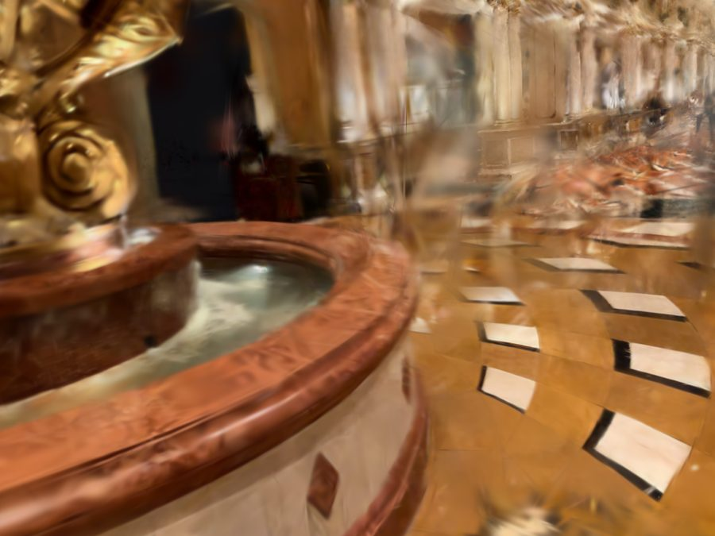
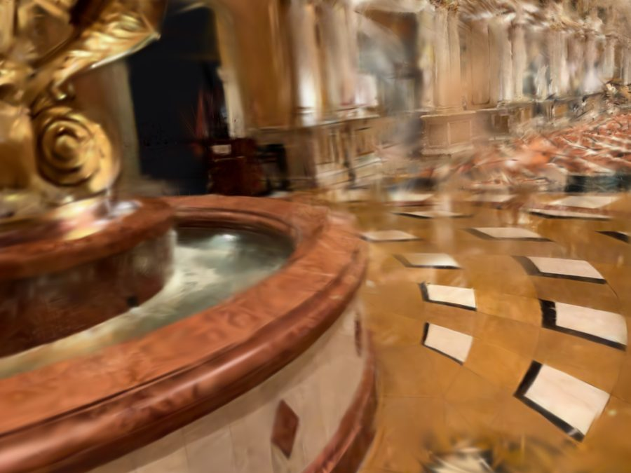
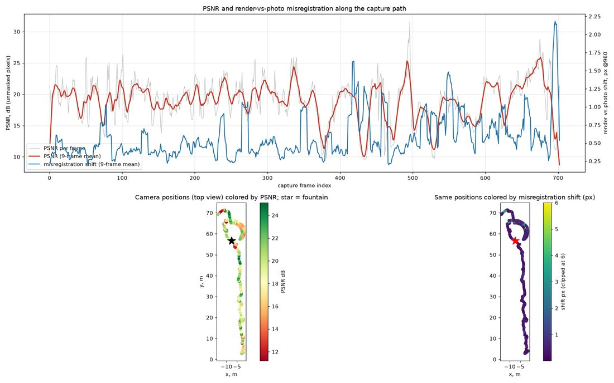

# GS Training Server — Feature Overview and User Manual

> Server version: `1.0.0`. This document describes the **actual behaviour of the code** in `gs_server/`,
> not only what older READMEs claim. Where the code behaves in a non-obvious way or disagrees with
> other documents, it is marked with ⚠️.

---

## Contents

1. [What this is](#1-what-this-is)
2. [Architecture](#2-architecture)
3. [Quick start in 5 minutes](#3-quick-start-in-5-minutes)
4. [Training modes: which one to choose](#4-training-modes-which-one-to-choose)
5. [Dataset format (Nerfstudio) and how to prepare it](#5-dataset-format-nerfstudio-and-how-to-prepare-it)
6. [Job lifecycle](#6-job-lifecycle)
7. [API reference](#7-api-reference)
8. [End-to-end scenarios with code](#8-end-to-end-scenarios-with-code)
9. [Training and processing parameters](#9-training-and-processing-parameters)
10. [Post-processing: floater filters](#10-post-processing-floater-filters)
11. [Masks: overexposure, people, dynamic objects](#11-masks-overexposure-people-dynamic-objects)
12. [Video preview and camera positions](#12-video-preview-and-camera-positions)
13. [How to evaluate model quality](#13-how-to-evaluate-model-quality)
14. [Operating the production server](#14-operating-the-production-server)
15. [Troubleshooting](#15-troubleshooting)
16. [Known limitations and quirks](#16-known-limitations-and-quirks)
17. [Recipes: what to enable in which situation](#17-recipes-what-to-enable-in-which-situation)
18. [Appendix: job directory layout](#18-appendix-job-directory-layout)

---

## 1. What this is

**GS Training Server** is an HTTP service that turns a set of photographs (and, optionally, LiDAR/IMU data)
into a trained **3D Gaussian Splatting** model: a `.ply` file that opens in any 3DGS viewer.

What the server can do:

| Capability | In short |
|---|---|
| Data intake | Photos in batches or in chunks, a point cloud `.ply`, or a ready-made dataset that already sits on the server's disk |
| 4 training modes | COLMAP from photos · ready dataset · hybrid "COLMAP + external cloud" · hybrid "known poses + extra triangulation" |
| Reconstruction | COLMAP (GPU SIFT, exhaustive/sequential/... matching, mapper, undistortion) |
| Training | Brush (Rust/wgpu) with local extensions: depth loss, position anchor, anisotropy regularisation, photo-consistency tracking |
| Masks | Overexposure (default in `hybrid_known_poses`), people (DeepLabV3), dynamic objects for COLMAP modes |
| Post-processing | Needle-floater filter, isolated-cluster filter, optional photometric filter |
| Queue | One job is processed at a time, the rest wait in a FIFO queue |
| Progress | REST polling, WebSocket, PSNR/SSIM/splat count/ETA metrics |
| Delivery | Download the final model and intermediate exports |
| Preview | Flythrough video along the capture trajectory (on request) and a set of good starting cameras |
| Resilience | Each job's state is kept on disk (`state.json`); after a service restart interrupted jobs are queued again |
| Documentation | Swagger UI at `/docs`, ReDoc at `/redoc` |

---

## 2. Architecture

```
                    ┌────────────────────────────────────────────────────────┐
                    │                GCP VM  gs-training-server              │
                    │             (NVIDIA L4 24 GB, Ubuntu, 8 vCPU)          │
                    │                                                        │
   Client           │   ┌──────────────┐    ┌───────────────────────────┐    │
 (curl / Python /   │   │  FastAPI     │    │       JobManager          │    │
  browser /   ──────┼──▶│  gs_server   │───▶│  • job dict + disk state  │    │
  your own app)     │   │  :8080       │    │  • queue (1 worker)       │    │
        ▲           │   │  REST + WS   │◀───│  • WebSocket subscribers  │    │
        │           │   └──────┬───────┘    └────────────┬──────────────┘    │
        │           │          │                         │ one job at a time │
        │           │          │ download                ▼                   │
        │           │          │ .ply / .mp4   ┌───────────────────────┐     │
        └───────────┼──────────┘               │       Pipeline        │     │
                    │                          │ EXIF → masks → COLMAP │     │
                    │   Files on disk          │  → Brush → filters    │     │
                    │   jobs/<job_id>/...      └───────────────────────┘     │
                    └────────────────────────────────────────────────────────┘
```

Key facts:

- A single process (`workers=1`); job state lives in memory and is mirrored to `jobs/<id>/state.json`.
- **Exactly one job is processed at a time** (a shared `asyncio.Lock`). New jobs wait in the queue.
- Preview rendering uses the GPU in parallel with training, but two previews never render simultaneously (global lock).
- CORS is open to any origin (`*`), so the API can be called straight from a browser.
- There is no authentication. Access is restricted only by the GCP firewall (see [section 14](#14-operating-the-production-server)).

### Pipeline per mode

```
POST /jobs ──▶ training_mode?
│
├─ colmap_images
│     upload photos + upload/complete
│     → EXIF normalisation → [DeepLabV3 masks, if enabled globally]
│     → COLMAP: features → matching → mapper → undistortion ─────────────┐
│                                                                         │
├─ hybrid_colmap_pointcloud                                               │
│     upload photos + points3d.ply                                        │
│     → EXIF → [masks] → COLMAP                                           │
│     → replace COLMAP's sparse cloud with the external points3d.ply ─────┤
│                                                                         │
├─ pointcloud_only                                                        │
│     dataset_path on the server                                          │
│     → COLMAP skipped ───────────────────────────────────────────────────┤
│                                                                         │
└─ hybrid_known_poses                                                     │
      dataset_path on the server (transforms.json + points3d.ply + images)│
      → COLMAP: features + exhaustive matching                            │
      → point_triangulator with the KNOWN poses                           │
        (+ optional selective bundle adjustment)                          │
      → point filters, merge with the LiDAR cloud                         │
      → masks: overexposure, optional people ─────────────────────────────┤
                                                                          ▼
                       Brush training (exports model_N.ply every 2500 steps)
                                      │
                                      ▼
                   needle filter → isolated-cluster filter
                                      │
                                      ▼
                         model_N_filtered.ply  →  status: completed
```

---

## 3. Quick start in 5 minutes

Assume the server is reachable at `http://<SERVER>:8080`. For the production VM the external IP is shown by
`gcloud compute instances describe gs-training-server ...` (see [section 14](#14-operating-the-production-server)).

**Step 0 — check that the server is alive:**

```bash
curl http://<SERVER>:8080/status
```
```json
{"status":"running","version":"1.0.0","active_jobs":0,"queued_jobs":0,"completed_jobs":12,
 "gpu_available":true,"colmap_version":null,"brush_version":null}
```

**Step 1 — create a job** (the default mode is COLMAP from photos):

```bash
curl -X POST http://<SERVER>:8080/jobs \
  -H "Content-Type: application/json" \
  -d '{"name":"my_scene","brush_config":{"total_steps":30000,"max_resolution":1920}}'
```
```json
{"job_id":"b6675af5-c61c-421f-b6d3-0d68d50b8c60",
 "upload_url":"http://<SERVER>:8080/jobs/b6675af5-c61c-421f-b6d3-0d68d50b8c60/upload",
 "websocket_url":"ws://<SERVER>:8080/jobs/b6675af5-c61c-421f-b6d3-0d68d50b8c60/ws"}
```

**Step 2 — upload photos** (the form field is literally called `files`; you may call this endpoint repeatedly):

```bash
curl -X POST http://<SERVER>:8080/jobs/$JOB/upload \
  -F "files=@photos/IMG_0001.jpg" -F "files=@photos/IMG_0002.jpg" -F "files=@photos/IMG_0003.jpg"
```
```json
{"uploaded":3,"total_images":3,"total_size_bytes":8123456}
```

**Step 3 — tell the server the upload is finished** (this is what starts processing when `auto_start=true`):

```bash
curl -X POST http://<SERVER>:8080/jobs/$JOB/upload/complete
```
```json
{"status":"upload_complete","images_count":3,"total_size_bytes":8123456}
```

**Step 4 — watch progress:**

```bash
curl http://<SERVER>:8080/jobs/$JOB/progress
```

**Step 5 — download the model once `status == "completed"`:**

```bash
curl -o my_scene.ply http://<SERVER>:8080/jobs/$JOB/model
```

> Open `http://<SERVER>:8080/docs`: the same steps can be done with buttons in Swagger UI.

---

## 4. Training modes: which one to choose

### 4.1 Decision tree

```
Do you have ACCURATE camera poses from another source
(LiDAR / IMU / SLAM, e.g. Leica BLK2GO)?
│
├── YES ──▶ do you also have a coloured point cloud (points3d.ply)?
│           │
│           ├── YES ──▶  hybrid_known_poses   ★ best choice for LiDAR scans
│           │            (poses are not re-estimated, COLMAP only adds points)
│           │
│           └── YES, and you want to train "as is", with no COLMAP ──▶ pointcloud_only
│
└── NO ───▶ do you have an external point cloud that you want to use
            instead of COLMAP's sparse cloud?
            │
            ├── YES ──▶ hybrid_colmap_pointcloud
            └── NO  ──▶ colmap_images   (photos only)
```

### 4.2 Summary table

| Mode | Where poses come from | What to upload / specify | Upload over HTTP? | COLMAP | Start |
|---|---|---|---|---|---|
| `colmap_images` | COLMAP estimates them | Photos only | yes (`/upload`) | full (mapper) | after `/upload/complete` |
| `hybrid_colmap_pointcloud` | COLMAP estimates them | Photos + `points3d.ply` | yes (`/upload` + `/pointcloud`) | full (mapper) | after `/upload/complete` |
| `pointcloud_only` | dataset's `transforms.json` | `dataset_path` on the server | **no**: files are already on the server | skipped | immediately on creation (`auto_start=true`) |
| `hybrid_known_poses` | dataset's `transforms.json` (not re-estimated\*) | `dataset_path` on the server | **no**: files are already on the server | features + matching + triangulator only | immediately on creation (`auto_start=true`) |

\* except for the optional selective bundle adjustment, see [section 9.3](#93-colmap_config).

### 4.3 Modes in detail

**`colmap_images`**: the classic route. Photos → EXIF normalisation → (optional DeepLab masks) →
COLMAP (`feature_extractor` → matcher → `mapper` → `image_undistorter`) → Brush.
Downside: on low-texture surfaces (shiny metal, repeating patterns, glass facades) the mapper falls apart into disconnected fragments.

**`hybrid_colmap_pointcloud`**: the same as `colmap_images`, but after COLMAP its sparse point cloud is replaced
by your `points3d.ply` (copied to `colmap/dense/points3d.ply`). Use it when you have a denser initialisation but no reliable poses.
Without `pointcloud_path` the job fails with `hybrid_colmap_pointcloud mode requires pointcloud_path`.

**`pointcloud_only`**: Brush runs directly on a ready dataset (`transforms.json` + `points3d.ply` + `images/`).
Nothing is recomputed. Fast, but the point cloud stays exactly as you prepared it.
Without `dataset_path` the job fails with `pointcloud_only mode requires dataset_path`.

**`hybrid_known_poses`**: the poses in `transforms.json` are treated as **ground truth**. COLMAP does not "search" for poses;
it only:
1. extracts SIFT features and matches all pairs (exhaustive; about 35–40 minutes for 703 images);
2. runs `point_triangulator` with your poses, producing a photogrammetric cloud **in the same coordinate frame** as your poses;
3. filters it (bounding-box filter against the LiDAR cloud + track length ≥ 3);
4. cleans the LiDAR cloud (statistical outlier removal, yielding space to COLMAP points) and merges the two;
5. creates a new dataset in `jobs/<id>/inputs/hybrid_dataset/` and trains Brush on it.

This is the only mode whose result can be better than either source alone, and in which poses never "drift".

### 4.4 Backward compatibility

If `training_mode` is not given, the server chooses it like this: `skip_colmap=true` → `pointcloud_only`,
otherwise → `colmap_images`.

---

## 5. Dataset format (Nerfstudio) and how to prepare it

The `pointcloud_only` and `hybrid_known_poses` modes need a directory **on the server's disk**
(its path goes into `dataset_path`). It cannot be uploaded over HTTP; copy it with `scp` / `gcloud compute scp`.

### 5.1 Layout

```
<dataset_path>/
├── transforms.json          ← required: poses and intrinsics
├── points3d.ply             ← coloured point cloud (splat initialisation)
├── images/                  ← required: frames (ONE flat directory, no subfolders)
│   ├── frame_000001.jpg
│   └── ...
├── depth/                   ← optional: depth maps (for depth_loss_weight)
│   ├── frame_000001.png
│   └── ...
└── masks/                   ← optional: Brush picks up masks/<stem>.png on its own
    └── frame_000001.png        (0 = exclude from the loss, 255 = use)
```

### 5.2 `transforms.json`

```json
{
  "camera_model": "OPENCV",
  "fl_x": 1456.2, "fl_y": 1456.1, "cx": 960.0, "cy": 720.0,
  "w": 1920, "h": 1440,
  "k1": 0.0, "k2": 0.0, "p1": 0.0, "p2": 0.0,
  "frames": [
    {
      "file_path": "images/frame_000001.jpg",
      "fl_x": 1456.2, "fl_y": 1456.1, "cx": 960.0, "cy": 720.0,
      "w": 1920, "h": 1440,
      "transform_matrix": [[ "... 4x4 camera-to-world matrix, NeRF convention ..." ]]
    }
  ]
}
```

Things to know:

- `transform_matrix` is a **camera-to-world matrix in the NeRF convention** (the Y and Z columns of the OpenCV matrix
  are multiplied by -1). The server applies the inverse conversion internally for COLMAP.
- Intrinsics are read **per frame** (`fl_x`, `fl_y`, `cx`, `cy`, `w`, `h`; optionally `k1,k2,p1,p2`).
- Units are **metres**. If your source exports centimetres or millimetres, scale during conversion
  (`--pose-scale 0.01`), otherwise the point cloud and the poses end up at different scales.
- `file_path` may look like `images/xxx.jpg`, but the server resolves each frame as
  `<dataset>/images/<basename of file_path>`: **images must live in one flat directory**.
- The optional field `ply_file_path` points to the point cloud (default `points3d.ply`).

### 5.3 Preparing data from a Leica BLK2GO

The repository root contains a converter, `leica_to_nerfstudio.py`:

```
Input:  <data-dir>/images/              RGB frames (JPEG 1920x1440)
        <data-dir>/depth/               depth maps
        <data-dir>/*_intrinsics.txt     per-frame intrinsics (CSV)
        <data-dir>/*_SensorFrames.txt   4x4 c2w matrices (OpenCV convention)
        <e57>                           point cloud used for initialisation

Output: <out>/images/ · transforms.json · points3d.ply
```

```bash
python leica_to_nerfstudio.py \
  --data-dir "D:\scans\2026-06-28 Nico Office" \
  --e57 "D:\scans\2026-06-28 Nico Office\scan.e57" \
  --out D:\scans\NicoOffice_nerfstudio \
  --e57-step 2 --max-pts 50000
  # --pose-scale 0.01   if the poses are in centimetres
  # --no-ply            skip extracting the cloud from the E57
  # --no-copy           do not copy the images
```

After conversion, copy the dataset to the server:

```bash
gcloud compute scp --recurse D:\scans\NicoOffice_nerfstudio \
  gs-training-server:/home/anoma/data_prepared/NicoOffice \
  --zone=us-central1-a --project=dgs-training
```

---

## 6. Job lifecycle

### 6.1 Statuses

```
 POST /jobs
     │
     ▼
 pending ── POST /upload ──▶ uploading ── POST /upload/complete ──▶ uploaded
     │                                                                  │
     │  dataset_path modes: auto-start on creation, or POST /start      │ auto_start or POST /start
     └───────────────────────────────┬──────────────────────────────────┘
                                     ▼
                              colmap_running ───── error ────▶ colmap_failed
                                     │ ok
                                     ▼
                               colmap_done
                                     │
                                     ▼
                                 training ──────── error ────▶ training_failed
                                     │ ok
                                     ▼
                                 completed

 pending / uploaded ── POST /cancel ──▶ cancelled
 pending ── missing dataset_path / pointcloud_path ──▶ failed
 colmap_failed, training_failed, failed, cancelled ── POST /restart ──▶ uploaded (and re-queued)
```

| Status | Meaning |
|---|---|
| `pending` | Created, waiting for data or for the queue |
| `uploading` | Files are being uploaded |
| `uploaded` | Upload finished (`/upload/complete`) |
| `colmap_running` | COLMAP (or known-pose triangulation) is running |
| `colmap_done` | COLMAP finished, waiting for Brush |
| `colmap_failed` | COLMAP / triangulation error |
| `training` | Brush is training |
| `training_failed` | Training error |
| `completed` | Done, the model is available |
| `failed` | Generic error (required fields missing, exception in the worker) |
| `cancelled` | Cancelled by the user |

⚠️ The value `training_done` is declared in the enum but is never set anywhere in the code: after training a job goes straight to `completed`.

### 6.2 Progress scale (`overall_progress`, 0–100)

```
0 ──── 2 ── 5 ───────────────────── 50 ─────────────────────────── 100
│      │    │                        │                               │
│      │    │◀─ COLMAP / known-pose ─▶│◀─ Brush: 50 + 50·step/total ─▶│
│      │    └ upload/complete = 5     └ COLMAP_DONE = 50              └ completed
│      └ EXIF normalisation = 2
└ created
```

Inside the first half for `hybrid_known_poses`: database and features ≈ 5–15, matching 15–35,
writing the model 35, triangulation 40, bundle adjustment 45, cloud merge 46, masks 48, done 50.

### 6.3 What happens when the service restarts

- Jobs in `colmap_running` or `training` get status `pending` on startup and are
  **queued again, from the very beginning** (there are no checkpoints).
- A preview that was rendering at the moment of the restart is marked `failed` ("Interrupted by server restart").
- Completed, failed and cancelled jobs are simply loaded from disk.

⚠️ That is why you must **always check for an active job before `systemctl restart gs-server`** (see [section 14](#14-operating-the-production-server)).

---

## 7. API reference

Base URL: `http://<SERVER>:8080`. All bodies are JSON except uploads (`multipart/form-data`).
Errors arrive as `{"detail": "..."}` with status 400/404/409/422/500.

### 7.1 Endpoint map

```
Info      GET    /                                   name, version, link to /docs
          GET    /status                             server summary

Jobs      POST   /jobs                               create a job
          GET    /jobs                               list (status, limit, offset)
          GET    /jobs/{id}                          full information
          GET    /jobs/{id}/progress                 progress only
          DELETE /jobs/{id}                          delete (not a running one)
          POST   /jobs/{id}/start                    start manually (+ overrides)
          POST   /jobs/{id}/cancel                   cancel
          POST   /jobs/{id}/restart                  restart a failed/cancelled job

Upload    POST   /jobs/{id}/upload                   photos in a batch (field "files")
          POST   /jobs/{id}/upload/chunk             photos in chunks
          POST   /jobs/{id}/upload/complete          "upload finished"
          POST   /jobs/{id}/pointcloud               whole points3d.ply
          POST   /jobs/{id}/pointcloud/chunk         points3d.ply in chunks

Download  GET    /jobs/{id}/model                    final model (.ply)
          GET    /jobs/{id}/model/info               model metadata
          GET    /jobs/{id}/exports                  all .ply exports
          GET    /jobs/{id}/exports/{filename}       one specific export

Preview   POST   /jobs/{id}/preview                  start rendering a video
          GET    /jobs/{id}/preview                  render status
          GET    /jobs/{id}/preview/download         download the .mp4
          GET    /jobs/{id}/camera_positions         "good" starting cameras

Realtime  WS     /jobs/{id}/ws                       push progress updates
Logs      GET    /jobs/{id}/logs                     ⚠️ see below: currently always empty
```

### 7.2 Info

**`GET /status`**

| Field | Meaning |
|---|---|
| `status` | always `"running"` |
| `version` | server version |
| `active_jobs` | jobs in `colmap_running` + `training` |
| `queued_jobs` | jobs in `pending` + `uploaded` |
| `completed_jobs` | jobs in `completed` |
| `gpu_available` | ⚠️ simply the value of `COLMAP_USE_GPU`; there is no real GPU check |
| `colmap_version`, `brush_version` | currently always `null` |

Statistics are computed over the first 1000 jobs.

### 7.3 Creating a job: `POST /jobs`

Body (`CreateJobRequest`):

| Field | Type | Default | Description |
|---|---|---|---|
| `name` | string, 1–256 | **required** | Name; becomes part of the downloaded file name `<name>_model.ply` |
| `training_mode` | enum | `null` | `colmap_images` / `pointcloud_only` / `hybrid_colmap_pointcloud` / `hybrid_known_poses` |
| `dataset_path` | string | `null` | Path **on the server** to a dataset (for `pointcloud_only`, `hybrid_known_poses`) |
| `pointcloud_path` | string | `null` | Path **on the server** to `points3d.ply` (for `hybrid_colmap_pointcloud`, if you do not upload through `/pointcloud`) |
| `auto_start` | bool | `true` | Start processing automatically |
| `brush_config` | object | `null` | Training overrides, see [section 9.1](#91-brush_config) |
| `colmap_config` | object | `null` | COLMAP overrides, see [section 9.3](#93-colmap_config) |
| `hybrid_config` | object | `null` | `hybrid_known_poses` options, see [section 9.4](#94-hybrid_config) |
| `skip_colmap` | bool | `false` | Legacy flag (= `pointcloud_only`) |
| `description` | string | `null` | Accepted but never stored |

⚠️ **The three configuration blocks, `colmap_config`, `brush_config` and `hybrid_config`, are top-level fields of the request body.**
A construction such as `{"config": {"brush": {...}}}` is silently discarded (the job then trains with defaults and nothing errors).
After creating a job, check that `GET /jobs/{id}` shows your options under `config`.

Response:

```json
{"job_id":"...","upload_url":"http://<SERVER>:8080/jobs/<id>/upload","websocket_url":"ws://<SERVER>:8080/jobs/<id>/ws"}
```

The base URLs in the response are built from the address you actually used to reach the server.

Auto-start: for `pointcloud_only` and `hybrid_known_poses`, with `auto_start=true` and a `dataset_path` given, the job enters the queue
**immediately on creation**: there is nothing to upload and no need to call `/start`.

Example request bodies:

```jsonc
// 1. Classic, from photos
{"name":"scene_colmap","training_mode":"colmap_images",
 "brush_config":{"total_steps":30000,"max_resolution":1920}}

// 2. Ready dataset, no COLMAP
{"name":"scene_ready","training_mode":"pointcloud_only",
 "dataset_path":"/home/anoma/data_prepared/NewScan"}

// 3. Hybrid "COLMAP + external cloud", started manually after uploading
{"name":"scene_hybrid","training_mode":"hybrid_colmap_pointcloud","auto_start":false}

// 4. Known poses + extra triangulation + person masks
{"name":"MyScan","training_mode":"hybrid_known_poses",
 "dataset_path":"/home/anoma/data_prepared/MyScan",
 "hybrid_config":{"person_mask_enabled":true,"person_mask_dilate_px":25},
 "brush_config":{"total_steps":30000,"max_resolution":1920}}
```

### 7.4 Reading state

**`GET /jobs/{id}`** → `JobInfo`:

```json
{
  "job_id": "b6675af5-c61c-421f-b6d3-0d68d50b8c60",
  "name": "MyScan",
  "status": "training",
  "progress": { "...": "see below" },
  "created_at": "2026-10-05T09:12:44.120000",
  "updated_at": "2026-10-05T10:31:07.554000",
  "started_at": "2026-10-05T09:13:01.002000",
  "completed_at": null,
  "images_count": 703,
  "total_size_bytes": 612345678,
  "model_path": null,
  "model_size_bytes": null,
  "preview_status": "not_requested",
  "preview_error": null,
  "config": { "colmap": {}, "brush": {"total_steps": 30000}, "hybrid_known_poses": {"person_mask_enabled": true},
              "training_mode": "hybrid_known_poses", "dataset_path": "/.../hybrid_dataset", "auto_start": true }
}
```

**`GET /jobs/{id}/progress`** → `JobProgress`:

```json
{
  "overall_progress": 71.4,
  "status": "training",
  "colmap": {
    "stage": "image_undistortion", "stage_progress": 100.0,
    "images_processed": 0, "total_images": 0, "features_extracted": 0,
    "matches_found": 0, "registered_images": 0, "points_3d": 0, "message": "Completed"
  },
  "training": {
    "current_step": 12840, "total_steps": 30000,
    "steps_per_second": 9.7, "elapsed_seconds": 1323.4, "eta_seconds": 1766.0,
    "current_loss": null, "psnr": 19.12, "ssim": 0.74, "splat_count": 1638948,
    "last_export_step": 12500, "last_export_path": ".../output/model_12500.ply"
  },
  "message": "Step 12840/30000",
  "error": null
}
```

COLMAP stages (`colmap.stage`): `feature_extraction` → `feature_matching` → `sparse_reconstruction` → `image_undistortion`.
`psnr`/`ssim` are refreshed once per `eval_every` steps (1000 by default) and are computed by Brush on
training/evaluation frames; see the caveat in [section 13](#13-how-to-evaluate-model-quality).

**`GET /jobs?status=training&limit=50&offset=0`**: a list, newest first. `limit` ≤ 100.
⚠️ The `total` field in the response equals the number of jobs **on this page**, not the overall count.

### 7.5 Control

| Request | What it does | Restrictions |
|---|---|---|
| `POST /jobs/{id}/start` | Puts the job in the queue. The body is optional (`StartTrainingRequest`: `training_mode`, `dataset_path`, `pointcloud_path`, `skip_colmap`, `brush_config`) | Only from `pending` / `uploaded` / `colmap_done`, otherwise `400 Cannot start job (invalid status)` |
| `POST /jobs/{id}/cancel` | Sets `cancelled` | ⚠️ **Does not kill an already running COLMAP/Brush process.** Reliable for a job waiting in the queue; not for a running one (see [section 16](#16-known-limitations-and-quirks)) |
| `POST /jobs/{id}/restart` | Wipes `colmap/` and `output/`, resets to `uploaded`, queues the job | Only from `colmap_failed` / `training_failed` / `failed` / `cancelled` |
| `DELETE /jobs/{id}` | Deletes the whole job directory | `400` for `uploading` / `colmap_running` / `training` |

⚠️ In `/start`, `brush_config` is **merged into** the existing one (`{**old, **new}`) rather than replacing it;
`colmap_config` and `hybrid_config` are not accepted by `/start`: set them when creating the job.

### 7.6 Uploading

**Photos in a batch: `POST /jobs/{id}/upload`** (`multipart`, field `files`, repeatable):

- Allowed extensions: `.jpg .jpeg .png .bmp .tiff .tif .webp`. **All other files are skipped silently.**
- Accepted only in statuses `pending` / `uploading`, otherwise `400 Job is not accepting uploads`.
- Files with the same name are overwritten. The name is taken without its path (`Path(name).name`).
- Response: `{"uploaded": N, "total_images": M, "total_size_bytes": S}` (M and S cover the whole job directory).
- The `GS_MAX_UPLOAD_GB` limit is declared in the config but ⚠️ **is not applied in the upload code**.

Sending 20–50 files per request is recommended.

**Photos in chunks: `POST /jobs/{id}/upload/chunk`** (for very large files):

| Form field | Meaning |
|---|---|
| `filename` | Final file name |
| `chunk_index` | Chunk number, zero-based |
| `total_chunks` | Total number of chunks |
| `chunk` | Binary data of the chunk (a file) |

Response while chunks are still missing: `{"status":"chunk_received","chunk_index":3,"received_chunks":4,"total_chunks":10}`.
When the last one arrives: `{"status":"complete","filename":"big.jpg"}`, and the chunks are concatenated into `images/<filename>`.
Chunks may be sent in any order and repeated; assembly triggers when the number of received chunks equals `total_chunks`.

**`POST /jobs/{id}/upload/complete`**: "all photos are uploaded". Counts the images, sets `uploaded`
(progress 5 %) and, if `auto_start=true`, **starts processing**. With no photos: `400 No images uploaded`.

**Point cloud** (`hybrid_colmap_pointcloud`):

- `POST /jobs/{id}/pointcloud`: `multipart`, field `file`, `.ply` only. Saved as `inputs/points3d.ply`,
  and the path is recorded in the job config. Response: `{"status":"pointcloud_uploaded","filename":...,"saved_as":...,"size_bytes":...}`.
- `POST /jobs/{id}/pointcloud/chunk`: the same fields as `/upload/chunk` (`filename`, `chunk_index`, `total_chunks`, `chunk`);
  `filename` must end in `.ply`. After the last chunk: `{"status":"complete",...}`.

Order for the hybrid mode: **cloud first, then `/upload/complete`** (otherwise the job starts without a `pointcloud_path` and fails).

### 7.7 Downloading

| Request | Result |
|---|---|
| `GET /jobs/{id}/model` | The final `.ply` (`<name>_model.ply`, `application/octet-stream`). Only for `completed`, otherwise `400 Training not completed` |
| `GET /jobs/{id}/model/info` | `ModelInfo`, example below |
| `GET /jobs/{id}/exports` | `{"exports":[{"filename","size_bytes","created_at"}, ...]}`: every `*.ply` in `output/` |
| `GET /jobs/{id}/exports/{filename}` | Any file from the list above (including intermediates such as `model_2500.ply`) |

```json
{
  "job_id": "...", "model_path": "/home/anoma/gs_server/jobs/.../output/model_30000_filtered.ply",
  "model_size_bytes": 387654321, "format": "ply",
  "training_steps": 30000, "final_psnr": 19.3, "final_ssim": 0.76, "splat_count": 1612233,
  "created_at": "2026-10-05T11:02:15.100000",
  "download_url": "http://<SERVER>:8080/jobs/.../model"
}
```

What lies in `output/` and what `/model` serves:

```
output/
├── model_2500.ply            ┐ intermediate exports (every export_every steps)
├── model_5000.ply            │ — raw, no filters
├── ...                       ┘
├── model_30000.ply           ← final raw model
└── model_30000_filtered.ply  ← after the filters; this is what GET /model serves
```

If the filters are disabled or removed nothing, `/model` returns `model_30000.ply`.

### 7.8 WebSocket: `ws://<SERVER>:8080/jobs/{id}/ws`

- A nonexistent `job_id` → the connection is closed with code `4004`.
- Right after connecting you receive `initial` with the full `JobInfo`, then events follow.

Message format:

```json
{"type":"progress","job_id":"...","data":{ /* JobProgress */ },"timestamp":"2026-10-05T10:31:07.554000"}
```

| `type` | When | `data` |
|---|---|---|
| `initial` | right after connecting | `JobInfo` |
| `progress` | any progress update | `JobProgress` |
| `upload_complete` | after `/upload/complete` | `{images_count, total_size}` |
| `completed` | model ready | `{model_path, model_size}` |
| `error` | job failed (`failed`) | `{error}` |
| `cancelled` | cancellation | `{message}` |
| `preview_completed` | preview ready | `{stats}` |
| `preview_failed` | preview failed | `{error}` |

⚠️ **The keep-alive is not JSON.** If the client is silent for 30 seconds the server sends a plain text frame `ping`;
if the client sends the text frame `ping`, the server answers `pong`. Your client must either catch the JSON-parse exception
or compare `message == "ping"` before calling `json.loads`.

`colmap_failed` / `training_failed` events arrive as `progress` with the corresponding `status` and an `error` field.

### 7.9 Logs: `GET /jobs/{id}/logs?tail=100`

⚠️ This endpoint reads the file `jobs/<id>/log.txt`, **which no server module ever creates**,
so the response is always `{"logs": []}`. The real logs are in the systemd journal:

```bash
sudo journalctl -u gs-server -f          # on the VM
```

Pipeline lines carry prefixes such as `[KNOWN-POSE-COLMAP]` and `[BRUSH]`. The current stage message is always available in
`progress.message`, and errors in `progress.error`.

---

## 8. End-to-end scenarios with code

### 8.1 Request sequence for `colmap_images`

```
Client                         GS Server                       Queue / worker
  │  POST /jobs {name, mode}       │                                  │
  │───────────────────────────────▶│                                  │
  │◀───────────────────────────────│ {job_id, upload_url, ws_url}     │
  │                                │                                  │
  │  (repeat in batches of 20-50 files)                               │
  │  POST /jobs/{id}/upload        │                                  │
  │───────────────────────────────▶│                                  │
  │◀───────────────────────────────│ {uploaded, total_images}         │
  │                                │                                  │
  │  POST /jobs/{id}/upload/complete                                  │
  │───────────────────────────────▶│  enqueue (auto_start)            │
  │                                │─────────────────────────────────▶│
  │◀───────────────────────────────│ {status: "upload_complete"}      │
  │                                │                                  │
  │  WS /jobs/{id}/ws              │                                  │ EXIF → COLMAP
  │◀══════════════════════════════▶│ initial                          │  → Brush
  │◀───────────────────────────────│ progress ... progress ...        │  → filters
  │◀───────────────────────────────│ completed                        │
  │                                │                                  │
  │  GET /jobs/{id}/model          │                                  │
  │───────────────────────────────▶│                                  │
  │◀───────────────────────────────│ model.ply                        │
```

### 8.2 Python: a full cycle from photographs

```python
import time
from pathlib import Path
import requests

SERVER = "http://<SERVER>:8080"
PHOTOS = sorted(Path("photos").glob("*.jpg"))

# 1. create the job
job = requests.post(f"{SERVER}/jobs", json={
    "name": "my_scene",
    "training_mode": "colmap_images",
    "brush_config": {"total_steps": 30000, "max_resolution": 1920},
}).json()
job_id = job["job_id"]

# 2. upload photos in batches (the form field is "files")
BATCH = 30
for i in range(0, len(PHOTOS), BATCH):
    batch = PHOTOS[i:i + BATCH]
    handles = [open(p, "rb") for p in batch]
    try:
        files = [("files", (p.name, h, "image/jpeg")) for p, h in zip(batch, handles)]
        r = requests.post(f"{SERVER}/jobs/{job_id}/upload", files=files, timeout=600)
        r.raise_for_status()
        print(r.json())
    finally:
        for h in handles:
            h.close()

# 3. finish the upload -> processing starts
requests.post(f"{SERVER}/jobs/{job_id}/upload/complete").raise_for_status()

# 4. wait
while True:
    info = requests.get(f"{SERVER}/jobs/{job_id}").json()
    p = info["progress"]
    t = p.get("training") or {}
    print(f'{info["status"]:<16} {p["overall_progress"]:5.1f}%  {p["message"]}  '
          f'PSNR={t.get("psnr")}  splats={t.get("splat_count")}')
    if info["status"] in ("completed", "failed", "colmap_failed", "training_failed", "cancelled"):
        break
    time.sleep(15)

# 5. download
if info["status"] == "completed":
    with requests.get(f"{SERVER}/jobs/{job_id}/model", stream=True) as r:
        r.raise_for_status()
        with open("my_scene.ply", "wb") as f:
            for chunk in r.iter_content(1 << 20):
                f.write(chunk)
else:
    print("Error:", info["progress"]["error"])
```

Sample polling output (illustrative: numbers and the wording of COLMAP-stage messages depend on version and scene):

```
uploaded           5.0%  Uploaded 120 images
colmap_running    18.0%  <message of the current COLMAP stage>
training          52.1%  Step 1260/30000  PSNR=None  splats=215040
training          71.4%  Step 12840/30000  PSNR=19.12  splats=1638948
completed        100.0%  Training completed  PSNR=19.3  splats=1612233
```

Training progress is computed as `50 + 50 · current_step / total_steps`.

### 8.3 Python: `hybrid_known_poses` on a dataset that is already on the server

```python
import time, requests
SERVER = "http://<SERVER>:8080"

job = requests.post(f"{SERVER}/jobs", json={
    "name": "MyScan",
    "training_mode": "hybrid_known_poses",
    "dataset_path": "/home/anoma/data_prepared/MyScan",   # path ON THE SERVER
    "hybrid_config": {"person_mask_enabled": True},
    "brush_config": {"total_steps": 30000, "max_resolution": 1920},
}).json()
# nothing to upload and no /start needed: the job is already queued
job_id = job["job_id"]

while True:
    info = requests.get(f"{SERVER}/jobs/{job_id}").json()
    print(info["status"], info["progress"]["overall_progress"], info["progress"]["message"])
    if info["status"] in ("completed", "colmap_failed", "training_failed", "failed", "cancelled"):
        break
    time.sleep(30)
```

Messages along the way (wording taken from the code; numbers in the example are illustrative):

```
colmap_running  5.0  Known-pose triangulation: creating database...
colmap_running  8.0  Known-pose triangulation: extracting features...
colmap_running 15.0  Known-pose triangulation: matching features (exhaustive)...      <- ~35-40 min for 703 frames
colmap_running 40.0  Known-pose triangulation: triangulating points...
colmap_running 46.0  Known-pose triangulation: denoising LiDAR cloud and merging 412,903 COLMAP points ...
colmap_running 48.0  Generating person masks (DeepLabV3)...
colmap_done   50.0  Known-pose triangulation done: 412,903 COLMAP points + 1,204,117 LiDAR points = 1,617,020 total
training      52.0  Step .../30000
```

### 8.4 `hybrid_colmap_pointcloud` (photos + your own cloud)

```bash
# 1. create, but do not auto-start
JOB=$(curl -s -X POST $S/jobs -H 'Content-Type: application/json' \
  -d '{"name":"scene_hybrid","training_mode":"hybrid_colmap_pointcloud","auto_start":false}' | jq -r .job_id)

# 2. photos
curl -X POST $S/jobs/$JOB/upload -F "files=@a.jpg" -F "files=@b.jpg" ...

# 3. point cloud (BEFORE upload/complete)
curl -X POST $S/jobs/$JOB/pointcloud -F "file=@points3d.ply"

# 4. finish the upload and start
curl -X POST $S/jobs/$JOB/upload/complete
curl -X POST $S/jobs/$JOB/start        # needed because auto_start=false
```

For a large `.ply`, upload in chunks:

```python
import math, requests
CH = 8 * 1024 * 1024
data = open("points3d.ply", "rb").read()
n = math.ceil(len(data) / CH)
for i in range(n):
    requests.post(f"{S}/jobs/{job_id}/pointcloud/chunk",
                  data={"filename": "points3d.ply", "chunk_index": i, "total_chunks": n},
                  files={"chunk": ("part", data[i*CH:(i+1)*CH])}).raise_for_status()
```

### 8.5 WebSocket client (Python)

```python
import asyncio, json, websockets

async def watch(job_id, server="ws://<SERVER>:8080"):
    async with websockets.connect(f"{server}/jobs/{job_id}/ws") as ws:
        async for raw in ws:
            if raw == "ping":              # keep-alive: NOT JSON!
                await ws.send("pong"); continue
            msg = json.loads(raw)
            if msg["type"] == "progress":
                p = msg["data"]
                print(f'{p["status"]} {p["overall_progress"]:.1f}% {p["message"]}')
            elif msg["type"] in ("completed", "error", "cancelled"):
                print(msg["type"], msg["data"]); break

asyncio.run(watch("b6675af5-c61c-421f-b6d3-0d68d50b8c60"))
```

JavaScript:

```javascript
const ws = new WebSocket(`ws://${SERVER}/jobs/${jobId}/ws`);
ws.onmessage = (e) => {
  if (e.data === "ping") { ws.send("pong"); return; }
  const msg = JSON.parse(e.data);
  if (msg.type === "progress") updateBar(msg.data.overall_progress, msg.data.message);
  if (msg.type === "completed") location.href = `http://${SERVER}/jobs/${jobId}/model`;
};
```

---

## 9. Training and processing parameters

Value precedence: **field in the job-creation request → server environment variable → default in `config.py`**.

### 9.1 `brush_config`

Main parameters:

| Key | Default | Description |
|---|---|---|
| `total_steps` | 30000 | Number of training iterations. The final file is named `model_<total_steps>.ply` |
| `max_resolution` | 1920 | Maximum image side during training (px) |
| `eval_every` | 1000 | How often to compute PSNR/SSIM |
| `export_every` | 2500 | How often to save an intermediate `model_N.ply` |
| `refine_every` | 200 | Refinement period (splat growth/pruning) |
| `max_splats` | 2000000 | Upper bound on splat count (the key only takes effect when set explicitly) |
| `lr_mean`, `lr_opac` | none | Learning rates for positions/opacity (forwarded only when set explicitly) |
| `growth_grad_threshold` | 0.006 | Gradient threshold for growth: higher means fewer new splats |
| `growth_select_fraction` | 0.12 | Fraction of candidates that actually get split/cloned |
| `stop_growth_at` | 12000 | Step after which growth stops |
| `opac_decay` | 1e-9 | `--opac-loss-weight` (Brush's own default) |
| `scale_decay` | 1e-8 | `--scale-loss-weight` |
| `ssim_weight` | 0.3 | Weight of SSIM in the loss |

Optional extensions (**everything is off by default**; with default values training and the exported PLY are
identical to stock Brush):

| Key | Default | What it does | When you need it |
|---|---|---|---|
| `depth_loss_weight` | 0.0 | Compares rendered depth with the maps in `depth/` next to `images/` | The dataset has per-frame depth (LiDAR/ARKit) |
| `depth_max_range` | 5.0 | Beyond this distance (m) depth is treated as missing | Uncapped far readings that look plausible but are wrong damage surfaces |
| `position_anchor_weight` | 0.0 | Pulls a splat toward the position of its source cloud point once it strays beyond `position_anchor_max_dist` | Geometry drift despite a good initialisation |
| `position_anchor_max_dist` | 0.2 | "Freedom" radius (scene units) | n/a |
| `aniso_reg_weight` | 0.0 | Penalty on the max/min axis ratio of a splat above a threshold | Long needles along silhouettes |
| `aniso_reg_ratio_threshold` | 50.0 | Axis ratio above which the penalty starts | n/a |
| `photo_consistency_enabled` | false | Accumulates each splat's photometric residual and writes it into the PLY (`photo_resid_avg`, `photo_resid_count`); never enters the loss | Diagnostics / the optional filter only |
| `photo_consistency_warmup_steps` | 15000 | Step from which accumulation starts | n/a |

> Note: penalty terms are normalised by the count of **violating** splats, not all visible
> ones; otherwise, with ~1.7 million splats, the sum either explodes (NaN) or is diluted to nothing.
> These options work correctly but gave no noticeable quality gain on the scenes tested, so enable
> them deliberately and compare the result with real photos (section 13.2).

Post-processing filter keys are also accepted in `brush_config`: [section 10](#10-post-processing-floater-filters).

### 9.2 Server environment variables

Set in the `Environment=` lines of the `gs-server.service` unit; changing them requires `daemon-reload` + `restart`.

| Variable | Default | Description |
|---|---|---|
| `GS_HOST` / `GS_PORT` | `0.0.0.0` / `8080` | Bind address and port |
| `GS_MAX_UPLOAD_GB` | 50 | ⚠️ read, but not applied |
| `GS_BASE_DIR` | parent of the package | Project root |
| `GS_JOBS_DIR` / `GS_UPLOADS_DIR` / `GS_MODELS_DIR` | `<base>/jobs`, `uploads`, `models` | Working directories |
| `GS_COLMAP_EXE` | `/usr/bin/colmap` (Linux), `colmap\bin\colmap.exe` (Windows) | Path to COLMAP |
| `GS_BRUSH_DIR` | `<base>/brush` | Brush sources |
| `GS_BRUSH_EXE` | none | Direct path to the Brush binary (otherwise `brush_dir/target/release/brush[.exe]` is searched, otherwise `cargo run`) |
| `COLMAP_USE_GPU` | `true` | GPU for SIFT/matching |
| `COLMAP_CAMERA_MODEL` | `SIMPLE_RADIAL` | Camera model |
| `COLMAP_SINGLE_CAMERA` | `false` | Shared intrinsics across the whole set |
| `COLMAP_MAX_IMAGE_SIZE` | 4500 | Maximum side for SIFT |
| `COLMAP_SIFT_MAX_FEATURES` | 32768 | Features per frame |
| `COLMAP_MATCHER_TYPE` | `exhaustive` | `exhaustive` / `sequential` / `spatial` / `vocab_tree` |
| `COLMAP_SEQUENTIAL_LOOP_DETECTION` | `false` | Loop-closure detection (for `sequential`) |
| `COLMAP_VOCAB_TREE_PATH` | none | Vocab-tree file. ⚠️ **Global only**: it cannot be set per job |
| `BRUSH_TOTAL_STEPS`, `BRUSH_MAX_RESOLUTION`, `BRUSH_EVAL_EVERY`, `BRUSH_EXPORT_EVERY` | see 9.1 | Global defaults |
| `BRUSH_FLOATER_FILTER_ENABLED`, `..._ANISO_THRESHOLD`, `..._SIZE_MULTIPLIER` | `true`, 1.01, 15 | Needle filter |
| `BRUSH_CLUSTER_FILTER_ENABLED`, `..._RADIUS_MULTIPLIER` | `true`, 5 | Cluster filter |
| `BRUSH_ANISO_REG_WEIGHT`, `..._RATIO_THRESHOLD` | 0, 50 | Global defaults for the option |
| `BRUSH_DEPTH_LOSS_WEIGHT`, `BRUSH_DEPTH_MAX_RANGE` | 0, 5 | Global defaults for the option |
| `BRUSH_POSITION_ANCHOR_WEIGHT`, `..._MAX_DIST` | 0, 0.2 | Global defaults for the option |
| `BRUSH_PHOTO_CONSISTENCY_ENABLED`, `..._WARMUP_STEPS` | `false`, 15000 | Residual tracking |
| `BRUSH_PHOTO_CONSISTENCY_FILTER_ENABLED`, `..._PERCENTILE`, `..._MIN_OBSERVATIONS` | `false`, 97.5, 30 | Photometric filter |
| `MASKING_ENABLED` | `false` (code default) | Global DeepLab masking for COLMAP modes. ⚠️ The production unit may set a different value: check `systemctl cat gs-server` |
| `MASKING_REMOVE_CLASSES` | bicycle, bus, car, cat, dog, motorbike, person | Classes that get masked |

### 9.3 `colmap_config`

| Key | Default | Modes | Description |
|---|---|---|---|
| `use_gpu` | `true` | all with COLMAP | GPU for features/matching |
| `camera_model` | `SIMPLE_RADIAL` | `colmap_images`, `hybrid_colmap_pointcloud` | `SIMPLE_PINHOLE`, `PINHOLE`, `OPENCV`, ... (always `OPENCV` in `hybrid_known_poses`) |
| `single_camera` | `false` | `colmap_images`, `hybrid_colmap_pointcloud` | `true` when all frames come from one camera |
| `max_image_size` | 4500 | all with COLMAP | Size used for SIFT |
| `matcher_type` | `exhaustive` | all with COLMAP | `exhaustive` / `sequential` / `spatial` / `vocab_tree` |
| `sequential_loop_detection` | `false` | `sequential` | Trajectory loop-closure detection (needs the vocab tree configured globally) |
| `sequential_overlap` | none | `sequential` | How many neighbouring frames to match |
| `selective_pose_refine_enabled` | `false` | `hybrid_known_poses` | Selective bundle adjustment (needs `pycolmap`): only frames with enough observations may move |
| `selective_pose_refine_min_percentile` | 50.0 | `hybrid_known_poses` | "Enough observations" threshold (percentile) |

Without `selective_pose_refine_enabled`, `hybrid_known_poses` runs bundle adjustment on **points only**:
poses and intrinsics are frozen. This is deliberate: free BA on low-texture scenes produced a "ghost" rotated copy of the cloud.

### 9.4 `hybrid_config`

For `hybrid_known_poses` only.

| Key | Default | Description |
|---|---|---|
| `colmap_min_track_length` | 3 | Minimum track length of a triangulated point (2 means weakly constrained points on silhouettes) |
| `sor_k` | 12 | Neighbour count of the LiDAR cloud's statistical outlier removal |
| `sor_std_ratio` | 2.5 | SOR threshold (in sigmas) |
| `colmap_priority_radius` | auto | Radius within which LiDAR points yield space to COLMAP points |
| `colmap_priority_radius_multiplier` | 1.5 | Multiplier for the automatic radius |
| `init_scale_clamp_enabled` | `true` | Clamp initial splat size by local density |
| `init_scale_clamp_percentile` | 90.0 | Percentile used for the clamp |
| `overexposure_mask_enabled` | `true` | Masks of overexposed pixels |
| `overexposure_threshold` | 250 | Brightness from which a pixel counts as overexposed |
| `person_mask_enabled` | `false` | People masks (DeepLabV3) |
| `person_mask_dilate_px` | 25 | Dilation of a person mask (px), to cover halo and shadow |

---

## 10. Post-processing: floater filters

After training (in execution order); each filter works on the previous one's output:

```
model_30000.ply
   │  (1) filter_needle_floaters           — by splat SHAPE/SIZE            (on by default)
   ▼
   │  (2) filter_isolated_clusters         — by SPATIAL ISOLATION           (on by default)
   ▼
   │  (3) filter_photometric_inconsistency — by photometric residual        (OFF by default)
   ▼
model_30000_filtered.ply   ← served by GET /model
```

| # | Filter | Keys (`brush_config`) | What it removes |
|---|---|---|---|
| 1 | Needle | `floater_filter_enabled` (true), `floater_filter_aniso_threshold` (1.01, i.e. practically no anisotropy cut), `floater_filter_size_multiplier` (15.0) | Large "glare blobs": splats larger than **15 × the median splat size of this very model**. The threshold is relative: an absolute cutoff would have discarded 59 % of a sparse COLMAP model |
| 2 | Isolated clusters | `cluster_filter_enabled` (true), `cluster_filter_radius_multiplier` (5.0) | Scattered "debris" around the scan that is not connected to the main structure. The connectivity graph is built from a bounded k-NN query (not `query_pairs`, which got the process OOM-killed on 2.4 M splats). A component lying entirely inside the main one's bounding box is not removed |
| 3 | Photometric | `photo_consistency_filter_enabled` (**false**), `..._percentile` (97.5), `..._min_observations` (30) | Splats with an extremely high "render vs photo" residual. Works only if the model was trained with `photo_consistency_enabled: true` |

⚠️ Filter 3 is **off for a reason**: in measurements against real photos it lowered PSNR
(18.15 → 17.53 → 17.24 dB at percentiles none / 97.5 / 95). It mostly removed large blurry
splats that nevertheless carry real image content. Use it only as a diagnostic tool.

The effect of the filters is visible in the service log (line format taken from the code, numbers in the example are illustrative):

```
[BRUSH] Floater filter removed 8021 (0.5%) needle splats (median splat size 0.0071, threshold 0.1065)
[BRUSH] Cluster filter removed 13590 (0.84%) isolated splats (7 components, main component 97.2% of model)
```

---

## 11. Masks: overexposure, people, dynamic objects

Brush automatically finds `masks/<frame_name>.png` next to `images/`:
**0 = exclude the pixel from the loss, 255 = use it**; the mask is full resolution.

```
 Photo                      Mask (255 white / 0 black)         What it does for training
┌────────────────┐         ┌────────────────┐
│   [window]     │         │   ████ <- 0    │   overexposed pixels do not "teach"
│   ░░░░░░       │   →     │   ████         │   the model to paint a white blob
│   [person]     │         │   ███  <- 0    │   a person is not memorised as
│                │         │                │   a semi-transparent "ghost"
└────────────────┘         └────────────────┘
```

| Mask type | Where it works | How to enable | Details |
|---|---|---|---|
| **Overexposure** | `hybrid_known_poses` | on by default (`overexposure_mask_enabled`) | Pixels brighter than `overexposure_threshold` (250) are excluded |
| **People** | `hybrid_known_poses` | `hybrid_config.person_mask_enabled: true` | DeepLabV3-ResNet101, class "person" (15), inference at side ≤ 1024 px upsampled to full size, dilation with an elliptical kernel `person_mask_dilate_px`; AND-ed with the overexposure mask |
| **Dynamic classes** | `colmap_images`, `hybrid_colmap_pointcloud` | globally: `MASKING_ENABLED=true` + `MASKING_REMOVE_CLASSES` | The masks are passed to COLMAP (`--ImageReader.mask_path`); they cannot be enabled per job |

Example of the effect of people masks on a LiDAR scan of an interior (the same viewpoint; left: no masks, right: with masks):

| Without people masks | With people masks |
|---|---|
|  |  |

The gain in this example is modest but visible: the "ghost" of a person who walked through the capture disappears and the translucent haze is weaker (≈ +0.24 dB on static areas).

---

## 12. Video preview and camera positions

### 12.1 Flythrough video

An optional render of a video along the real capture trajectory, **strictly on request**
(`gsplat` on CUDA; if it is missing, a custom EWA renderer is used). Works for every mode;
the server itself picks the correct pose coordinate frame (COLMAP modes live in COLMAP's own frame).

```
POST /jobs/{id}/preview          →  {"status":"rendering", ...}      (instant)
GET  /jobs/{id}/preview          →  rendering ... completed|failed    (poll every 5-10 s)
GET  /jobs/{id}/preview/download →  <name>_preview.mp4
```

Request body (all fields optional):

| Field | Default | Range | Meaning |
|---|---|---|---|
| `num_waypoints` | 40 | 2–200 | How many real poses to sample along the path |
| `sub_steps` | 48 | 1–120 | Interpolated frames between neighbouring waypoints. **Controls camera speed**, not just the frame count |
| `path_smoothing` | 0.5 | 0–1 | 0 = raw path, 1 = fully smoothed; smoothing is automatically reduced near geometry |
| `fps` | 24 | 1–60 | Frame rate |
| `resolution` | 960 | 128–1920 | Width in px |

Duration ≈ `num_waypoints × sub_steps / fps` seconds (≈ 80 s with the defaults). To make a preview shorter,
lower `sub_steps`, not `fps` (otherwise the video becomes choppy).

```bash
curl -X POST $S/jobs/$JOB/preview -H 'Content-Type: application/json' \
  -d '{"num_waypoints":30,"sub_steps":24,"resolution":1280}'
curl $S/jobs/$JOB/preview
curl -o preview.mp4 $S/jobs/$JOB/preview/download
```

Status response:

```json
{"job_id":"...","status":"completed","error":null,
 "download_url":"http://<SERVER>:8080/jobs/.../preview/download",
 "stats":{"num_splats":1638948,"num_frames":753,"fps":24,"duration_seconds":31.4,"resolution":[960,720],"device":"cuda"}}
```

Errors: `400`: the job is not `completed`; `409`: a render is already running (just keep polling);
`failed`: read `error` (most often the pose data was deleted after training).

### 12.2 Starting cameras: `GET /jobs/{id}/camera_positions?count=12`

Synchronously (no GPU) returns `count` (1–100) **real** camera poses spread evenly through the scanned volume
(greedy farthest-point sampling). They are meant for quickly choosing a starting viewpoint in an external 3DGS viewer
that has loaded the same `.ply`.

```json
{
  "job_id": "...", "convention": "Right-handed world space, same frame as the exported .ply ...", "count": 2,
  "cameras": [
    {"position":[2.29,-1.72,0.55],"forward":[-0.87,0.46,0.20],"up":[0.45,0.54,0.71],"right":[0.21,0.70,-0.68],
     "quaternion_wxyz":[0.62,0.47,0.62,0.10],"fov_x_deg":40.7,"fov_y_deg":66.8,"source_image":"frame_000013.jpg"}
  ]
}
```

three.js:

```javascript
const c = cameras[0];
camera.position.set(...c.position);
camera.up.set(...c.up);
camera.lookAt(...c.position.map((v, i) => v + c.forward[i]));
```

These are "good candidates", not "the best angle": the selection is purely geometric.
The full protocol and examples are in `CLIENT_TRAINING_MODES_DEVELOPER_GUIDE.md`, sections 12–13.

---

## 13. How to evaluate model quality

### 13.1 Limits of the built-in metrics

⚠️ The pipeline has **no held-out split**: the PSNR/SSIM reported under `training` are computed on frames that took part in training.
They tell you "how well the model reproduces the training photos", not "how good it is from new viewpoints".
For an honest estimate, exclude some frames from training (for example every 8th one) and compare renders against exactly those.

### 13.2 Checking "render versus a real photo"

The only reliable way to find out whether a visible defect is really a defect is to render the model from the nearest real camera
and compare it with the real photograph.

| Real photo | Model render from the same camera |
|---|---|
|  |  |

Rule of thumb: something that looks like an "artifact" in a render may be a genuine detail of the scene
(for example, a pattern in the floor). **Before tuning filters or parameters, check against the real photo.**
To find the nearest camera, use `GET /jobs/{id}/camera_positions` and its `source_image` field.

### 13.3 PSNR map along the trajectory

A useful trick is to compute "render vs photo" PSNR for every frame of the trajectory and plot it.
It shows **where** the model is weakest (for example glossy or moving surfaces) and lets you separate
scene problems from settings problems:



*Example: a PSNR dip on the part of the trajectory facing glossy water and mirror-like marble.*

If poses are supplied externally (LiDAR/IMU), it is also worth checking their accuracy: the shift of the render
relative to the photo (for example by phase correlation) should be a fraction of a pixel.

### 13.4 Interpretation checklist (typical causes and what to try)

```
PSNR low everywhere        → check the scale of poses/cloud (--pose-scale), vertical orientation, intrinsics
PSNR low in some zones     → reflective/glass surfaces; look at the PSNR map along the trajectory
People "ghosts"            → person_mask_enabled
White blobs near windows   → overexposure_mask_enabled (on by default in hybrid_known_poses)
Debris around the scan     → cluster_filter_enabled (on) / lower cluster_filter_radius_multiplier
Large glare blobs          → floater_filter_size_multiplier (lower it from 15)
Haze / translucency        → open problem, see section 16
```

---

## 14. Operating the production server

### 14.1 Facts

| Item | Value |
|---|---|
| VM | `gs-training-server` |
| Zone / project | `us-central1-a` / `dgs-training` |
| Hardware | NVIDIA L4 24 GB, 8 vCPU, 32 GB RAM, 500 GB data disk |
| Server code | `/home/anoma/gs_server/gs_server/` (one level deeper than the repository name suggests) |
| User / service | `anoma` / `gs-server.service` (systemd) |
| Port | `8080` (firewall rule `allow-gs-server`) |
| Brush (Rust) | `/home/anoma/brush`, branch `gs-server-patches` (commit `b0900e6` on top of upstream `3edecbb`) |
| Cost | ≈ $0.90/h while running; ≈ $0.02/h with the VM stopped (disk only) |

gcloud login is done with the account `alex.lisavets@q3dsensing.com` (the flow opens a browser;
`anomalisfree@gmail.com` has no compute permissions). On the error
`Reauthentication failed: cannot prompt during non-interactive execution`, run `gcloud auth login`.
Start only one login at a time: two overlapping attempts corrupt the OAuth state.

### 14.2 Frequent commands

```bash
# external IP
gcloud compute instances describe gs-training-server --zone=us-central1-a --project=dgs-training \
  --format='get(networkInterfaces[0].accessConfigs[0].natIP)'

# run a command on the VM
gcloud compute ssh gs-training-server --zone=us-central1-a --project=dgs-training --quiet \
  --command="systemctl status gs-server --no-pager"

# service journal
gcloud compute ssh gs-training-server --zone=us-central1-a --project=dgs-training --quiet \
  --command="sudo journalctl -u gs-server -n 100 --no-pager"

# stop / start the VM (saves money)
gcloud compute instances stop  gs-training-server --zone=us-central1-a --project=dgs-training
gcloud compute instances start gs-training-server --zone=us-central1-a --project=dgs-training
```

### 14.3 Deploying code changes

```
  edit .py locally ──▶ scp to the VM ──▶ check for active jobs ──▶ restart ──▶ check /status
```

1. Copy the file(s):
   ```bash
   gcloud compute scp gs_server/known_pose_triangulation.py \
     gs-training-server:/home/anoma/gs_server/gs_server/known_pose_triangulation.py \
     --zone=us-central1-a --project=dgs-training
   ```
2. **Make sure there is no active job**, otherwise the restart kills COLMAP/Brush with no way to resume:
   ```bash
   curl -s "http://<SERVER>:8080/jobs?limit=100" | python -c "import sys,json; \
   print([ (j['job_id'][:8], j['status']) for j in json.load(sys.stdin)['jobs'] \
   if j['status'] not in ('completed','failed','colmap_failed','training_failed','cancelled')])"
   ```
   An empty list `[]` means it is safe to restart.
3. Restart (the service does **not** reload code by itself):
   ```bash
   gcloud compute ssh gs-training-server --zone=us-central1-a --project=dgs-training --quiet \
     --command="sudo systemctl restart gs-server"
   ```
4. Verify it came back: `curl http://<SERVER>:8080/status`.

### 14.4 Pitfalls when working from Windows

- **Git-Bash/MSYS:** if the `--command="..."` string starts with `/`, MSYS rewrites it as a Windows path.
  Do not start the command with an absolute path: write `colmap ...`, not `/usr/local/bin/colmap ...`.
- **`grep` exit code:** if the last command in a pipe is `grep` and nothing matches, the exit code is 1,
  and gcloud reports this as an SSH error. Read the actual output.
- **PowerShell:** put complex JSON or multi-line commands into a file and copy it with `scp`; use `curl --data @file`;
  use `git commit -F file` for commits.
- `ps` and journald truncate long argv; the full command line of a process is in `/proc/<pid>/cmdline`.

### 14.5 Environment for GPU preview rendering (`gsplat`)

`gsplat` is JIT-compiled and needs **CUDA 12.1** (`/usr/local/cuda-12.1`) on `PATH` and
`TORCH_CUDA_ARCH_LIST=8.9` (the L4 is Ada). Both are already set in the unit file; if you ever have to clear
`~/.cache/torch_extensions`, the rebuild must run with the same variables. When running GPU scripts by hand over SSH,
export them first: `export PATH=/usr/local/cuda-12.1/bin:/home/anoma/.local/bin:$PATH; export TORCH_CUDA_ARCH_LIST=8.9`.

### 14.6 The Brush (Rust) changes

They live **only on the server**, in `/home/anoma/brush` on the branch `gs-server-patches` (origin is upstream: do not push).
Build:

```bash
source /home/anoma/.cargo/env && cd /home/anoma/brush && cargo build --release --bin brush_app
```

Back up with `git bundle` / `format-patch`. A verified copy of the patch (applies cleanly to upstream `3edecbb`) is committed in this repository under `patches/` (see `patches/README.md` for the restore and refresh steps).
There is no git identity on the VM: for commits use `git -c user.name=... -c user.email=...`.

---

## 15. Troubleshooting

| Symptom | Cause | What to do |
|---|---|---|
| `400 Job is not accepting uploads` | The job is no longer in `pending`/`uploading` | Create a new job; if you need to add files, do not call `/upload/complete` too early |
| `400 No images uploaded` | All files had "foreign" extensions (skipped silently) | Check the extensions: `.jpg .jpeg .png .bmp .tiff .tif .webp` |
| Job stays in `uploaded` and does not start | `auto_start=false` | `POST /jobs/{id}/start` |
| Job created but "nothing happens" (`dataset_path` modes) | Another job is ahead in the queue | `GET /status` → `active_jobs`/`queued_jobs`; wait |
| `failed`: `pointcloud_only mode requires dataset_path` | `dataset_path` not given | Provide it at creation or in `/start` |
| `failed`: `hybrid_colmap_pointcloud mode requires pointcloud_path` | The cloud was not uploaded before `/upload/complete` | `/pointcloud` first, then `/upload/complete` |
| `colmap_failed`: `hybrid_known_poses requires transforms.json ...` | No `transforms.json` in `dataset_path` (or wrong path) | Check the path **on the server** |
| `colmap_failed`: `point_triangulator` crashes with "img_N.jpg does not exist in database" | `images/` is not a flat directory (frames in subfolders produce dangling links) | Make `images/` one real directory (symlinks plus new files are fine) |
| `colmap_failed`: crash caused by frames with no verified matches | Some frames have no match to any other | The server excludes such frames itself (see the `[KNOWN-POSE-COLMAP] ... zero verified matches` line in the journal) |
| COLMAP fell into fragments / few registered frames | Low-texture scene | Use `hybrid_known_poses` if you have poses; otherwise the `sequential` matcher, `single_camera:true` |
| `training_failed: Brush training failed with code ...` | Brush error / GPU out of memory | Lower `max_resolution` / `max_splats`; read `journalctl` |
| Brush exited with a signal but the job is `completed` | The server treats it as success if ≥ 90 % of steps were already exported | This is normal (protection against crashes on exit) |
| Config overrides "have no effect" | Config blocks nested under `config` | Pass `brush_config`/`colmap_config`/`hybrid_config` at the **top level** of the body |
| `400 Training not completed` on `/model` | Status is not `completed` | Wait; intermediate files are available via `/exports` |
| `409` on `POST /preview` | A render is already running | Just poll `GET /preview` |
| Preview `failed: Interrupted by server restart` | The service restarted during the render | Request the preview again |
| `/logs` is empty | Nothing writes `log.txt` | Use `journalctl -u gs-server` and `progress.message` |
| Cancel did not stop training | Cancel changes only the status, the process is not killed | Wait for it to end, or restart the service (after checking for active jobs) |
| WebSocket client crashes while parsing | The keep-alive `ping` is plain text | Check `raw == "ping"` before `json.loads` |
| Model "at the wrong scale" / cloud and poses disagree | Poses are in cm/mm | Rebuild the dataset with `--pose-scale` |
| Server does not respond | Service crashed / port closed | `systemctl status gs-server`, `journalctl -n 50 -u gs-server`, firewall rule `tcp:8080` |

---

## 16. Known limitations and quirks

Behaviour worth knowing up front:

1. **A queue of one.** There is no parallel training.
2. **No resume.** A service restart restarts interrupted jobs from scratch.
3. **Cancel does not kill subprocesses** of COLMAP/Brush.
4. **Datasets are not uploaded over HTTP**: `dataset_path` points to a path on the server's disk.
5. **No authentication**: protection is at the firewall level only.
6. **`GS_MAX_UPLOAD_GB` is not applied**, `/logs` does not work, `gpu_available` does not check the GPU, `total` in `/jobs` is the page size, `description` is not stored.
7. **`hybrid_known_poses` always redoes exhaustive matching** (≈ 35–40 min for 703 frames), even on a repeated run.
8. **No held-out quality evaluation** (see section 13).
9. **The vocab tree** is set globally only (`COLMAP_VOCAB_TREE_PATH`).
10. **Per-job DeepLab masking** for COLMAP modes is not available through the API (only the global `MASKING_ENABLED`).
11. **`images/` must be flat** in known-pose datasets (see section 5.2).

Typical quality problems that server settings do not solve:

- **Haze/translucency and "ghosts"** in places are not caused by post-filtering (the opacity distribution of kept
  and removed splats is statistically identical); the likely reason is regularisation/coverage during training. People masks help partly.
- **Thin "needles" along silhouettes** may survive both filters; presumably a photometric effect
  of blended edge pixels rather than a geometric outlier.
- **Glossy, mirror-like and moving surfaces** (water, polished stone, glass) give a noticeably lower PSNR than the rest of the scene.
- **Synthetic views rendered from a point cloud do not "stitch" into COLMAP**: mixing them with real photos
  to improve registration does not work.
- **Full SfM (`colmap_images`) on low-texture sites can fragment** into disconnected sub-models. For such scenes,
  use `hybrid_known_poses` when poses are available.

---

## 17. Recipes: what to enable in which situation

| Situation | Mode | Recommended parameters |
|---|---|---|
| Ordinary phone/camera shooting, textured scene | `colmap_images` | defaults; for a video trajectory, `matcher_type:"sequential"` |
| One camera with a constant zoom | `colmap_images` | `colmap_config.single_camera: true` |
| People/cars in frame when shooting photos | `colmap_images` | `MASKING_ENABLED=true` on the server |
| LiDAR scan (Leica BLK2GO), poses + E57 available | `hybrid_known_poses` | defaults; `person_mask_enabled:true` if people appear |
| The same, but the poses contain drift | `hybrid_known_poses` | `colmap_config.selective_pose_refine_enabled: true` |
| Per-frame depth available (LiDAR/ARKit) | `hybrid_known_poses` / `pointcloud_only` | `brush_config.depth_loss_weight` > 0 (a good value was not tuned: try a short run and compare with real photos), `depth_max_range: 5.0` |
| Quick "just have a look" run | any | lower `total_steps` and `max_resolution` (specific values were not calibrated; defaults are 30000 / 1920) |
| Normal quality | any | defaults: `total_steps: 30000`, `max_resolution: 1920` |
| Many large glare blobs | any | lower `floater_filter_size_multiplier` (default 15; lower = more aggressive, a good value was not calibrated) |

Example "LiDAR scan, full set of options, people in frame":

```json
{
  "name": "MyScan_v2",
  "training_mode": "hybrid_known_poses",
  "dataset_path": "/home/anoma/data_prepared/MyScan",
  "colmap_config": { "selective_pose_refine_enabled": true, "selective_pose_refine_min_percentile": 50.0 },
  "hybrid_config": { "person_mask_enabled": true, "person_mask_dilate_px": 25,
                     "overexposure_mask_enabled": true, "overexposure_threshold": 250 },
  "brush_config":  { "total_steps": 30000, "max_resolution": 1920 }
}
```

Typical routine for a new scan:

```
1. leica_to_nerfstudio.py   → dataset (transforms.json, points3d.ply, images/)
2. scp to the server        → /home/anoma/data_prepared/<scan>
3. GET /status              → make sure the server is free
4. POST /jobs               → hybrid_known_poses (+ person_mask if needed)
5. WS / GET /progress       → watch; the COLMAP part takes ~40 min, then Brush
6. GET /model               → download *_filtered.ply
7. POST /preview            → a video for a quick check (optional)
8. Compare with real photos → section 13.2, before "fixing" artifacts
```

---

## 18. Appendix: job directory layout

```
jobs/<job_id>/
├── state.json                      ← job state (re-read when the service starts)
├── images/                         ← uploaded photos (colmap_images, hybrid_colmap_pointcloud)
├── chunks/                         ← temporary chunk-upload parts (deleted after assembly)
├── colmap/
│   ├── database.db, sparse/, dense/            ← COLMAP modes
│   ├── known_pose.db                           ┐
│   ├── safe_images/                            │ hybrid_known_poses:
│   ├── known_pose_model/, triangulated/        │ working artifacts
│   ├── refined/, triangulated_txt/             ┘ of the triangulation
├── inputs/
│   ├── points3d.ply                ← uploaded cloud (hybrid_colmap_pointcloud)
│   └── hybrid_dataset/             ← final hybrid_known_poses dataset (read by Brush)
│       ├── transforms.json         ←   poses (incl. selective BA results, if enabled)
│       ├── points3d.ply            ←   merged LiDAR + COLMAP cloud (+ density-clamped log_scales)
│       ├── images  →  symlink to the source frames
│       ├── depth   →  symlink to the source depth maps (if any)
│       └── masks/                  ←   overexposure [+ people]
└── output/
    ├── model_2500.ply ... model_30000.ply      ← Brush exports
    └── model_30000_filtered.ply                ← result after the filters (what /model serves)
```

Deleting a job (`DELETE /jobs/{id}`) erases this whole directory. A restart (`/restart`) erases
`colmap/` and `output/`, but not `images/` or `inputs/`.

---

*Related documents:* `README.md` (installation and overview), `CLIENT_TRAINING_MODES_DEVELOPER_GUIDE.md`
(protocol for client developers; sections 12–13 cover preview and cameras), `CLIENT_INTEGRATION_GUIDE.md`,
`deploy/DEPLOYMENT.md` (VM deployment; ⚠️ its client examples are out of date: they use the nonexistent `/download`
endpoint and the field name `file`; the correct forms are in this document), `CLAUDE.md` (operational notes for agents).
